# Backend Architecture & NestJS Modular Monolith Specification (v1.1 Corrected)

## 1. Modular Monolith Architecture

The BDMart backend is built as a **Modular Monolith** using **NestJS 11.x** running on **Node.js 24 LTS**. It unites high development velocity, end-to-end TypeScript type safety, and strict business domain encapsulation. The entire application runs as a single deployable unit on **Render**, communicating with **Neon PostgreSQL** and **Cloudflare R2**.

```mermaid
graph TD
    subgraph Gateway["NestJS Application Gateway Layer"]
        Main["main.ts (Bootstrap)"]
        Cors["CORS & Helmet Security"]
        RateLimit["Rate Limiter (Throttler)"]
        ValPipe["Global ZodValidationPipe"]
        AuthGuard["JWT & RBAC Multi-Tenant Guard"]
        RespInt["ResponseTransformInterceptor"]
        ErrFilter["GlobalProblemDetailsFilter"]
    end

    subgraph CoreInfrastructure["Core Persistence & Infrastructure"]
        PrismaMod["PrismaModule (Prisma 6 + @prisma/adapter-neon)"]
        ConfigMod["ConfigModule (Environment Validation)"]
        AuditMod["AuditModule (Tamper-evident logs)"]
        LockMod["DistributedLockService (PostgreSQL Advisory Locks)"]
        OutboxMod["OutboxModule (Transactional Outbox Dispatcher)"]
    end

    subgraph BusinessModules["Business Domain Modules"]
        AuthM["AuthModule (Phone OTP & Password Fallback)"]
        UserM["UsersModule (Profiles & Addresses)"]
        BizM["BusinessesModule (Organizations & Verification)"]
        SellerM["SellersModule (Storefronts & Staff)"]
        CatM["CatalogModule (Taxonomy & Canonical Products)"]
        ListM["ListingsModule (Seller Offers & Price Tiers)"]
        InvM["InventoryModule (Pessimistic Locking & Movement Ledger)"]
        CartM["CartsModule (Segregated B2B & B2C Carts)"]
        OrderM["OrdersModule (Parent & Sub-Orders Split)"]
        RFQM["QuotationsModule (Multi-Supplier B2B Sourcing)"]
        PayM["PaymentsModule (Gateway Adapters & IPN Re-validation)"]
        ShipM["LogisticsModule (Courier Adapters & Webhooks)"]
        SettleM["SettlementsModule (Seller Earnings Ledger)"]
        ReviewM["ReviewsModule (Verified Purchase Reviews)"]
        SupportM["SupportModule (Disputes & Tickets)"]
        AdminM["AdminModule (Governance & Operations)"]
    end

    Main --> Cors --> RateLimit --> ValPipe --> AuthGuard --> RespInt --> ErrFilter
    ErrFilter --> BusinessModules
    BusinessModules --> CoreInfrastructure
```



---

## 2. Module Specifications & Service Responsibilities

### 2.1 Identity & Organizations
- **`AuthModule`**:
  - *Responsibilities:* Phone OTP issuance and verification using salted SHA-256 hashes (`auth_otps`), Argon2id password hashing fallback, JWT issuance (15-min Access Tokens), cryptographic refresh token rotation and family theft detection (`user_sessions`).
  - *Controllers:* `AuthController` (`/v1/auth/*`).
  - *Services:* `AuthService`, `OtpService`, `TokenService`.
- **`UsersModule`**:
  - *Responsibilities:* User profiles, delivery addresses with standardized Bangladesh hierarchy (Division, District, Thana), personal preferences.
  - *Controllers:* `UsersController` (`/v1/users/me`), `AddressesController` (`/v1/addresses/*`).
  - *Services:* `UsersService`, `AddressesService`.
- **`BusinessesModule`**:
  - *Responsibilities:* Corporate organizations, multi-member roles (Owner, Manager, Procurement Officer), Trade License / e-TIN / BIN verification submissions via Cloudflare R2 presigned URLs.
  - *Controllers:* `BusinessesController` (`/v1/businesses/*`).
  - *Services:* `BusinessesService`, `BusinessVerificationService`.
- **`SellersModule`**:
  - *Responsibilities:* Seller storefront configuration, staff role delegations, bank payout destination accounts.
  - *Controllers:* `SellersController` (`/v1/sellers/*`), `SellerPortalController` (`/v1/seller/me/*`).
  - *Services:* `SellersService`, `TenantGuard`.

### 2.2 Product Catalog & Commercial Offers
- **`CatalogModule`**:
  - *Responsibilities:* Category tree, dynamic attribute schemas, brand registry, canonical products, SKU variants, media metadata.
  - *Controllers:* `PublicCatalogController` (`/v1/catalog/*`), `CatalogModerationController` (`/v1/admin/catalog/*`).
  - *Services:* `CategoriesService`, `BrandsService`, `ProductsService`, `VariantsService`.
- **`ListingsModule`**:
  - *Responsibilities:* Seller offers attaching merchants to canonical variants. Single source of price truth: `retail_price_paisa` for consumer sales; `wholesale_price_tiers` for volume B2B sales. MOQ and pack multiple enforcement.
  - *Controllers:* `PublicListingsController` (`/v1/listings/*`), `SellerListingsController` (`/v1/seller/listings/*`).
  - *Services:* `ListingsService`, `TierPricingService`.

### 2.3 Inventory & Fulfillment
- **`InventoryModule`**:
  - *Responsibilities:* Real-time stock tracking (`quantity_on_hand`, `quantity_reserved`, `quantity_available`), atomic checkout stock reservation with `SELECT ... FOR UPDATE` pessimistic row locking, automated reservation expiry worker, and immutable movement ledger (`inventory_movements`).
  - *Controllers:* `SellerInventoryController` (`/v1/seller/inventory/*`).
  - *Services:* `InventoryService`, `StockReservationService`, `MovementLedgerService`.

### 2.4 Commerce & Procurement
- **`CartsModule`**:
  - *Responsibilities:* Persistent shopping carts with strict type segregation (`CONSUMER` vs. `BUSINESS`). Prevents mixing B2B wholesale items with consumer retail items. Server-side price calculation.
  - *Controllers:* `CartsController` (`/v1/carts/*`).
  - *Services:* `CartsService`.
- **`OrdersModule`**:
  - *Responsibilities:* Parent order creation, seller sub-order splitting by merchant, delivery fee aggregation, immutable line-item snapshotting (title, variant, price, tax), order lifecycle state machine.
  - *Controllers:* `BuyerOrdersController` (`/v1/orders/*`), `SellerOrdersController` (`/v1/seller/orders/*`).
  - *Services:* `OrdersService`, `OrderSplittingService`, `OrderStateMachineService`.
- **`QuotationsModule` (B2B Multi-Supplier Sourcing)**:
  - *Responsibilities:* Buyer RFQ broadcasting to eligible category suppliers (`rfq_requests`), independent supplier quotation authoring (`seller_quotations`), side-by-side bid comparison, quotation acceptance, and atomic draft B2B order conversion.
  - *Controllers:* `BuyerRfqController` (`/v1/b2b/rfq-requests/*`), `SellerRfqController` (`/v1/seller/rfq-requests/*`).
  - *Services:* `RfqService`, `QuotationService`.

### 2.5 Payments, Settlements & Logistics
- **`PaymentsModule`**:
  - *Responsibilities:* Abstract gateway adapter management (`PaymentProvider`), hosted session creation, server-to-server IPN ingestion, mandatory provider API re-validation, refund execution, duplicate webhook idempotency.
  - *Controllers:* `PaymentsController` (`/v1/payments/*`), `PaymentWebhooksController` (`/v1/webhooks/payments/*`).
  - *Services:* `PaymentsService`, `SslcommerzAdapter`, `BkashAdapter`, `PaymentReconciliationService`.
- **`LogisticsModule`**:
  - *Responsibilities:* Abstract courier adapter management (`LogisticsProvider`), shipment creation for seller sub-orders, tracking webhook ingestion, delivery milestone tracking (Pathao, Steadfast, RedX).
  - *Controllers:* `ShippingController` (`/v1/shipping/*`), `ShippingWebhooksController` (`/v1/webhooks/shipping/*`).
  - *Services:* `LogisticsService`, `CourierAdapterFactory`.
- **`SettlementsModule`**:
  - *Responsibilities:* Calculating platform commissions per sub-order, managing the merchant payables ledger (`seller_settlements`), generating bank payout disbursement records.
  - *Controllers:* `SellerSettlementsController` (`/v1/seller/settlements/*`), `AdminSettlementsController` (`/v1/admin/settlements/*`).
  - *Services:* `SettlementsService`, `LedgerService`.

---

## 3. Operational Architecture: Distributed Background Jobs Without Redis

To ensure that scheduled background jobs execute reliably without duplicate runs when the API scales to multiple instances on Render:

### 3.1 Distributed Locking via PostgreSQL Advisory Locks
```typescript
import { Injectable, Logger } from '@nestjs/common';
import { PrismaService } from '../prisma/prisma.service';

@Injectable()
export class DistributedLockService {
  private readonly logger = new Logger(DistributedLockService.name);

  constructor(private readonly prisma: PrismaService) {}

  /**
   * Attempts to acquire a non-blocking PostgreSQL advisory lock.
   * Returns true if lock was acquired, false if held by another instance.
   */
  async tryAcquireLock(lockKey: number): Promise<boolean> {
    const result = await this.prisma.$queryRaw<[{ acquired: boolean }]>`
      SELECT pg_try_advisory_lock(${lockKey}) AS acquired;
    `;
    return result[0]?.acquired ?? false;
  }

  async releaseLock(lockKey: number): Promise<void> {
    await this.prisma.$executeRaw`
      SELECT pg_advisory_unlock(${lockKey});
    `;
  }
}
```

### 3.2 Key Scheduled Operations
| Job Name | Lock ID | Interval | Responsibilities |
|---|---|---|---|
| `ReservationExpiryWorker` | `1001` | Every 60s | Releases pending inventory reservations older than 15 minutes; restores available stock. |
| `OutboxDispatcherWorker` | `1002` | Every 5s | Polls `system_outbox` for `PENDING` records; dispatches external SMS/Email/Push notifications. |
| `PaymentReconciliationJob` | `1003` | Every 6h | Reconciles unverified payment transactions against gateway settlement APIs. |
| `SettlementClearingJob` | `1004` | Daily | Aggregates delivered sub-orders past the dispute window; generates seller settlement batches. |

---

## 4. REST API Conventions & Error Standards

- **Base Path:** `/v1/*`
- **Envelope Response:** Standardized `{ success: true, data: ..., meta: ..., error: null }`.
- **Error Format:** Compliant with RFC 7807 Problem Details.
- **Idempotency:** State-mutating endpoints enforce `Idempotency-Key: <UUID>` header.
- **Validation:** Global `ZodValidationPipe` stripping unrecognized properties and rejecting malformed inputs.
