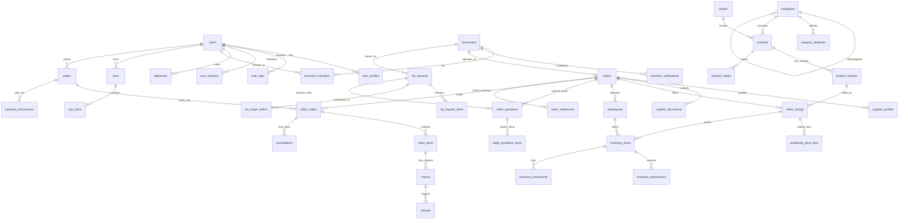

# Database Architecture & Schema Specification (v1.1 Corrected)

## 1. Architectural Principles & Modeling Standards

The BDMart persistence tier is engineered on **Neon Managed PostgreSQL** utilizing **Prisma ORM (v6+)**. It is structured to support our **Phase 1 B2B foundation** while seamlessly scaling into **Phase 2 B2C marketplace** operations without destructive schema reorganizations.

### Core Database Rules
1. **Primary Keys:** All tables utilize **UUIDv7** stored as native PostgreSQL `uuid`. UUIDv7 provides time-ordered monotonicity, preventing B-Tree index fragmentation and eliminating predictable enumeration attacks.
2. **Monetary Precision:** All currency amounts are stored as **64-bit BigInt** representing **Integer Paisa** (1 BDT = 100 Paisa). Zero floating-point columns are permitted for financial data.
3. **Canonical Separation:** Master catalog items (`products`) are strictly decoupled from commercial seller offers (`seller_listings`).
4. **Single Source of Price Truth:** Consumer retail pricing is stored directly in `seller_listings.retail_price_paisa`. Volume wholesale pricing is stored in `wholesale_price_tiers`. Redundant pricing tables (`listing_prices`) are eliminated.
5. **Order Immutability:** When an order is placed, line items take an immutable data snapshot of titles, variants, tax bases, and prices. Historical orders are never altered by subsequent catalog updates.
6. **Strict B2B vs. B2C Cart & Order Segregation:** Wholesale purchases and retail purchases cannot be mixed in the same cart or order due to statutory taxation (Bangladesh VAT Act 2012) and invoice compliance.
7. **Inventory Movement Ledger:** Stock is tracked via append-only movement logs (`inventory_movements`) alongside fast balance lookups (`inventory_items`).
8. **Auditing & Traceability:** Every sensitive mutation (verification status, pricing changes, refunds, stock adjustments) records the acting user, timestamp, previous state, and new state.
9. **Zero Stored-Value Wallets:** The platform does not operate a regulated customer deposit wallet. Seller balances represent internal accounting payables (`seller_settlements`), disbursed via banking rails.
10. **Soft Delete vs. Hard Delete:** Core entities (`users`, `businesses`, `products`, `seller_listings`, `orders`) use soft deletion (`deleted_at TIMESTAMP WITH TIME ZONE NULL`). Ephemeral records (sessions, cart items) may be hard-deleted.

---

## 2. Updated Entity-Relationship Diagram (ERD)



---

## 3. Detailed Table Specifications by Domain

### 3.1 Domain: Identity & Access Management (IAM)

#### `users`
Central identity record for authentication and profile linkage.
- **`id`** (`UUID`, PK): Unique user identifier (UUIDv7).
- **`phone`** (`VARCHAR(20)`, UNIQUE, NOT NULL): Normalized Bangladesh mobile number (`+8801[3-9]XXXXXXXX`).
- **`email`** (`VARCHAR(255)`, UNIQUE, NULL): Verified email address.
- **`password_hash`** (`VARCHAR(255)`, NULL): Argon2id password hash (nullable for OTP-only accounts).
- **`status`** (`VARCHAR(30)`, NOT NULL, DEFAULT 'ACTIVE'): `PENDING_VERIFICATION`, `ACTIVE`, `SUSPENDED`, `DEACTIVATED`.
- **`created_at`** (`TIMESTAMPTZ`, NOT NULL, DEFAULT NOW())
- **`updated_at`** (`TIMESTAMPTZ`, NOT NULL, DEFAULT NOW())
- **`deleted_at`** (`TIMESTAMPTZ`, NULL): Soft delete timestamp.
- **Indexes:** `idx_users_phone`, `idx_users_email`, `idx_users_status`.

#### `auth_otps`
Hashed one-time passwords for secure mobile authentication.
- **`id`** (`UUID`, PK)
- **`phone`** (`VARCHAR(20)`, NOT NULL)
- **`otp_hash`** (`VARCHAR(255)`, NOT NULL): Salted SHA-256 hash of the 6-digit OTP.
- **`attempts`** (`INT`, NOT NULL, DEFAULT 0): Counter to throttle brute-force attempts.
- **`expires_at`** (`TIMESTAMPTZ`, NOT NULL): 5-minute TTL.
- **`consumed_at`** (`TIMESTAMPTZ`, NULL)
- **`created_at`** (`TIMESTAMPTZ`, NOT NULL, DEFAULT NOW())
- **Indexes:** `idx_otps_phone_created` (`phone`, `created_at`).

#### `user_profiles`
Personal demographic information.
- **`id`** (`UUID`, PK)
- **`user_id`** (`UUID`, FK -> `users.id`, UNIQUE, NOT NULL, ON DELETE CASCADE)
- **`full_name`** (`VARCHAR(150)`, NOT NULL)
- **`avatar_url`** (`VARCHAR(500)`, NULL)
- **`preferred_language`** (`VARCHAR(10)`, NOT NULL, DEFAULT 'bn'): `bn` (Bangla) or `en` (English).
- **`date_of_birth`** (`DATE`, NULL)
- **`gender`** (`VARCHAR(20)`, NULL)
- **`updated_at`** (`TIMESTAMPTZ`, NOT NULL, DEFAULT NOW())

#### `roles`, `permissions` & `user_roles`
Multi-tenant Role-Based and Attribute-Based Access Control.
- **`roles`**: `id` (`UUID`, PK), `code` (`VARCHAR(50)`, UNIQUE, NOT NULL - e.g., `SUPER_ADMIN`, `MODERATOR`, `FINANCE_ADMIN`, `SELLER_OWNER`, `SELLER_STAFF`, `BUSINESS_BUYER`, `CONSUMER`), `name` (`VARCHAR(100)`), `description` (`TEXT`).
- **`permissions`**: `id` (`UUID`, PK), `code` (`VARCHAR(100)`, UNIQUE, NOT NULL - e.g., `catalog:moderate`, `order:cancel`, `settlement:payout`), `module` (`VARCHAR(50)`).
- **`role_permissions`**: `role_id` (`UUID`, FK), `permission_id` (`UUID`, FK), PK(`role_id`, `permission_id`).
- **`user_roles`**: `id` (`UUID`, PK), `user_id` (`UUID`, FK -> `users.id`, NOT NULL), `role_id` (`UUID`, FK -> `roles.id`, NOT NULL), `scope_type` (`VARCHAR(30)`, NOT NULL, DEFAULT 'PLATFORM' - `PLATFORM`, `BUSINESS`, `SELLER`), `scope_id` (`UUID`, NULL - links to `business_id` or `seller_id`), `created_at` (`TIMESTAMPTZ`, DEFAULT NOW()).
  - **Unique Constraint:** `uq_user_role_scope` (`user_id`, `role_id`, `scope_type`, `scope_id`).

#### `user_sessions`
Active authentication sessions with cryptographic refresh token rotation and family theft detection.
- **`id`** (`UUID`, PK)
- **`user_id`** (`UUID`, FK -> `users.id`, NOT NULL, ON DELETE CASCADE)
- **`family_id`** (`UUID`, NOT NULL): Token family identifier for rotation tracking.
- **`refresh_token_hash`** (`VARCHAR(255)`, NOT NULL): SHA-256 hash of refresh token.
- **`rotation_counter`** (`INT`, NOT NULL, DEFAULT 1)
- **`user_agent`** (`VARCHAR(500)`, NULL)
- **`ip_address`** (`VARCHAR(45)`, NULL)
- **`is_revoked`** (`BOOLEAN`, NOT NULL, DEFAULT FALSE)
- **`expires_at`** (`TIMESTAMPTZ`, NOT NULL): 7-day TTL.
- **`created_at`** (`TIMESTAMPTZ`, NOT NULL, DEFAULT NOW())
- **Indexes:** `idx_user_sessions_family` (`family_id`), `idx_user_sessions_lookup` (`user_id`, `refresh_token_hash`).

#### `addresses`
Standardized Bangladesh physical delivery, warehouse, and billing addresses.
- **`id`** (`UUID`, PK)
- **`user_id`** (`UUID`, FK -> `users.id`, NULL, ON DELETE SET NULL)
- **`business_id`** (`UUID`, FK -> `businesses.id`, NULL, ON DELETE SET NULL)
- **`address_type`** (`VARCHAR(30)`, NOT NULL): `SHIPPING`, `BILLING`, `WAREHOUSE`.
- **`recipient_name`** (`VARCHAR(150)`, NOT NULL)
- **`phone`** (`VARCHAR(20)`, NOT NULL)
- **`division`** (`VARCHAR(50)`, NOT NULL): E.g., Dhaka, Chittagong, Rajshahi, Khulna, Barisal, Sylhet, Rangpur, Mymensingh.
- **`district`** (`VARCHAR(50)`, NOT NULL): E.g., Dhaka, Gazipur, Narayanganj, Chittagong.
- **`thana`** (`VARCHAR(100)`, NOT NULL): Upazila / Police Station.
- **`postal_code`** (`VARCHAR(10)`, NULL)
- **`street_address`** (`TEXT`, NOT NULL): Holding no, road, area details.
- **`is_default`** (`BOOLEAN`, NOT NULL, DEFAULT FALSE)
- **`created_at`** (`TIMESTAMPTZ`, NOT NULL, DEFAULT NOW())
- **Indexes:** `idx_addresses_user`, `idx_addresses_business`.

---

### 3.2 Domain: Business & Seller Management

#### `businesses`
Legal entities representing wholesalers, manufacturers, corporate buyers, or retail enterprises.
- **`id`** (`UUID`, PK)
- **`legal_name`** (`VARCHAR(255)`, NOT NULL): Registered business trade name.
- **`business_type`** (`VARCHAR(50)`, NOT NULL): `MANUFACTURER`, `IMPORTER`, `DISTRIBUTOR`, `WHOLESALER`, `RETAILER`, `INSTITUTIONAL_BUYER`.
- **`trade_license_number`** (`VARCHAR(100)`, NULL)
- **`tax_identification_number`** (`VARCHAR(50)`, NULL): e-TIN.
- **`business_identification_number`** (`VARCHAR(50)`, NULL): BIN (VAT registration).
- **`verification_status`** (`VARCHAR(30)`, NOT NULL, DEFAULT 'UNVERIFIED'): `UNVERIFIED`, `PENDING_REVIEW`, `VERIFIED`, `REJECTED`, `SUSPENDED`.
- **`created_at`** (`TIMESTAMPTZ`, NOT NULL, DEFAULT NOW())
- **`updated_at`** (`TIMESTAMPTZ`, NOT NULL, DEFAULT NOW())
- **`deleted_at`** (`TIMESTAMPTZ`, NULL)
- **Indexes:** `idx_businesses_verification_status`, `idx_businesses_bin`.

#### `business_members`
User membership within a business organization.
- **`id`** (`UUID`, PK)
- **`business_id`** (`UUID`, FK -> `businesses.id`, NOT NULL, ON DELETE CASCADE)
- **`user_id`** (`UUID`, FK -> `users.id`, NOT NULL, ON DELETE CASCADE)
- **`role`** (`VARCHAR(50)`, NOT NULL): `OWNER`, `MANAGER`, `PROCUREMENT_OFFICER`, `ACCOUNTANT`.
- **`is_active`** (`BOOLEAN`, NOT NULL, DEFAULT TRUE)
- **`created_at`** (`TIMESTAMPTZ`, NOT NULL, DEFAULT NOW())
- **Unique Constraint:** `uq_business_user` (`business_id`, `user_id`).

#### `business_verifications`
Document verification audit log.
- **`id`** (`UUID`, PK)
- **`business_id`** (`UUID`, FK -> `businesses.id`, NOT NULL)
- **`document_type`** (`VARCHAR(50)`, NOT NULL): `TRADE_LICENSE`, `E_TIN`, `BIN_CERTIFICATE`, `INCORPORATION_CERTIFICATE`, `OWNER_NID`.
- **`document_number`** (`VARCHAR(100)`, NULL)
- **`file_storage_key`** (`VARCHAR(500)`, NOT NULL): Object key in Cloudflare R2 private bucket.
- **`status`** (`VARCHAR(30)`, NOT NULL, DEFAULT 'PENDING'): `PENDING`, `APPROVED`, `REJECTED`.
- **`reviewed_by`** (`UUID`, FK -> `users.id`, NULL)
- **`review_notes`** (`TEXT`, NULL)
- **`reviewed_at`** (`TIMESTAMPTZ`, NULL)
- **`created_at`** (`TIMESTAMPTZ`, NOT NULL, DEFAULT NOW())

#### `sellers`
Marketplace merchant profile linked to a verified business.
- **`id`** (`UUID`, PK)
- **`business_id`** (`UUID`, FK -> `businesses.id`, UNIQUE, NOT NULL)
- **`store_name`** (`VARCHAR(150)`, UNIQUE, NOT NULL): Display name for storefront.
- **`slug`** (`VARCHAR(150)`, UNIQUE, NOT NULL): URL-safe store identifier.
- **`logo_url`** (`VARCHAR(500)`, NULL)
- **`banner_url`** (`VARCHAR(500)`, NULL)
- **`seller_rating`** (`NUMERIC(3,2)`, NOT NULL, DEFAULT 0.00)
- **`rating_count`** (`INT`, NOT NULL, DEFAULT 0)
- **`is_b2b_enabled`** (`BOOLEAN`, NOT NULL, DEFAULT TRUE)
- **`is_b2c_enabled`** (`BOOLEAN`, NOT NULL, DEFAULT FALSE)
- **`status`** (`VARCHAR(30)`, NOT NULL, DEFAULT 'PENDING_APPROVAL'): `PENDING_APPROVAL`, `ACTIVE`, `SUSPENDED`, `VACATION`.
- **`created_at`** (`TIMESTAMPTZ`, NOT NULL, DEFAULT NOW())
- **`updated_at`** (`TIMESTAMPTZ`, NOT NULL, DEFAULT NOW())
- **Indexes:** `idx_sellers_status`, `idx_sellers_slug`.

---

### 3.3 Domain: Canonical Product Catalog

#### `categories`
Hierarchical product classification taxonomy.
- **`id`** (`UUID`, PK)
- **`parent_id`** (`UUID`, FK -> `categories.id`, NULL, ON DELETE SET NULL): Self-referential tree.
- **`name_en`** (`VARCHAR(150)`, NOT NULL)
- **`name_bn`** (`VARCHAR(150)`, NOT NULL)
- **`slug`** (`VARCHAR(150)`, UNIQUE, NOT NULL)
- **`level`** (`INT`, NOT NULL, DEFAULT 1): Hierarchy depth (1 = Department, 2 = Category, 3 = Leaf).
- **`commission_rate_percent`** (`NUMERIC(5,2)`, NOT NULL, DEFAULT 5.00): Configurable category take rate.
- **`is_active`** (`BOOLEAN`, NOT NULL, DEFAULT TRUE)
- **Indexes:** `idx_categories_parent`, `idx_categories_slug`.

#### `category_attributes`
Dynamic attribute definitions required or optional per category (e.g., Fabric GSM, Voltage, Bag Weight).
- **`id`** (`UUID`, PK)
- **`category_id`** (`UUID`, FK -> `categories.id`, NOT NULL, ON DELETE CASCADE)
- **`code`** (`VARCHAR(50)`, NOT NULL): E.g., `compressive_strength_mpa`, `fabric_gsm`.
- **`name_en`** (`VARCHAR(100)`, NOT NULL)
- **`name_bn`** (`VARCHAR(100)`, NOT NULL)
- **`attribute_type`** (`VARCHAR(30)`, NOT NULL): `TEXT`, `NUMBER`, `SELECT`, `MULTI_SELECT`, `BOOLEAN`.
- **`is_required`** (`BOOLEAN`, NOT NULL, DEFAULT FALSE)
- **`options`** (`JSONB`, NULL): Permitted values for select types.
- **Unique Constraint:** `uq_category_attribute_code` (`category_id`, `code`).

#### `brands`
Standardized brand directory.
- **`id`** (`UUID`, PK)
- **`name`** (`VARCHAR(150)`, UNIQUE, NOT NULL)
- **`slug`** (`VARCHAR(150)`, UNIQUE, NOT NULL)
- **`logo_url`** (`VARCHAR(500)`, NULL)
- **`is_verified`** (`BOOLEAN`, NOT NULL, DEFAULT FALSE)

#### `products`
Canonical master product definition (what the product is).
- **`id`** (`UUID`, PK)
- **`category_id`** (`UUID`, FK -> `categories.id`, NOT NULL)
- **`brand_id`** (`UUID`, FK -> `brands.id`, NULL)
- **`title_en`** (`VARCHAR(255)`, NOT NULL)
- **`title_bn`** (`VARCHAR(255)`, NOT NULL)
- **`slug`** (`VARCHAR(255)`, UNIQUE, NOT NULL)
- **`description_en`** (`TEXT`, NULL)
- **`description_bn`** (`TEXT`, NULL)
- **`model_number`** (`VARCHAR(100)`, NULL)
- **`country_of_origin`** (`VARCHAR(50)`, NULL)
- **`status`** (`VARCHAR(30)`, NOT NULL, DEFAULT 'DRAFT'): `DRAFT`, `PENDING_REVIEW`, `APPROVED`, `REJECTED`, `ARCHIVED`.
- **`created_at`** (`TIMESTAMPTZ`, NOT NULL, DEFAULT NOW())
- **`updated_at`** (`TIMESTAMPTZ`, NOT NULL, DEFAULT NOW())
- **`deleted_at`** (`TIMESTAMPTZ`, NULL)
- **Indexes:** `idx_products_category`, `idx_products_brand`, `idx_products_status`.
- **Full-Text Search Index:** `gin_products_search` on `to_tsvector('english', title_en || ' ' || coalesce(description_en, ''))`.

#### `product_variants`
SKU-level physical variants (Color, Size, Packaging).
- **`id`** (`UUID`, PK)
- **`product_id`** (`UUID`, FK -> `products.id`, NOT NULL, ON DELETE CASCADE)
- **`sku`** (`VARCHAR(100)`, UNIQUE, NOT NULL): Canonical master SKU identifier.
- **`barcode`** (`VARCHAR(50)`, UNIQUE, NULL): EAN / UPC / GTIN-13.
- **`attributes`** (`JSONB`, NOT NULL): Key-value pairs (e.g., `{"color": "Grey", "bag_weight_kg": 50}`).
- **`weight_grams`** (`INT`, NULL)
- **`dimensions_cm`** (`JSONB`, NULL): `{"length": 10, "width": 5, "height": 2}`.
- **`unit_of_measure`** (`VARCHAR(20)`, NOT NULL, DEFAULT 'PIECE'): `PIECE`, `BOX`, `CARTON`, `KG`, `METER`, `DOZEN`.
- **`created_at`** (`TIMESTAMPTZ`, NOT NULL, DEFAULT NOW())
- **Indexes:** `idx_variants_product`, `idx_variants_sku`, `idx_variants_barcode`.

#### `product_media`
High-resolution images and videos stored in Cloudflare R2.
- **`id`** (`UUID`, PK)
- **`product_id`** (`UUID`, FK -> `products.id`, NOT NULL, ON DELETE CASCADE)
- **`storage_key`** (`VARCHAR(500)`, NOT NULL): Cloudflare R2 key.
- **`media_type`** (`VARCHAR(30)`, NOT NULL, DEFAULT 'IMAGE'): `IMAGE`, `VIDEO`, `DOCUMENT`.
- **`display_order`** (`INT`, NOT NULL, DEFAULT 0)
- **`is_primary`** (`BOOLEAN`, NOT NULL, DEFAULT FALSE)

---

### 3.4 Domain: Marketplace Listings & Pricing (Single Source of Truth)

#### `seller_listings`
Seller offer attaching a merchant to a canonical product variant.
- **`id`** (`UUID`, PK)
- **`seller_id`** (`UUID`, FK -> `sellers.id`, NOT NULL)
- **`variant_id`** (`UUID`, FK -> `product_variants.id`, NOT NULL)
- **`seller_sku`** (`VARCHAR(100)`, NOT NULL): Seller's private SKU.
- **`retail_price_paisa`** (`BIGINT`, NULL): Consumer retail price in integer paisa (single source of truth for B2C; nullable if B2B-only).
- **`minimum_order_quantity`** (`INT`, NOT NULL, DEFAULT 1): MOQ for B2B orders.
- **`pack_multiple`** (`INT`, NOT NULL, DEFAULT 1): Incremental purchase step (e.g., packs of 12).
- **`lead_time_days`** (`INT`, NOT NULL, DEFAULT 2): Production/dispatch lead time.
- **`is_b2b_active`** (`BOOLEAN`, NOT NULL, DEFAULT TRUE)
- **`is_b2c_active`** (`BOOLEAN`, NOT NULL, DEFAULT FALSE)
- **`status`** (`VARCHAR(30)`, NOT NULL, DEFAULT 'ACTIVE'): `ACTIVE`, `OUT_OF_STOCK`, `INACTIVE`.
- **`created_at`** (`TIMESTAMPTZ`, NOT NULL, DEFAULT NOW())
- **`updated_at`** (`TIMESTAMPTZ`, NOT NULL, DEFAULT NOW())
- **Unique Constraint:** `uq_seller_variant_listing` (`seller_id`, `variant_id`).
- **Indexes:** `idx_listings_variant`, `idx_listings_seller`, `idx_listings_status`.

#### `wholesale_price_tiers`
Volume pricing structure for wholesale procurement (single source of truth for B2B).
- **`id`** (`UUID`, PK)
- **`listing_id`** (`UUID`, FK -> `seller_listings.id`, NOT NULL, ON DELETE CASCADE)
- **`min_quantity`** (`INT`, NOT NULL)
- **`max_quantity`** (`INT`, NULL): Nullable for open-ended top tier (e.g., 500+ units).
- **`unit_price_paisa`** (`BIGINT`, NOT NULL): Wholesale unit price in integer paisa.
- **Check Constraint:** `chk_tier_quantity` (`max_quantity IS NULL OR max_quantity >= min_quantity`).
- **Unique Constraint:** `uq_listing_min_qty` (`listing_id`, `min_quantity`).
- **Indexes:** `idx_price_tiers_listing`.

---

### 3.5 Domain: Inventory & Warehousing

#### `warehouses`
Fulfillment locations operated by sellers or 3PL hubs.
- **`id`** (`UUID`, PK)
- **`seller_id`** (`UUID`, FK -> `sellers.id`, NOT NULL)
- **`name`** (`VARCHAR(150)`, NOT NULL)
- **`address_id`** (`UUID`, FK -> `addresses.id`, NOT NULL)
- **`is_primary`** (`BOOLEAN`, NOT NULL, DEFAULT TRUE)

#### `inventory_items`
Real-time physical stock balances per listing and warehouse.
- **`id`** (`UUID`, PK)
- **`listing_id`** (`UUID`, FK -> `seller_listings.id`, NOT NULL)
- **`warehouse_id`** (`UUID`, FK -> `warehouses.id`, NOT NULL)
- **`quantity_on_hand`** (`INT`, NOT NULL, DEFAULT 0): Physical stock present on shelf.
- **`quantity_reserved`** (`INT`, NOT NULL, DEFAULT 0): Stock locked during checkout/pending payment.
- **`quantity_available`** (`INT` GENERATED ALWAYS AS (quantity_on_hand - quantity_reserved) STORED): Computed purchasable balance.
- **`reorder_threshold`** (`INT`, NOT NULL, DEFAULT 10)
- **`version`** (`INT`, NOT NULL, DEFAULT 0): Optimistic concurrency locking counter.
- **Check Constraint:** `chk_non_negative_balances` (`quantity_on_hand >= 0 AND quantity_reserved >= 0`).
- **Unique Constraint:** `uq_listing_warehouse` (`listing_id`, `warehouse_id`).
- **Indexes:** `idx_inventory_listing`, `idx_inventory_available`.

#### `inventory_reservations`
Temporary stock holds during checkout.
- **`id`** (`UUID`, PK)
- **`inventory_item_id`** (`UUID`, FK -> `inventory_items.id`, NOT NULL)
- **`cart_id`** (`UUID`, NULL): Session cart reference.
- **`order_id`** (`UUID`, NULL): Parent order reference once checkout submits.
- **`seller_order_id`** (`UUID`, NULL): Sub-order reference.
- **`reserved_quantity`** (`INT`, NOT NULL)
- **`status`** (`VARCHAR(30)`, NOT NULL, DEFAULT 'PENDING'): `PENDING`, `COMMITTED`, `RELEASED`, `EXPIRED`.
- **`expires_at`** (`TIMESTAMPTZ`, NOT NULL): 15-minute TTL from creation.
- **`created_at`** (`TIMESTAMPTZ`, NOT NULL, DEFAULT NOW())
- **Indexes:** `idx_reservations_status_expires` (`status`, `expires_at`), `idx_reservations_order` (`order_id`).

#### `inventory_movements`
Immutable audit ledger of every stock change.
- **`id`** (`UUID`, PK)
- **`inventory_item_id`** (`UUID`, FK -> `inventory_items.id`, NOT NULL)
- **`movement_type`** (`VARCHAR(50)`, NOT NULL): `RECEIVING`, `RESERVATION_HOLD`, `RESERVATION_RELEASE`, `SALE_DEDUCTION`, `RETURN_RESTOCK`, `MANUAL_CORRECTION`, `DAMAGE_WRITEOFF`.
- **`quantity_delta`** (`INT`, NOT NULL): Positive or negative balance change.
- **`reference_type`** (`VARCHAR(50)`, NULL): E.g., `ORDER`, `RETURN`, `ADJUSTMENT`.
- **`reference_id`** (`UUID`, NULL)
- **`actor_id`** (`UUID`, FK -> `users.id`, NULL)
- **`reason`** (`TEXT`, NULL)
- **`created_at`** (`TIMESTAMPTZ`, NOT NULL, DEFAULT NOW())
- **Indexes:** `idx_movements_item`, `idx_movements_ref`.

---

### 3.6 Domain: Multi-Supplier B2B Sourcing & Quotations (RFQ)

#### `rfq_requests`
Buyer-initiated procurement requests supporting multi-supplier bidding.
- **`id`** (`UUID`, PK)
- **`rfq_number`** (`VARCHAR(50)`, UNIQUE, NOT NULL): Formatted identifier (e.g., `RFQ-2026-000123`).
- **`buyer_business_id`** (`UUID`, FK -> `businesses.id`, NOT NULL)
- **`created_by_user_id`** (`UUID`, FK -> `users.id`, NOT NULL)
- **`title`** (`VARCHAR(255)`, NOT NULL)
- **`category_id`** (`UUID`, FK -> `categories.id`, NOT NULL)
- **`target_delivery_date`** (`DATE`, NULL)
- **`delivery_address_id`** (`UUID`, FK -> `addresses.id`, NOT NULL)
- **`payment_terms_requested`** (`VARCHAR(50)`, NULL): E.g., `ADVANCE_100`, `ADVANCE_50_DELIVERY_50`.
- **`status`** (`VARCHAR(30)`, NOT NULL, DEFAULT 'OPEN'): `DRAFT`, `OPEN`, `AWARDED`, `CLOSED`, `CANCELLED`, `EXPIRED`.
- **`expires_at`** (`TIMESTAMPTZ`, NOT NULL): Bidding submission deadline.
- **`created_at`** (`TIMESTAMPTZ`, NOT NULL, DEFAULT NOW())
- **`updated_at`** (`TIMESTAMPTZ`, NOT NULL, DEFAULT NOW())
- **Indexes:** `idx_rfq_buyer`, `idx_rfq_category`, `idx_rfq_status`.

#### `rfq_request_items`
Individual line-item specifications within an RFQ.
- **`id`** (`UUID`, PK)
- **`rfq_request_id`** (`UUID`, FK -> `rfq_requests.id`, NOT NULL, ON DELETE CASCADE)
- **`variant_id`** (`UUID`, FK -> `product_variants.id`, NULL): Optional link to canonical variant.
- **`item_title`** (`VARCHAR(255)`, NOT NULL)
- **`requested_quantity`** (`INT`, NOT NULL)
- **`unit_of_measure`** (`VARCHAR(20)`, NOT NULL)
- **`target_unit_price_paisa`** (`BIGINT`, NULL): Buyer's suggested target unit price.
- **`specifications`** (`TEXT`, NULL)

#### `rfq_target_sellers`
Sellers invited to participate in the RFQ.
- **`id`** (`UUID`, PK)
- **`rfq_request_id`** (`UUID`, FK -> `rfq_requests.id`, NOT NULL, ON DELETE CASCADE)
- **`seller_id`** (`UUID`, FK -> `sellers.id`, NOT NULL)
- **`invited_at`** (`TIMESTAMPTZ`, NOT NULL, DEFAULT NOW())
- **`viewed_at`** (`TIMESTAMPTZ`, NULL)
- **Unique Constraint:** `uq_rfq_target_seller` (`rfq_request_id`, `seller_id`).

#### `seller_quotations`
Independent commercial bids submitted by suppliers.
- **`id`** (`UUID`, PK)
- **`quotation_number`** (`VARCHAR(60)`, UNIQUE, NOT NULL): E.g., `QT-2026-000456`.
- **`rfq_request_id`** (`UUID`, FK -> `rfq_requests.id`, NOT NULL)
- **`seller_id`** (`UUID`, FK -> `sellers.id`, NOT NULL)
- **`status`** (`VARCHAR(30)`, NOT NULL, DEFAULT 'SUBMITTED'): `DRAFT`, `SUBMITTED`, `ACCEPTED`, `REJECTED`, `EXPIRED`, `CONVERTED_TO_ORDER`.
- **`valid_until`** (`TIMESTAMPTZ`, NOT NULL): Expiration of quotation price guarantee.
- **`payment_terms_offered`** (`VARCHAR(50)`, NOT NULL)
- **`lead_time_days`** (`INT`, NOT NULL)
- **`estimated_delivery_fee_paisa`** (`BIGINT`, NOT NULL, DEFAULT 0)
- **`seller_notes`** (`TEXT`, NULL)
- **`created_at`** (`TIMESTAMPTZ`, NOT NULL, DEFAULT NOW())
- **`updated_at`** (`TIMESTAMPTZ`, NOT NULL, DEFAULT NOW())
- **Indexes:** `idx_quotations_rfq`, `idx_quotations_seller`, `idx_quotations_status`.

#### `seller_quotation_items`
Specific item pricing within a supplier's quotation.
- **`id`** (`UUID`, PK)
- **`quotation_id`** (`UUID`, FK -> `seller_quotations.id`, NOT NULL, ON DELETE CASCADE)
- **`rfq_request_item_id`** (`UUID`, FK -> `rfq_request_items.id`, NOT NULL)
- **`listing_id`** (`UUID`, FK -> `seller_listings.id`, NULL)
- **`offered_quantity`** (`INT`, NOT NULL)
- **`unit_price_paisa`** (`BIGINT`, NOT NULL)
- **`total_paisa`** (`BIGINT`, NOT NULL)
- **`notes`** (`TEXT`, NULL)

---

### 3.7 Domain: Shopping & Order Management

#### `carts` & `cart_items`
Shopping cart state segregated by purchase intent.
- **`carts`**:
  - `id` (`UUID`, PK)
  - `user_id` (`UUID`, FK -> `users.id`, NULL)
  - `cart_type` (`VARCHAR(20)`, NOT NULL, DEFAULT 'CONSUMER'): `CONSUMER` or `BUSINESS`.
  - `buyer_business_id` (`UUID`, FK -> `businesses.id`, NULL): Mandatory for `BUSINESS` carts.
  - `session_token` (`VARCHAR(100)`, UNIQUE, NULL): For anonymous consumer carts.
  - `currency` (`VARCHAR(3)`, DEFAULT 'BDT')
  - `updated_at` (`TIMESTAMPTZ`, DEFAULT NOW())
  - **Check Constraint:** `chk_business_cart` (`(cart_type = 'BUSINESS' AND buyer_business_id IS NOT NULL) OR (cart_type = 'CONSUMER' AND buyer_business_id IS NULL)`).
- **`cart_items`**:
  - `id` (`UUID`, PK)
  - `cart_id` (`UUID`, FK -> `carts.id`, ON DELETE CASCADE)
  - `listing_id` (`UUID`, FK -> `seller_listings.id`)
  - `quantity` (`INT`, NOT NULL, DEFAULT 1)
  - `created_at` (`TIMESTAMPTZ`, DEFAULT NOW())
  - **Unique Constraint:** `uq_cart_listing` (`cart_id`, `listing_id`).

#### `orders` (Parent Marketplace Order)
The top-level financial transaction representing the customer checkout.
- **`id`** (`UUID`, PK)
- **`order_number`** (`VARCHAR(50)`, UNIQUE, NOT NULL): E.g., `ORD-20261112-98412`.
- **`user_id`** (`UUID`, FK -> `users.id`, NOT NULL)
- **`buyer_business_id`** (`UUID`, FK -> `businesses.id`, NULL): Mandatory for B2B orders.
- **`order_type`** (`VARCHAR(20)`, NOT NULL): `B2B` or `B2C`.
- **`subtotal_paisa`** (`BIGINT`, NOT NULL)
- **`discount_paisa`** (`BIGINT`, NOT NULL, DEFAULT 0)
- **`total_delivery_fee_paisa`** (`BIGINT`, NOT NULL, DEFAULT 0): Aggregate of sub-order delivery fees.
- **`tax_vat_paisa`** (`BIGINT`, NOT NULL, DEFAULT 0)
- **`total_amount_paisa`** (`BIGINT`, NOT NULL): Final total in integer paisa.
- **`payment_status`** (`VARCHAR(30)`, NOT NULL, DEFAULT 'PENDING'): `PENDING`, `AUTHORIZED`, `PAID`, `PARTIALLY_REFUNDED`, `REFUNDED`, `FAILED`.
- **`order_status`** (`VARCHAR(30)`, NOT NULL, DEFAULT 'PLACED'): `PLACED`, `PROCESSING`, `PARTIALLY_SHIPPED`, `COMPLETED`, `CANCELLED`.
- **`shipping_address_snapshot`** (`JSONB`, NOT NULL): Immutable copy of address at checkout.
- **`idempotency_key`** (`VARCHAR(100)`, UNIQUE, NOT NULL): Prevents duplicate orders.
- **`created_at`** (`TIMESTAMPTZ`, NOT NULL, DEFAULT NOW())
- **`updated_at`** (`TIMESTAMPTZ`, NOT NULL, DEFAULT NOW())
- **`deleted_at`** (`TIMESTAMPTZ`, NULL)
- **Indexes:** `idx_orders_user`, `idx_orders_status`, `idx_orders_order_number`.

#### `seller_orders` (Sub-Orders per Merchant)
Seller-specific partition of the parent order for fulfillment, shipping, and settlement.
- **`id`** (`UUID`, PK)
- **`order_id`** (`UUID`, FK -> `orders.id`, NOT NULL, ON DELETE CASCADE)
- **`seller_id`** (`UUID`, FK -> `sellers.id`, NOT NULL)
- **`sub_order_number`** (`VARCHAR(60)`, UNIQUE, NOT NULL): E.g., `ORD-20261112-98412-S1`.
- **`status`** (`VARCHAR(30)`, NOT NULL, DEFAULT 'PENDING_ACCEPTANCE'): `PENDING_ACCEPTANCE`, `ACCEPTED`, `PACKED`, `HANDED_OVER_TO_COURIER`, `IN_TRANSIT`, `DELIVERED`, `CANCELLED`, `RETURNED`.
- **`subtotal_paisa`** (`BIGINT`, NOT NULL)
- **`delivery_fee_paisa`** (`BIGINT`, NOT NULL): Specific courier delivery fee for this seller's package.
- **`commission_rate_percent`** (`NUMERIC(5,2)`, NOT NULL)
- **`commission_amount_paisa`** (`BIGINT`, NOT NULL)
- **`seller_payable_paisa`** (`BIGINT`, NOT NULL): Subtotal minus commission.
- **`created_at`** (`TIMESTAMPTZ`, NOT NULL, DEFAULT NOW())
- **`updated_at`** (`TIMESTAMPTZ`, NOT NULL, DEFAULT NOW())
- **Indexes:** `idx_seller_orders_seller`, `idx_seller_orders_order`, `idx_seller_orders_status`.

#### `order_items`
Immutable line-item snapshot.
- **`id`** (`UUID`, PK)
- **`seller_order_id`** (`UUID`, FK -> `seller_orders.id`, NOT NULL, ON DELETE CASCADE)
- **`listing_id`** (`UUID`, FK -> `seller_listings.id`, NULL, ON DELETE SET NULL)
- **`product_title_snapshot`** (`VARCHAR(255)`, NOT NULL)
- **`variant_attributes_snapshot`** (`JSONB`, NOT NULL)
- **`sku_snapshot`** (`VARCHAR(100)`, NOT NULL)
- **`unit_price_paisa`** (`BIGINT`, NOT NULL)
- **`quantity`** (`INT`, NOT NULL)
- **`total_paisa`** (`BIGINT`, NOT NULL): unit_price * quantity.
- **`vat_rate_percent`** (`NUMERIC(5,2)`, NOT NULL, DEFAULT 0.00)
- **`vat_amount_paisa`** (`BIGINT`, NOT NULL, DEFAULT 0)

#### `order_status_history`
Append-only timeline of every order lifecycle transition.
- **`id`** (`UUID`, PK)
- **`seller_order_id`** (`UUID`, FK -> `seller_orders.id`, NOT NULL, ON DELETE CASCADE)
- **`previous_status`** (`VARCHAR(30)`, NULL)
- **`new_status`** (`VARCHAR(30)`, NOT NULL)
- **`actor_id`** (`UUID`, FK -> `users.id`, NULL)
- **`reason`** (`VARCHAR(255)`, NULL)
- **`created_at`** (`TIMESTAMPTZ`, NOT NULL, DEFAULT NOW())

#### `cancellations`, `returns` & `refunds`
Exception processing and customer protection records.
- **`cancellations`**: `id` (`UUID`, PK), `seller_order_id` (`UUID`, FK), `requested_by` (`UUID`, FK), `reason_code` (`VARCHAR(50)`), `details` (`TEXT`), `status` (`VARCHAR(30)`), `created_at` (`TIMESTAMPTZ`).
- **`returns`**: `id` (`UUID`, PK), `order_item_id` (`UUID`, FK), `user_id` (`UUID`, FK), `return_quantity` (`INT`), `reason` (`VARCHAR(100)`), `status` (`VARCHAR(30)` - `REQUESTED`, `APPROVED`, `REJECTED`, `RECEIVED`, `RESTOCKED`), `tracking_number` (`VARCHAR(100)`), `created_at` (`TIMESTAMPTZ`).
- **`refunds`**: `id` (`UUID`, PK), `order_id` (`UUID`, FK), `return_id` (`UUID`, FK, NULL), `order_item_id` (`UUID`, FK, NULL - for partial item refunds), `amount_paisa` (`BIGINT`, NOT NULL), `refund_method` (`VARCHAR(50)` - `ORIGINAL_GATEWAY`, `BANK_TRANSFER`), `gateway_refund_ref` (`VARCHAR(150)`, NULL), `status` (`VARCHAR(30)` - `PENDING`, `PROCESSED`, `FAILED`), `processed_at` (`TIMESTAMPTZ`, NULL).

---

### 3.8 Domain: Payment & Financial Clearing

#### `payment_transactions`
Payment gateway transactions and ledger references.
- **`id`** (`UUID`, PK)
- **`order_id`** (`UUID`, FK -> `orders.id`, NOT NULL)
- **`provider`** (`VARCHAR(50)`, NOT NULL): `SSLCOMMERZ`, `BKASH`, `NAGAD`, `COD`.
- **`provider_transaction_id`** (`VARCHAR(150)`, UNIQUE, NULL): Gateway reference.
- **`amount_paisa`** (`BIGINT`, NOT NULL)
- **`currency`** (`VARCHAR(3)`, NOT NULL, DEFAULT 'BDT')
- **`status`** (`VARCHAR(30)`, NOT NULL, DEFAULT 'INITIALIZED'): `INITIALIZED`, `PENDING_VALIDATION`, `SUCCESS`, `FAILED`, `CANCELLED`.
- **`raw_response`** (`JSONB`, NULL): Sanitized gateway payload for audit.
- **`created_at`** (`TIMESTAMPTZ`, NOT NULL, DEFAULT NOW())
- **`updated_at`** (`TIMESTAMPTZ`, NOT NULL, DEFAULT NOW())
- **Indexes:** `idx_payment_order`, `idx_payment_provider_tran`.

#### `payment_webhooks`
Raw webhook/IPN ingestion log for idempotent replay protection.
- **`id`** (`UUID`, PK)
- **`provider`** (`VARCHAR(50)`, NOT NULL)
- **`event_id`** (`VARCHAR(150)`, NULL)
- **`payload`** (`JSONB`, NOT NULL)
- **`headers`** (`JSONB`, NOT NULL)
- **`status`** (`VARCHAR(30)`, NOT NULL, DEFAULT 'PENDING'): `PENDING`, `PROCESSED`, `IGNORED`, `ERROR`.
- **`error_details`** (`TEXT`, NULL)
- **`created_at`** (`TIMESTAMPTZ`, NOT NULL, DEFAULT NOW())
- **Indexes:** `idx_webhooks_provider_event` (`provider`, `event_id`).

#### `seller_settlements`
Internal merchant accounting ledger for bank clearing (NOT a stored-value deposit).
- **`id`** (`UUID`, PK)
- **`seller_id`** (`UUID`, FK -> `sellers.id`, NOT NULL)
- **`settlement_number`** (`VARCHAR(50)`, UNIQUE, NOT NULL): E.g., `SETTLE-202611-0012`.
- **`period_start`** (`TIMESTAMPTZ`, NOT NULL)
- **`period_end`** (`TIMESTAMPTZ`, NOT NULL)
- **`total_gross_paisa`** (`BIGINT`, NOT NULL)
- **`total_commission_paisa`** (`BIGINT`, NOT NULL)
- **`payout_net_paisa`** (`BIGINT`, NOT NULL)
- **`payout_status`** (`VARCHAR(30)`, NOT NULL, DEFAULT 'PENDING'): `PENDING`, `PROCESSING`, `DISBURSED`, `FAILED`.
- **`bank_routing_number`** (`VARCHAR(20)`, NULL)
- **`bank_account_number`** (`VARCHAR(50)`, NULL)
- **`bank_transaction_ref`** (`VARCHAR(100)`, NULL): BEFTN / NPSB reference.
- **`disbursed_at`** (`TIMESTAMPTZ`, NULL)
- **`created_at`** (`TIMESTAMPTZ`, NOT NULL, DEFAULT NOW())
- **Indexes:** `idx_settlements_seller`, `idx_settlements_status`.

---

### 3.9 Domain: Operations, Outbox & Audit

#### `system_outbox`
Transactional Outbox table ensuring at-least-once asynchronous event delivery.
- **`id`** (`UUID`, PK)
- **`event_type`** (`VARCHAR(100)`, NOT NULL): E.g., `order.created`, `payment.verified`, `notification.sms`.
- **`aggregate_type`** (`VARCHAR(50)`, NOT NULL): E.g., `ORDER`, `PAYMENT`, `SELLER`.
- **`aggregate_id`** (`UUID`, NOT NULL)
- **`payload`** (`JSONB`, NOT NULL)
- **`status`** (`VARCHAR(30)`, NOT NULL, DEFAULT 'PENDING'): `PENDING`, `PROCESSING`, `COMPLETED`, `FAILED`.
- **`attempts`** (`INT`, NOT NULL, DEFAULT 0)
- **`last_error`** (`TEXT`, NULL)
- **`scheduled_at`** (`TIMESTAMPTZ`, NOT NULL, DEFAULT NOW())
- **`processed_at`** (`TIMESTAMPTZ`, NULL)
- **`created_at`** (`TIMESTAMPTZ`, NOT NULL, DEFAULT NOW())
- **Indexes:** `idx_outbox_status_scheduled` (`status`, `scheduled_at`).

#### `audit_logs`
Security and administrative tamper-evident event log.
- **`id`** (`UUID`, PK)
- **`actor_id`** (`UUID`, FK -> `users.id`, NULL)
- **`action`** (`VARCHAR(100)`, NOT NULL): E.g., `SELLER_VERIFICATION_APPROVE`, `PRICE_UPDATE`, `REFUND_OVERRIDE`.
- **`resource_type`** (`VARCHAR(50)`, NOT NULL)
- **`resource_id`** (`VARCHAR(100)`, NOT NULL)
- **`previous_state`** (`JSONB`, NULL)
- **`new_state`** (`JSONB`, NULL)
- **`ip_address`** (`VARCHAR(45)`, NULL)
- **`user_agent`** (`VARCHAR(500)`, NULL)
- **`created_at`** (`TIMESTAMPTZ`, NOT NULL, DEFAULT NOW())
- **Indexes:** `idx_audit_resource` (`resource_type`, `resource_id`), `idx_audit_actor` (`actor_id`).

---

## 4. Concurrency, Locking & Stock Reservation Strategy

To prevent stock overselling under high concurrency (flash sales or rapid wholesale orders), checkout uses **Pessimistic Row-Level Locking** combined with atomic transaction boundaries.

```sql
-- Step 1: Atomic Stock Reservation at Checkout Start
BEGIN;

-- Lock the inventory row to prevent concurrent checkouts from reading stale balances
SELECT id, quantity_on_hand, quantity_reserved, quantity_available 
FROM inventory_items 
WHERE listing_id = 'listing-uuid-123' AND warehouse_id = 'warehouse-uuid-456'
FOR UPDATE;

-- Verify quantity_available >= requested_quantity
-- If insufficient, ROLLBACK and throw 409 INSUFFICIENT_STOCK

-- Increment reservation counter
UPDATE inventory_items 
SET quantity_reserved = quantity_reserved + 10,
    version = version + 1
WHERE id = 'inventory-item-uuid-789';

-- Record reservation with 15-minute TTL
INSERT INTO inventory_reservations (id, inventory_item_id, cart_id, reserved_quantity, expires_at, status)
VALUES (gen_random_uuid(), 'inventory-item-uuid-789', 'cart-uuid-456', 10, NOW() + INTERVAL '15 minutes', 'PENDING');

COMMIT;
```

### Stock State Lifecycle
```
[Physical Stock Received] -> quantity_on_hand += Q, quantity_available += Q
[Checkout Initiated]     -> quantity_reserved += Q, quantity_available -= Q
[Payment Confirmed / COD]-> quantity_on_hand -= Q, quantity_reserved -= Q (Reservation COMMITTED)
[Checkout Timeout / Cancel]-> quantity_reserved -= Q, quantity_available += Q (Reservation RELEASED)
[Warehouse Return (RTO)] -> quantity_on_hand += Q, quantity_available += Q (Restocked after inspection)
```

---

## 5. Migration & Connection Strategy for Neon PostgreSQL

Neon features compute-storage separation and built-in connection pooling via **pgBouncer**. Under **Prisma 6+**, connection strings are configured cleanly:

1. **`DATABASE_URL` (Runtime Application Traffic via Pooler):**
   - URL includes `-pooler` in the host: `postgresql://[user]:[password]@[endpoint]-pooler.[region].aws.neon.tech/[dbname]?sslmode=require`
   - Configured at runtime using the `@prisma/adapter-neon` package with `PrismaNeon`.
   - **No assumed port numbers are hardcoded.**
2. **`DATABASE_URL_UNPOOLED` (Prisma CLI Migrations via Direct Compute):**
   - URL connects directly to compute without `-pooler`: `postgresql://[user]:[password]@[endpoint].[region].aws.neon.tech/[dbname]?sslmode=require`
   - Declared in `prisma.config.ts` for schema migrations (`prisma migrate dev` / `prisma migrate deploy`).

```typescript
// prisma.config.ts
import "dotenv/config";
import { defineConfig, env } from "prisma/config";

export default defineConfig({
  schema: "prisma/schema.prisma",
  migrations: {
    path: "prisma/migrations",
  },
  datasource: {
    url: env("DATABASE_URL_UNPOOLED"),
  },
});
```

```typescript
// src/common/prisma/prisma.service.ts
import { Injectable, OnModuleInit } from "@nestjs/common";
import { PrismaClient } from "@prisma/client";
import { PrismaNeon } from "@prisma/adapter-neon";

@Injectable()
export class PrismaService extends PrismaClient implements OnModuleInit {
  constructor() {
    const adapter = new PrismaNeon({
      connectionString: process.env.DATABASE_URL!,
    });
    super({ adapter });
  }

  async onModuleInit() {
    await this.$connect();
  }
}
```

---

## 6. Distributed Job Locking via Native PostgreSQL Advisory Locks

To enable scheduled background processing (reservation expiry, payment reconciliation, outbox dispatch) across **multiple horizontal Node.js backend instances on Render without Redis or Docker**:

Each scheduled job attempts an application-level advisory lock using a designated 64-bit integer identifier:

```typescript
// Example: Safe distributed reservation release worker
@Cron('*/1 * * * *') // Runs every 60 seconds
async releaseExpiredReservations() {
  const LOCK_ID = 987654321; // Unique lock ID for this worker
  
  // Try to acquire the advisory lock non-blocking
  const [{ acquired }] = await this.prisma.$queryRaw<[{ acquired: boolean }]>`
    SELECT pg_try_advisory_lock(${LOCK_ID}) AS acquired;
  `;
  
  if (!acquired) {
    // Another instance is already processing this job; exit cleanly
    return;
  }
  
  try {
    await this.processExpiredReservations();
  } finally {
    // Release the advisory lock
    await this.prisma.$executeRaw`
      SELECT pg_advisory_unlock(${LOCK_ID});
    `;
  }
}
```

This guarantees zero duplicate execution across scaled instances with zero additional infrastructure.
