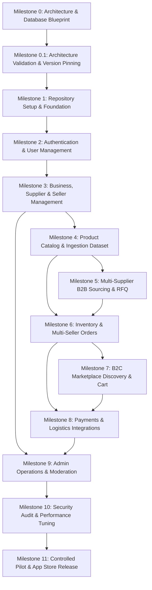

# Development Roadmap & Implementation Blueprint (v1.1 Corrected)

## 1. Roadmap Architecture & Execution Philosophy

The BDMart development strategy is phased to validate marketplace supply and procurement liquidity before introducing broad consumer acquisition. 

Every milestone is an atomic, independently testable engineering block. **No milestone may begin until all prerequisite dependencies and quality gates from prior milestones are fully satisfied.**

---

## 2. Milestone Specifications (0 through 11)

### Milestone 0: Architecture, Repository Design & Database Blueprint
- **Objectives:** Inspect existing workspace, formalize enterprise system architecture, design normalized relational schema, define API boundaries, and establish Windows-native development environment constraints (zero Docker).
- **Deliverables:** Complete set of 14 architecture documents in `docs/` with Mermaid diagrams and technical specifications.
- **Acceptance Criteria:** Architectural approval by founding engineering team; zero application code written.

---

### Milestone 0.1: Architecture Validation, Technical Corrections & Final Approval
- **Objectives:** Audit Milestone 0 blueprints, resolve schema contradictions (eliminate duplicate price sources, separate B2B/B2C carts, model multi-supplier RFQs), pin stable technology versions (Node.js 24 LTS, Next.js 16 Active LTS, Expo SDK 54, Prisma 6), configure Neon connection architecture via `prisma.config.ts`, establish distributed locking via native PostgreSQL advisory locks, and separate Bangladesh legal mandates from platform business risk controls.
- **Deliverables:** Updated core architecture documents, new ADRs (ADR-015 through ADR-021), and `docs/MILESTONE_0_1_REVIEW_REPORT.md`.
- **Acceptance Criteria:** Formal technical sign-off on corrected architecture.

---

### Milestone 1: Repository Setup & Development Foundation
- **Objectives:** Initialize TypeScript monorepo with pnpm workspaces, Turborepo, shared packages (`contracts`, `config`, `utils`), NestJS backend skeleton (Node.js 24 LTS), Next.js 16 web skeleton, and Expo SDK 54 mobile skeleton. Configure Prisma 6 with Neon PostgreSQL using `prisma.config.ts` and `@prisma/adapter-neon`.
- **Dependencies:** Milestone 0.1 approval.
- **Required Features:**
  - `pnpm-workspace.yaml` and `turbo.json` task pipelines.
  - Initial `schema.prisma` committed and pushed to Neon development branch via direct unpooled connection.
  - Shared TypeScript configurations and ESLint rules.
  - Health check endpoints on backend (`/v1/health`) and basic web/mobile shells.
- **Testing Requirements:** `pnpm turbo run typecheck` and `pnpm turbo run lint` pass across all workspaces.

---

### Milestone 2: Authentication & Identity Management
- **Objectives:** Implement secure, multi-role authentication supporting both consumers and verified business users.
- **Dependencies:** Milestone 1.
- **Required Features:**
  - Bangladesh phone number normalization (`+8801[3-9]XXXXXXXX`).
  - SMS OTP request and verification with 5-minute expiry, salted SHA-256 storage (`auth_otps`), and rate limits.
  - Argon2id password hashing fallback for desktop/business users.
  - Short-lived JWT access tokens (15m) and database-backed refresh token rotation with family theft detection (`user_sessions`).
  - User profiles and standardized Bangladesh address hierarchy (Division, District, Thana).
- **Acceptance Criteria:** User can register, verify OTP, log in, refresh token, and update profile from both web and mobile.

---

### Milestone 3: Business, Supplier & Seller Management
- **Objectives:** Build organizational structures, merchant onboarding, verification document upload to Cloudflare R2, and multi-tenant seller authorization guards.
- **Dependencies:** Milestone 2.
- **Required Features:**
  - Business profile registration (Trade License No, e-TIN, BIN).
  - Cloudflare R2 presigned upload pipeline for verification documents.
  - Admin verification queue (`PENDING`, `APPROVED`, `REJECTED`).
  - Seller storefront profile setup and staff membership roles.
  - `TenantGuard` enforcing 100% data isolation between sellers.
- **Acceptance Criteria:** Unverified sellers cannot list products; verified sellers manage only their own data.

---

### Milestone 4: Product Catalog & Dataset Ingestion
- **Objectives:** Deliver canonical master catalog, dynamic category attributes, seller listing offers, volume wholesale price tiers, and bulk CSV/XLSX import.
- **Dependencies:** Milestone 3.
- **Required Features:**
  - Category hierarchy tree and dynamic attribute schemas.
  - Brand directory and canonical product/variant creation.
  - Seller offers linking merchant to canonical product (retail price, MOQ, pack multiple, lead time).
  - Tiered wholesale pricing table (`min_quantity`, `unit_price_paisa`).
  - Bulk CSV/Excel parser with row validation and duplicate detection engine.
  - Cloudflare R2 image upload pipeline with responsive optimization.
- **Acceptance Criteria:** Seller can upload 100 SKUs via CSV, preview validation errors, and publish approved listings.

---

### Milestone 5: Multi-Supplier B2B Procurement & Quotations (RFQ)
- **Objectives:** Implement formal wholesale procurement workflows enabling competitive price negotiations and commercial quotation conversion.
- **Dependencies:** Milestone 4.
- **Required Features:**
  - Buyer RFQ broadcast to eligible category suppliers (`rfq_requests`, `rfq_request_items`).
  - Independent supplier quotation authoring (`seller_quotations`, `seller_quotation_items`).
  - Side-by-side bid comparison and quotation acceptance/rejection flows.
  - Conversion of accepted quotation into draft purchase order with immutable terms.
- **Acceptance Criteria:** Buyer broadcasts RFQ, multiple suppliers submit quotations, buyer accepts one, competing quotes are rejected, and draft B2B order is generated.

---

### Milestone 6: Inventory Engine & Multi-Seller Orders
- **Objectives:** Build multi-warehouse inventory engine with atomic pessimistic locking, and multi-seller parent/sub-order checkout pipeline.
- **Dependencies:** Milestone 4, Milestone 5.
- **Required Features:**
  - Real-time stock tracking (`quantity_on_hand`, `quantity_reserved`, `quantity_available`).
  - Concurrency-safe checkout with `SELECT ... FOR UPDATE` row locking.
  - 15-minute temporary reservation TTL with automated release worker (using PostgreSQL advisory locks).
  - Parent order creation splitting into seller sub-orders grouped by merchant.
  - Strict segregation: consumer cart vs. business cart.
  - Immutable order item snapshots (title, variant, price, tax basis).
- **Acceptance Criteria:** Zero stock overselling under 50 concurrent checkout attempts; multi-seller cart splits cleanly.

---

### Milestone 7: B2C Marketplace Discovery & Cart
- **Objectives:** Launch consumer retail discovery, search, filtering, and responsive shopping experiences across Next.js 16 and Expo mobile.
- **Dependencies:** Milestone 6.
- **Required Features:**
  - PostgreSQL full-text search with trigram fuzzy matching and faceted filters.
  - Product Details Page (PDP) with variant selectors and seller comparison blocks.
  - Shopping cart with persistent storage and server-calculated totals.
  - Verified buyer review and rating submission.
  - Public seller storefront pages.
- **Acceptance Criteria:** Consumer can search, filter, add to cart, and review products seamlessly.

---

### Milestone 8: Payments & Logistics Integrations
- **Objectives:** Integrate payment gateways and 3PL courier APIs behind abstract adapter interfaces.
- **Dependencies:** Milestone 6, Milestone 7.
- **Required Features:**
  - SSLCOMMERZ hosted checkout integration with server-to-server IPN validation.
  - bKash direct tokenized checkout adapter.
  - Cash on Delivery (COD) risk scoring engine and configurable limits.
  - Pathao and Steadfast courier shipment booking and label generation.
  - Courier tracking webhook ingestion and milestone timeline updates.
  - Cancellation and refund workflow complying with Bangladesh 7–10 day guidelines.
- **Acceptance Criteria:** Test payments complete end-to-end via sandbox; duplicate IPNs handled idempotently.

---

### Milestone 9: Admin Operations, Moderation & Finance
- **Objectives:** Deliver internal back-office tooling for compliance, catalog governance, dispute arbitration, and financial clearing.
- **Dependencies:** Milestone 3, Milestone 8.
- **Required Features:**
  - Trade license and e-TIN verification review interface.
  - Canonical product moderation and duplicate merge tools.
  - Buyer-seller dispute arbitration and refund override controls.
  - Seller settlement ledger calculating net payouts minus platform commission.
  - Full-text searchable audit log viewer.
- **Acceptance Criteria:** Finance operator can reconcile a payment batch; compliance officer can verify a seller.

---

### Milestone 10: Security Hardening, Audit & Performance Optimization
- **Objectives:** Conduct end-to-end vulnerability assessment, load testing, database query indexing, and caching optimization.
- **Dependencies:** Milestone 9.
- **Required Features:**
  - OWASP Top 10 penetration testing and multi-tenant BOLA fuzzing.
  - Database index optimization (`EXPLAIN ANALYZE` on all primary search and order queries).
  - Rate-limiting stress tests on public and authentication endpoints.
  - Mobile performance optimization on low-end Android hardware.
- **Acceptance Criteria:** P95 API response times under 150ms; zero high/critical security findings.

---

### Milestone 11: Controlled Pilot Launch & App Store Release
- **Objectives:** Compile production mobile binaries via Expo EAS, submit to Google Play and Apple App Store, and execute controlled commercial pilot.
- **Dependencies:** Milestone 10.
- **Planning Targets (Configurable):**
  - **Single Focused Category:** To be finalized prior to pilot launch (e.g., Electrical Goods or Construction Materials).
  - **Supplier Target:** 20–30 verified suppliers (planning target).
  - **SKU Target:** 200–500 active catalog items (planning target).
  - **Buyer Target:** 50–100 registered retail shops (planning target).
- **App Store Deliverables:**
  - Google Play Console submission targeting Android 16 (API Level 36+).
  - Apple App Store submission adhering to physical-goods non-IAP guidelines.
- **Acceptance Criteria:** Apps published in stores; first 100 live commercial transactions completed successfully.
