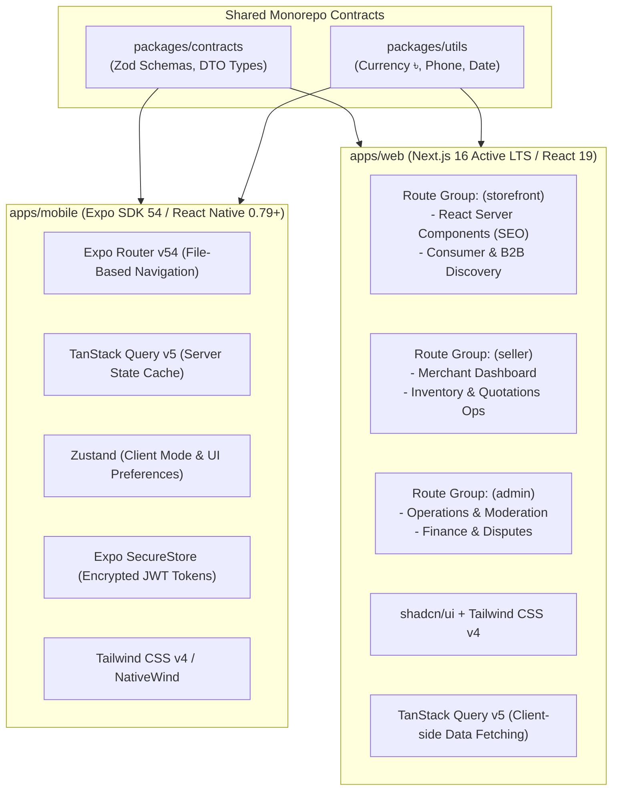

# Frontend Architecture & Client Engineering Specification (v1.1 Corrected)

## 1. Unified Frontend Strategy

BDMart deploys a multi-client frontend tier built in **TypeScript**, pinned to stable, enterprise-grade releases:
1. **Mobile Application (`apps/mobile`):** React Native (0.79+) + **Expo SDK 54** (with integrated **Expo Router v54**) for Android and iOS. Delivers an adaptive mobile shopping and wholesale procurement experience.
2. **Customer Web Storefront (`apps/web` -> `app/(storefront)`):** **Next.js 16 Active LTS** (v16.4.x) utilizing React Server Components (RSC) and **React 19** for high-SEO discovery, sub-second page loads, and fast consumer checkout.
3. **Seller & Admin Portals (`apps/web` -> `app/(seller)` & `app/(admin)`):** **Next.js 16 Active LTS** client route groups utilizing **shadcn/ui** and **Tailwind CSS v4** for merchant inventory operations and internal marketplace administration.

---

## 2. Mobile Application Architecture (`apps/mobile`)

### 2.1 Technology Stack & Version Pins
- **Framework:** React Native 0.79+ with **Expo SDK 54** (Managed Workflow).
- **Navigation:** **Expo Router v54** (matching SDK 54 release).
- **Server State Management:** **TanStack Query v5** for caching, optimistic updates, and background synchronization.
- **Client State Management:** **Zustand** for active buying mode toggle (`B2C` vs `B2B`) and UI state.
- **Hardware Token Security:** **`expo-secure-store`** for encrypting JWT access and refresh tokens via Android Keystore and iOS Keychain.
- **Form Validation:** **React Hook Form** with **Zod** validation schemas imported directly from `packages/contracts`.

### 2.2 Dynamic Buying Mode & Strict Cart Separation
The mobile application features a persistent **Mode Switcher** in the header and account settings:
- **B2C Consumer Mode:** Displays retail prices (`retail_price_paisa`), standard consumer product cards, single-unit "Add to Cart", verified customer reviews, and COD/MFS checkout.
- **B2B Wholesale Mode:** Gated by business verification. Unverified users see prompt banners to register their business. Verified business buyers see:
  - Wholesale volume pricing tables (`wholesale_price_tiers`).
  - Minimum Order Quantity (MOQ) and pack multiples.
  - "Submit RFQ" button for custom quotations.
  - Separate **Business Cart**: B2B items cannot be added to a consumer cart. Attempting to add a wholesale item while in consumer mode prompts the user to switch modes, preventing invalid cart mixtures.

---

## 3. Web Application Architecture (`apps/web`)

### 3.1 Technology Stack & Version Pins
- **Framework:** **Next.js 16 Active LTS** (v16.4.x) utilizing the App Router.
- **React Baseline:** **React 19** (React 19.3+).
- **Rendering Strategy:**
  - **Server Components (RSC):** Utilized for all public catalog and product pages (`(storefront)`) to ensure high SEO indexing and instant initial paint.
  - **Client Components (`'use client'`):** Utilized for authenticated seller dashboards, quotation authoring, and admin tables (`(seller)` and `(admin)`).
- **UI System:** **shadcn/ui** primitives styled with **Tailwind CSS v4**.
- **Data Tables:** **TanStack Table v8** for high-volume sorting and filtering in merchant portals.

### 3.2 Route Group Partitioning
- `app/(storefront)`: Public homepage, faceted search, canonical product detail pages, consumer cart, checkout.
- `app/(seller)`: Merchant onboarding, listing management, bulk CSV import staging queue, inventory adjustments, sub-order fulfillment, inbound RFQ bidding.
- `app/(admin)`: Verification document review queue, catalog moderation, dispute arbitration, payment reconciliation, audit logs.

---

## 4. Shared State Taxonomy & Boundary Rules

| State Category | Storage Location | Tool | Lifetime | Examples |
|---|---|---|---|---|
| **Server State** | Memory Cache | TanStack Query v5 | Query TTL (5 min) | Products, active orders, quotations, account profile |
| **Auth Credentials** | Secure Storage | `Expo SecureStore` (Mobile) / `HttpOnly Cookies` (Web) | Session / Refresh TTL | JWT Access & Refresh Tokens |
| **Client UI State** | Memory / LocalStore | Zustand | Session | Active buying mode (`CONSUMER`/`BUSINESS`), language (`bn`/`en`) |
| **Form State** | Local Component | React Hook Form | Page Lifetime | RFQ inputs, delivery address creation |

> [!IMPORTANT]
> **Zero Frontend Business Calculations:** Total order sums, delivery charges, tiered discounts, coupon validity, and stock availability must **always** be calculated by the NestJS backend API. The frontend only displays server-calculated figures and never submits calculated prices in checkout payloads.

---

## 5. Performance, Image Optimization & Low-Bandwidth Resilience

- **Edge Media Delivery:** Product images are served via Cloudflare R2's global edge network. Next.js `<Image>` automatically optimizes modern `.webp` and `.avif` formats with responsive `srcset`. Mobile uses `expo-image` with blurhash placeholders.
- **Aggressive Caching:** TanStack Query caches previously fetched catalog categories and search results, rendering cached data instantly while refreshing in the background (`stale-while-revalidate`).
- **Retryable Network Client:** The central Axios/Fetch wrapper implements exponential backoff retries for transient 502/503/504 errors on unstable 2G/3G mobile networks.
- **Localization:** Native bilingual support for Bangla (`bn-BD`) and English (`en-US`) utilizing Google's Noto Sans Bengali typography.
