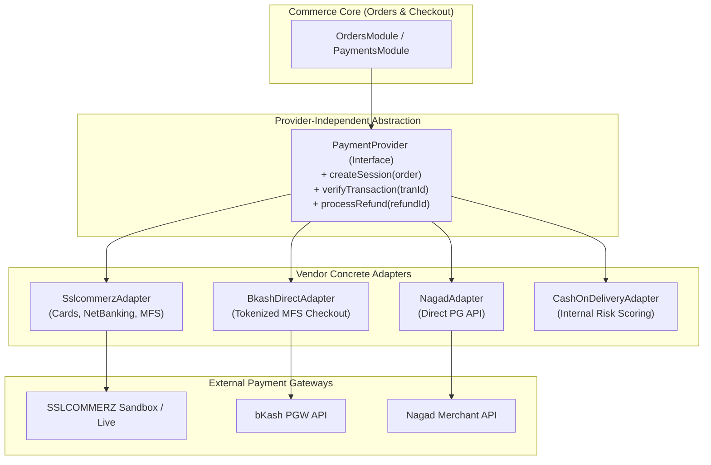
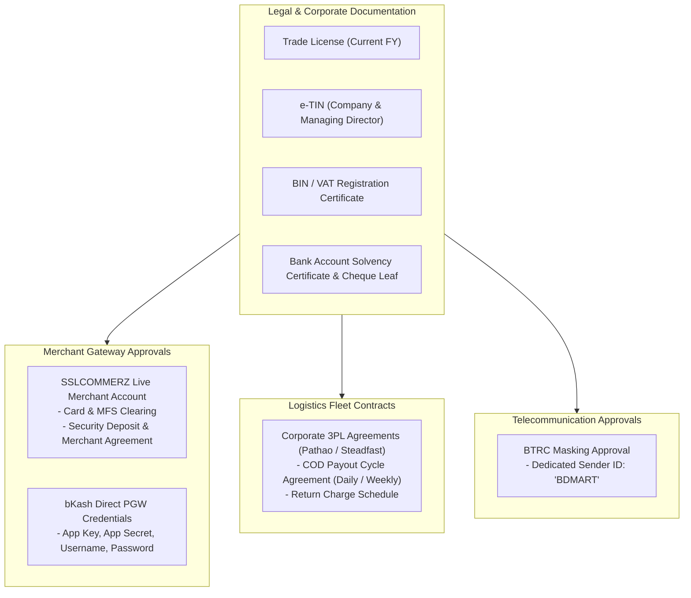

# Third-Party Integration Strategy & Provider Abstraction (v1.1 Corrected)

## 1. Provider-Agnostic Integration Philosophy

External payment gateways, logistics couriers, and telecommunication providers in Bangladesh frequently alter API versions, fee structures, or operational reliability. 

To insulate the BDMart commerce core from third-party vendor volatility, all external services are integrated behind **strict provider-independent abstraction interfaces (Adapters)**. The application domain interacts solely with generic contracts (`PaymentService`, `LogisticsService`, `NotificationService`). Changing or adding a payment gateway or courier requires writing a single adapter class without modifying the checkout, order, or settlement engines.



---

## 2. Bangladesh Payment Gateway Integrations

### 2.1 Provider Landscape & Evaluation

| Gateway / Method | Coverage | Primary Use Case | Commercial & Onboarding Requirements |
|---|---|---|---|
| **SSLCOMMERZ** | Visa, Mastercard, AMEX, bKash, Nagad, Rocket, Upay, Internet Banking | Primary aggregator gateway for MVP launch; unified checkout for cards and MFS | Trade License, e-TIN, BIN (VAT), Bank Account Statement, CIB report, merchant agreement. |
| **bKash Merchant API** | Direct bKash MFS tokenized checkout | High-conversion direct mobile wallet checkout (60%+ market share in BD) | Direct bKash merchant account, registered business documents, API agreement. |
| **Nagad Merchant API** | Direct Nagad MFS payment | Secondary mobile wallet checkout (Postal department MFS) | Nagad corporate merchant onboarding. |
| **Cash on Delivery (COD)** | Physical cash collected by courier upon doorstep delivery | Default payment preference for 70%+ of retail consumers in Bangladesh | Courier COD collection agreement (1% collection fee standard). |

### 2.2 Payment Provider Interface Contract

```typescript
export interface PaymentSessionRequest {
  orderId: string;
  orderNumber: string;
  amountPaisa: bigint;
  currency: 'BDT';
  customerName: string;
  customerPhone: string;
  customerEmail?: string;
  shippingAddress: string;
  returnUrl: string;
  cancelUrl: string;
  ipnUrl: string;
}

export interface PaymentSessionResponse {
  sessionId: string;
  redirectUrl: string;
  provider: string;
}

export interface PaymentVerificationResult {
  isSuccess: boolean;
  providerTransactionId: string;
  amountPaisa: bigint;
  currency: 'BDT';
  rawPayload: Record<string, any>;
  riskLevel?: 'LOW' | 'MEDIUM' | 'HIGH';
}

export interface PaymentProvider {
  getProviderCode(): string;
  initiatePayment(request: PaymentSessionRequest): Promise<PaymentSessionResponse>;
  verifyPayment(payload: Record<string, any>): Promise<PaymentVerificationResult>;
  initiateRefund(refundRef: string, amountPaisa: bigint, reason: string): Promise<boolean>;
}
```

### 2.3 Cash on Delivery (COD) Risk Mitigation Policy
> [!NOTE]
> The COD transaction ceiling (e.g., ৳10,000) is an **internal platform risk policy** established to prevent Return-to-Origin (RTO) courier delivery losses, **not a statutory legal mandate** under Bangladesh law.

Because Cash on Delivery in Bangladesh carries high Return-to-Origin (RTO) rates (courier delivery charges are incurred even if the customer rejects the parcel at the door), BDMart implements an automated COD risk evaluation:
1. **Phone Verification:** COD is enabled only for accounts with a verified mobile number.
2. **Configurable Order Value Cap:** Consumer COD is capped at a default of ৳10,000 (configurable via `system_settings`). Orders above this threshold require MFS or card pre-payment.
3. **Historical Delivery Score:** If a buyer's past delivery completion rate drops below 80%, COD is automatically disabled for that account.
4. **B2B COD Policy:** Wholesale B2B orders never permit standard consumer COD. They require advance partial payment (e.g., 20% advance booking via bank/gateway, 80% on delivery against formal commercial invoice).

---

## 3. Logistics & Courier Integrations

### 3.1 Bangladesh 3PL Courier Landscape

| Provider | Service Strengths | Coverage | API Capabilities |
|---|---|---|---|
| **Pathao Courier** | Rapid same-day/next-day in Dhaka & Chittagong; robust merchant dashboard | 64 Districts, major Thanas | REST API, webhook milestone updates, automated COD reconciliation. |
| **Steadfast Courier** | Deep rural coverage across all Upazilas; competitive inter-district rates | Nationwide (all Upazilas) | Fast REST API, real-time parcel tracking, bulk order creation. |
| **RedX (ShopUp)** | Strong middle-mile trucking network for bulk parcels | Nationwide | Enterprise merchant API, warehouse pickup, reverse logistics. |
| **Manual Dispatch / Transport** | Large wholesale truck deliveries (Chittagong-to-Dhaka, Gabtoli/Khatunganj hubs) | Bulk B2B shipments | Internal challan printing, manual milestone entry by seller. |

### 3.2 Logistics Provider Interface Contract

```typescript
export interface CreateShipmentRequest {
  sellerOrderId: string;
  subOrderNumber: string;
  pickupWarehouseAddress: AddressDTO;
  deliveryCustomerAddress: AddressDTO;
  parcelWeightKg: number;
  itemDescription: string;
  codAmountPaisa: bigint; // Zero if pre-paid online
}

export interface ShipmentResponse {
  trackingId: string;
  consignmentId: string;
  courierName: string;
  estimatedDeliveryDate: Date;
  labelUrl?: string;
}

export interface LogisticsProvider {
  getProviderCode(): string;
  createShipment(request: CreateShipmentRequest): Promise<ShipmentResponse>;
  trackShipment(consignmentId: string): Promise<ShipmentTrackingTimeline>;
  cancelShipment(consignmentId: string): Promise<boolean>;
}
```

---

## 4. Communication & Messaging Services

### 4.1 Bangladesh SMS Gateway Integration
- **Regulatory Requirement:** In Bangladesh, commercial SMS must comply with Bangladesh Telecommunication Regulatory Commission (BTRC) rules:
  - Masked Sender ID (Brand Name, e.g., `BDMART`) requires formal BTRC approval and Trade License documentation.
  - SMS gateways must provide Delivery Status Reports (DLR).
- **Approved Local Providers:** Greenweb, Elitbuzz, or Reve Systems.
- **Failover Architecture:** Handled via the Transactional Outbox pattern with primary and secondary gateway credentials.

### 4.2 Transactional Email (Resend API)
- Primary channel for B2B commercial documents: RFQ alerts, pro-forma invoices, quotation PDFs, and monthly settlement statements.
- Uses **Resend** with DKIM/SPF domain verification for high inbox deliverability.

### 4.3 Push Notifications (Expo Application Services)
- Delivers real-time mobile order milestone alerts ("Your parcel has been dispatched", "Supplier has responded to your RFQ").
- Utilizes **Expo Notifications** integrated with Google Firebase Cloud Messaging (FCM) for Android and Apple Push Notification service (APNs) for iOS.

---

## 5. Regulatory Onboarding & Credential Requirements

To transition from development sandbox to live commercial operations, the following legal and business prerequisites must be satisfied:



> [!NOTE]
> In Milestone 0, zero live credentials or real merchant accounts are configured. All integration interfaces are specified declaratively as abstract contracts.
