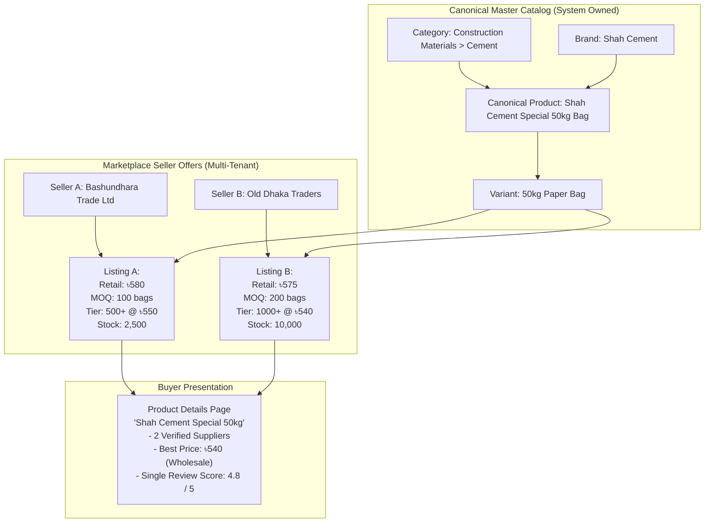
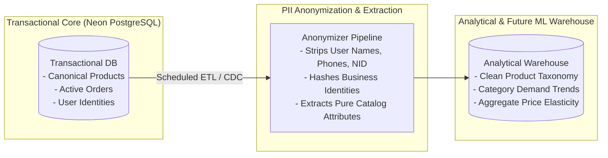

# Product Dataset & Data Management Strategy

## 1. Catalog Architecture: Master Canonical Catalog vs. Seller Offers

A cornerstone of the BDMart marketplace architecture is the strict decoupling of **Canonical Master Products** from **Seller Listings (Offers)**.



### Architectural Benefits
1. **Catalog Cleanliness:** Prevents 50 identical search results for the same commodity, eliminating customer confusion.
2. **Consolidated Trust & Reviews:** Customer ratings accumulate on the canonical product rather than fragmenting across dozens of duplicate listings.
3. **Wholesale Comparison Shopping:** B2B buyers can compare MOQ, delivery lead times, warehouse locations, and volume discount tiers from different suppliers on a single screen.

---

## 2. Taxonomy, Attributes & Controlled Vocabulary

### 2.1 Category Hierarchy
The category taxonomy is modeled as a directed acyclic tree with a maximum depth of 3 levels:
- **Level 1 (Sector / Department):** E.g., `Industrial & Construction`, `Apparel & Textiles`, `Electronics & Electrical`, `FMCG & Grocery`.
- **Level 2 (Family / Category):** E.g., `Building Materials`, `Fabrics & Yarn`, `Commercial Appliances`.
- **Level 3 (Leaf Subcategory):** E.g., `Portland Cement`, `Cotton Grey Fabric`, `Industrial Exhaust Fans`. Products can be attached **only to Leaf Subcategories**.

### 2.2 Dynamic Attribute Engine
Different product categories require radically different technical specifications. Rather than creating hundreds of sparse columns in the database, leaf categories define dynamic attribute schemas stored in `category_attributes`:

| Category | Attribute Code | Data Type | Requirement | Allowed Options / Unit |
|---|---|---|---|---|
| **Portland Cement** | `compressive_strength_mpa` | Number | Mandatory | Minimum MPa at 28 days |
| **Portland Cement** | `bag_weight_kg` | Number | Mandatory | `50` (kg) |
| **Fabrics & Yarn** | `fabric_gsm` | Number | Mandatory | Grams per Square Meter |
| **Fabrics & Yarn** | `fiber_composition` | Multi-Select | Mandatory | Cotton, Polyester, Linen, Viscose |
| **Industrial Pumps** | `voltage_phase` | Select | Mandatory | `Single Phase (220V)`, `Three Phase (440V)` |
| **Industrial Pumps** | `max_flow_rate_lpm` | Number | Optional | Litres per minute |

### 2.3 Standardized Units of Measure (UOM)
All variants must declare a standardized base unit of measure:
- `PIECE` (Pcs)
- `BOX` (Pre-packed wholesale box)
- `CARTON` (Master shipping carton)
- `KILOGRAM` (kg) / `GRAM` (g) / `METRIC_TON` (MT)
- `LITRE` (L) / `MILLILITRE` (mL)
- `METER` (m) / `YARD` (yd)
- `DOZEN` (12 Pcs) / `GROSS` (144 Pcs)

---

## 3. Bulk CSV / Spreadsheet Import Pipeline

To onboard suppliers with hundreds of SKUs without manual data entry, BDMart provides an automated bulk ingestion pipeline.

```mermaid
flowchart TD
    Upload[Supplier uploads CSV/XLSX\nvia Seller Portal] --> R2_Save[Store original file in\nCloudflare R2 private bucket]
    R2_Save --> JobCreate[Create import_jobs record\nStatus: PROCESSING]
    JobCreate --> Parse[Stream & Parse Rows\n(PapaParse / ExcelJS)]
    Parse --> ValidateSchema[Step 1: Schema Validation\nCheck mandatory headers & types]
    ValidateSchema --> CheckDups[Step 2: Duplicate Detection\nCheck GTIN, Model, Normalized Title]
    CheckDups --> MatchCanonical[Step 3: Canonical Mapping\nMatch existing product or flag NEW]
    MatchCanonical --> GenPreview[Step 4: Generate Staging Preview\nShow valid rows & row-level errors]
    GenPreview --> SellerConfirm[Seller Reviews Errors\n& Submits Valid Rows]
    SellerConfirm --> ModQueue[Catalog Moderation Queue\nAdmin approves new canonical items]
    ModQueue --> Published[Published to Marketplace]
```

### 3.1 Import Specification Template

#### Mandatory Fields
1. `category_slug`: Valid leaf category identifier.
2. `brand_name`: Registered brand name or "Generic / Non-Branded".
3. `product_title_en`: Title in English (minimum 10 characters, no keyword stuffing).
4. `product_title_bn`: Title in Bangla.
5. `unit_of_measure`: One of the standardized UOM enum values.
6. `seller_sku`: Supplier's internal unique SKU code.
7. `retail_price_bdt`: Consumer price (mandatory if B2C active).
8. `moq`: Minimum Order Quantity (integer >= 1).
9. `pack_multiple`: Step quantity (integer >= 1).
10. `stock_quantity`: Current physical inventory.
11. `lead_time_days`: Estimated dispatch lead time.
12. `image_url_1`: Direct URL to high-resolution product image (minimum 800x800px).

#### Optional Fields
1. `barcode_gtin`: EAN-13, UPC, or ISBN barcode.
2. `model_number`: Manufacturer model or part number.
3. `description_en` & `description_bn`: Detailed specifications.
4. `tier_1_min_qty` & `tier_1_unit_price_bdt`: Wholesale Tier 1.
5. `tier_2_min_qty` & `tier_2_unit_price_bdt`: Wholesale Tier 2.
6. `tier_3_min_qty` & `tier_3_unit_price_bdt`: Wholesale Tier 3.
7. `weight_grams` & `dimensions_cm`: Packaging logistics metrics.

---

## 4. Duplicate Detection & Catalog Moderation

To preserve catalog integrity and prevent duplicate product sprawl, the ingestion engine runs a multi-factor matching algorithm:

1. **Exact Barcode / GTIN Match:** If `barcode_gtin` matches an existing canonical variant, the seller offer is automatically mapped to that variant.
2. **Brand + Model Normalization:** If `brand_id` and normalized `model_number` match an existing product, it is identified as a candidate match.
3. **Fuzzy String Matching (Trigram Similarity):** If title similarity against an existing product in the same leaf category exceeds 85% (`similarity(title_en, existing_title) > 0.85`), the import flags the row for manual catalog moderator review.

### Moderation Queue States
- `PENDING_REVIEW`: New canonical product proposed by a seller.
- `APPROVED`: Verified by catalog moderator; immediately visible in public search.
- `REJECTED`: Rejected due to trademark infringement, poor image quality, prohibited item, or misleading claims (with mandatory moderator notes).
- `MERGED`: Merged into an existing canonical product; seller's offer attached cleanly.

---

## 5. Media Pipeline: Processing & Cloudflare R2 Optimization

1. **Direct Presigned Upload:** Images are uploaded directly from the seller's browser to Cloudflare R2 using short-lived presigned URLs.
2. **Automated Validation:**
   - Permitted MIME types: `image/jpeg`, `image/png`, `image/webp`.
   - Maximum file size: 5MB per image.
   - Server-side magic-byte inspection prevents executable injection disguised as images.
3. **Responsive Image CDN Transformations:** Cloudflare Image Optimization generates responsive widths (`320w`, `640w`, `1024w`, `1920w`) in modern `.webp` and `.avif` formats on the fly, stripping sensitive EXIF GPS metadata.

---

## 6. Separation of Operational Catalog vs. Analytics & Machine Learning

A critical architectural mandate is maintaining a strict firewall between the **live operational catalog** and **future analytics / AI training datasets**:



### Privacy & Governance Mandates
1. **Zero Customer PII in Training Sets:** Customer phone numbers, home delivery addresses, National ID (NID) numbers, and personal payment identifiers must never enter any analytics or recommendation model training set.
2. **Compliance with Local Data Protection:** In accordance with national digital commerce regulations, transactional product performance data (conversion rate, price elasticity, search impressions) is aggregated at the category and SKU level without tracking individual consumer personal browsing behavior without consent.
3. **Operational Performance Protection:** Complex analytical aggregations and batch exports must never execute against the primary transactional database compute. They run against dedicated read replicas or isolated analytical snapshots.

