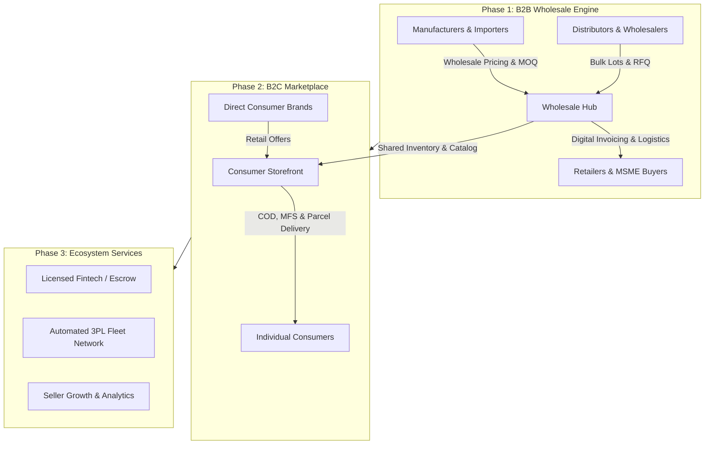

# Project Vision & Strategic Blueprint

## 1. Executive Summary

**BDMart** is conceived as a high-performance, dual-engine commerce ecosystem engineered specifically for the Bangladesh market, designed from its inception to scale regionally across South Asia. Combining the wholesale depth of Alibaba, the operational reliability of Amazon, and the local market reach of Daraz, BDMart bridges the massive structural gap between Bangladesh's traditional, informal wholesale supply chains and modern digital commerce.

The platform executes a **B2B-First, B2C-Enabled** strategy:
1. **Phase 1 (B2B Foundation):** Digitize upstream supply chains—manufacturers, direct importers, authorized distributors, and wholesale traders in major commercial hubs (e.g., Old Dhaka's Chawkbazar, Mitford, Islampur, and Chittagong's Khatunganj). Provide verified micro, small, and medium enterprises (MSMEs), physical retailers, and institutional buyers with transparent tiered pricing, Minimum Order Quantities (MOQ), verified trade credentials, Requests for Quotation (RFQ), formal invoicing, and digital ordering workflows.
2. **Phase 2 (B2C Marketplace Expansion):** Open the verified supplier and brand infrastructure to consumer retail. Individual buyers gain access to authentic products, consumer-grade search, retail pricing, localized payments (bKash, Nagad, cards, Cash on Delivery), parcel tracking, verified reviews, and customer protection.
3. **Phase 3 (Fintech, Logistics & Ecosystem Services):** Layer formal escrow/settlement reconciliation, automated third-party logistics (3PL) dispatch, merchant analytics, inventory financing integration through licensed financial partners, and cross-border sourcing.

---

## 2. Bangladesh Market Context & Strategic Rationale

### 2.1 The Problem Space
- **Informal Wholesale Channels:** Wholesale procurement in Bangladesh relies heavily on physical visits to congested markets, handwritten paper memos (*challan*), opaque pricing based on personal bargaining, and informal credit (*baki*) with high default risk.
- **Counterfeit & Grey Market Risk:** Retailers and consumers alike struggle with counterfeit cosmetics, electronics, FMCG goods, and pharmaceuticals due to lack of traceability back to authorized importers or manufacturers.
- **Fragmented Logistics:** Logistics is divided into inter-district trucking for bulk goods and urban courier networks for small parcels. B2B commerce lacks automated, trackable middle-mile integration.
- **Regulatory Framework:** Digital commerce in Bangladesh is governed by the **Digital Commerce Operation Guidelines 2021** (Ministry of Commerce), requiring strict operational compliance regarding product delivery timelines (5 days intra-district, 10 days inter-district), transparent refund mechanisms within 7–10 days, verified merchant identities (Trade License, e-TIN, BIN/VAT registration), and prohibited product controls.

### 2.2 Strategic Principles
- **One Shared Infrastructure, Distinct Experiences:** The platform shares underlying accounts, catalog items, inventory balances, order pipelines, and payment rails, but strictly partitions business rules, pricing logic, checkout flows, and user interfaces between wholesale and consumer modes.
- **Data Integrity & Traceability:** Canonical product records are maintained independently of seller offers. Multiple sellers compete on price, MOQ, stock, and delivery time without duplicating catalog items or corrupting product specifications.
- **Pragmatic Operational Simplicity:** Built as a TypeScript-based **Modular Monolith** deployed on managed cloud infrastructure (Neon PostgreSQL, Cloudflare R2, Render, Vercel, Expo EAS). This achieves maximum operational stability, low infrastructure maintenance, and zero local container friction for developers working on Windows environments.

---

## 3. Core Personas & User Classes

| Persona | Role Identifier | Primary Workflows | Value Proposition |
|---|---|---|---|
| **Manufacturer / Importer** | `SUPPLIER` | Bulk catalog upload, wholesale tier configuration, RFQ negotiation, carton/pallet dispatch, bank settlements | Direct access to thousands of retailers nationwide without physical intermediaries. |
| **Wholesaler / Distributor** | `SELLER` | Inventory allocation, local warehouse management, wholesale & retail listing, order fulfillment | Automated inventory management and fast turnover of working capital. |
| **Retailer / MSME Buyer** | `BUSINESS_BUYER` | Business verification, bulk product discovery, tiered price unlocks, RFQ submission, formal tax invoices | Transparent wholesale pricing, guaranteed authentic stock, convenient store-door delivery. |
| **End Consumer** | `CONSUMER` | Product browsing, retail search, cart checkout, MFS/COD payments, order tracking, returns & reviews | Authentic products, reliable delivery, consumer protection under national guidelines. |
| **Seller Staff** | `SELLER_STAFF` | Role-restricted catalog editing, stock updates, pick-pack-ship operations | Operational efficiency with granular owner permissions. |
| **Platform Moderator** | `MODERATOR` | Reviewing business trade licenses, verifying e-TIN/BIN, moderating catalog items, fraud detection | Ensuring platform trust, legal compliance, and catalog cleanliness. |
| **Finance Operator** | `FINANCE_ADMIN` | Payment reconciliation, commission tracking, payout disbursements, refund audits | Flawless financial integrity, zero ledger discrepancies. |
| **Super Administrator** | `SUPER_ADMIN` | Role assignments, system configuration, dispute escalation, platform-wide audit review | Full operational oversight and governance. |

---

## 4. Platform Development Phases

### Phase 1: B2B Marketplace Foundation (Months 1–6)
- **Identity & Verification:** User authentication, multi-member business profiles, verification document uploads (Trade License, e-TIN, BIN, Business NID).
- **Canonical Catalog & Offers:** Master catalog system separating canonical products from seller-specific offers (MOQ, tiered wholesale pricing, pack multiples).
- **B2B Procurement:** Bulk cart, Request for Quotation (RFQ) workflow, seller quotation generation, accepted quote order conversion.
- **Inventory Engine:** Multi-warehouse inventory tracking, reservation on checkout, atomic stock movement ledger.
- **Order Pipeline:** Multi-seller split orders, pro-forma invoicing, commercial challan generation.
- **Operations & Moderation:** Admin verification portal for merchant onboarding, catalog approval queue.

### Phase 2: B2C Marketplace Activation (Months 7–10)
- **Consumer Experiences:** Next.js public storefront and Expo React Native mobile app in consumer mode.
- **B2C Search & Discovery:** Full-text search with phonetic Bengali support, faceted navigation (category, brand, price, rating).
- **Consumer Checkout:** Retail cart, coupon engine, dynamic delivery charge calculation, Cash on Delivery (COD) and MFS payment integration.
- **Logistics Integration:** Automated shipping label generation and webhook tracking with leading Bangladesh couriers (Pathao, RedX, Steadfast).
- **Consumer Trust:** Verified buyer reviews, rating moderation, return request and refund processing within regulatory windows.

### Phase 3: Ecosystem & Scaled Services (Months 11+)
- **Seller Financial Services:** Formal settlement ledger, commission automation, payout batches to commercial banks via BEFTN/NPSB.
- **Logistics Orchestration:** Smart courier assignment based on delivery success rates by district/thana.
- **Advanced Merchant Analytics:** Demand forecasting, category price indices, slow-moving inventory alerts.
- **Cross-Border Gateway:** Sourcing connections for raw materials and imported goods with customs documentation workflows.

---

## 5. Success Metrics & Key Performance Indicators (KPIs)

### 5.1 Marketplace Liquidity
- **Active Verified Suppliers:** Number of vetted sellers maintaining at least 10 in-stock listings.
- **Catalog Depth & Quality:** Total Active SKUs with 100% compliant specifications and approved media.
- **RFQ Conversion Rate:** Percentage of submitted RFQs that receive a seller quotation within 24 hours, and conversion to paid orders.
- **B2B Repeat Procurement:** Percentage of business buyers placing 2 or more orders per month.

### 5.2 Financial & Economic Performance
- **Gross Merchandise Value (GMV):** Total transaction value across B2B and B2C channels.
- **Net Revenue / Take Rate:** Platform commission, transaction fees, and value-added service fees earned.
- **Average Order Value (AOV):** Benchmarked separately for wholesale (target: ৳25,000–৳250,000) and consumer retail (target: ৳1,200–৳3,500).
- **Contribution Margin per Order:** Net revenue minus payment gateway fees, delivery subsidies, support costs, and return losses.

### 5.3 Operational Excellence & Trust
- **Stock Accuracy / Zero Oversell Rate:** Target: 99.98% accurate stock reservations with zero unfulfilled orders due to phantom inventory.
- **Order Fulfillment Time:** Time elapsed from order placement to courier handover (target: < 24 hours for B2C; < 48 hours for B2B).
- **Return & Dispute Rate:** Maintained below 3% in retail and below 1% in wholesale.
- **Regulatory Refund Compliance:** 100% of validated refunds processed within 7 business days as stipulated by Bangladesh law.

