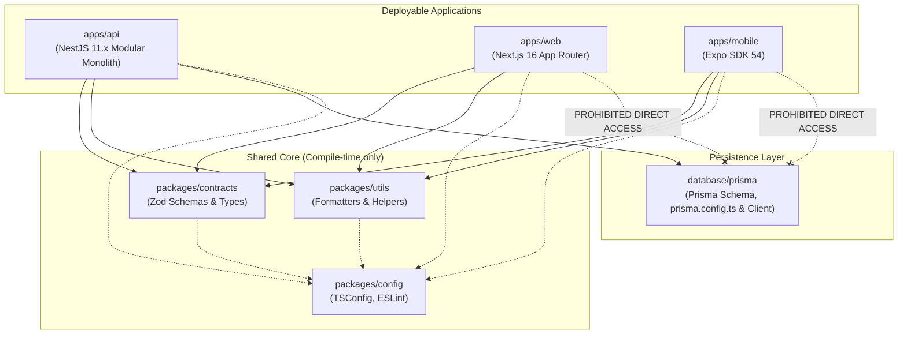

# Repository Structure & Monorepo Design (v1.1 Corrected)

## 1. Monorepo Topology

BDMart is organized as an enterprise-grade TypeScript monorepo powered by **pnpm workspaces** and **Turborepo**. This structure enforces strict boundary separation, eliminates duplicate business contracts, and optimizes Windows local development by utilizing pnpm's content-addressable storage to minimize disk space consumption.

```
D:\Project\BDMart/
├── apps/
│   ├── api/                     # Backend REST API (NestJS 11.x Modular Monolith on Node.js 24 LTS)
│   ├── web/                     # Unified Web Applications (Next.js 16 Active LTS App Router)
│   │   └── app/
│   │       ├── (storefront)/    # Public Customer Marketplace & SEO Catalog (React Server Components)
│   │       ├── (seller)/        # Supplier & Seller Management Portal
│   │       └── (admin)/         # Internal Operations & Moderation Console
│   └── mobile/                  # Native Mobile Application (React Native 0.79+ / Expo SDK 54)
│       └── app/                 # File-based navigation (Expo Router v54)
│
├── packages/
│   ├── contracts/               # Shared API Request/Response DTOs & Zod Schemas
│   ├── config/                  # Shared Tooling Configurations (TSConfig, ESLint, Prettier)
│   └── utils/                   # Environment-neutral utility functions & formatters
│
├── database/
│   ├── prisma/                  # Prisma Schema, prisma.config.ts, Migrations & Client Extensions
│   └── seed/                    # Synthetic Seed Data for Categories, Sellers & Catalog
│
├── docs/                        # Complete Architecture & System Documentation (15 Files)
│   ├── PROJECT_VISION.md
│   ├── SYSTEM_ARCHITECTURE.md
│   ├── ARCHITECTURE_DECISIONS.md
│   ├── REPOSITORY_STRUCTURE.md
│   ├── DATABASE_DESIGN.md
│   ├── PRODUCT_DATA_STRATEGY.md
│   ├── BACKEND_ARCHITECTURE.md
│   ├── FRONTEND_ARCHITECTURE.md
│   ├── API_DESIGN.md
│   ├── SECURITY_ARCHITECTURE.md
│   ├── INTEGRATION_STRATEGY.md
│   ├── TESTING_STRATEGY.md
│   ├── DEPLOYMENT_STRATEGY.md
│   ├── DEVELOPMENT_ROADMAP.md
│   └── MILESTONE_0_1_REVIEW_REPORT.md
│
├── .github/
│   └── workflows/               # CI/CD Pipelines (Lint, Typecheck, Test, EAS Build)
│
├── .env.example                 # Documented template of all required environment variables
├── .gitignore                   # Comprehensive ignore rules for Windows, Node & Expo
├── package.json                 # Monorepo root configuration & workspace scripts
├── pnpm-workspace.yaml          # Monorepo workspace package definitions
├── turbo.json                   # Turborepo task pipeline caching configuration
└── README.md                    # Project overview & developer onboarding guide
```

---

## 2. Deep Dive: Package & Application Responsibilities

### 2.1 `apps/api` (Backend Modular Monolith)
- **Role:** Central NestJS 11.x REST API server running on Node.js 24 LTS providing all core business logic, database mutations, and integration adapters.
- **Dependencies:** `packages/contracts`, `packages/utils`, `packages/config`, `database/prisma`.
- **Contents:**
  - `src/main.ts`: Application bootstrap, CORS, global validation pipes, Swagger/OpenAPI setup.
  - `src/modules/*`: Domain modules (`AuthModule`, `UsersModule`, `BusinessesModule`, `CatalogModule`, `ListingsModule`, `InventoryModule`, `OrdersModule`, `QuotationsModule`, `PaymentsModule`, `LogisticsModule`, etc.).
  - `src/common/*`: Global interceptors (Logging, Response Transform), Guards (JWT, Roles, Tenant), Exception Filters, DistributedLockService (PostgreSQL Advisory Locks).
- **Boundary Rules:** Must never import frontend libraries (React, Next.js, React Native). All database mutations pass through Prisma services.

### 2.2 `apps/web` (Unified Next.js 16 Web Portal)
- **Role:** High-performance web tier serving the public B2C/B2B storefront, the seller operational dashboard, and the admin control panel. Built on Next.js 16 Active LTS and React 19.3.
- **Dependencies:** `packages/contracts`, `packages/utils`, `packages/config`.
- **Contents:**
  - `app/(storefront)`: Public discovery, category browsing, product detail pages (PDP via RSC), B2B inquiry forms, consumer cart, checkout.
  - `app/(seller)`: Seller onboarding, bulk catalog upload, inventory adjustments, purchase order review, quotation drafting, shipment manifest printing.
  - `app/(admin)`: Merchant verification review, catalog moderation queue, commission configuration, refund approvals, system audit logs.
  - `components/*`: Shared UI design system built on **shadcn/ui** and **Tailwind CSS v4**.
- **Boundary Rules:** **Strictly prohibited from importing `database/prisma` or connecting to PostgreSQL directly.** All data access occurs via HTTPS calls to `apps/api`.

### 2.3 `apps/mobile` (Expo SDK 54 React Native Cross-Platform App)
- **Role:** Native Android and iOS application delivering on-the-go purchasing for both retail consumers and wholesale business buyers. Built on React Native 0.79+ and Expo SDK 54.
- **Dependencies:** `packages/contracts`, `packages/utils`, `packages/config`.
- **Contents:**
  - `app/*`: File-based navigation screens powered by `Expo Router v54`.
  - `src/features/*`: Feature-sliced UI components (Catalog, Cart, Orders, RFQs, Account).
  - `src/services/*`: TanStack Query hooks consuming the REST API contracts.
  - `src/storage/*`: Hardware-backed secure storage helpers using `Expo SecureStore`.
- **Boundary Rules:** Contains zero business rule calculations (pricing, discounts, or stock deductions). Consumes purely typed API contracts.

### 2.4 `packages/contracts` (Single Source of Truth for API Schemas)
- **Role:** Environment-neutral TypeScript interfaces, DTOs, and runtime **Zod validation schemas**.
- **Dependencies:** `zod` only. Zero platform-specific dependencies.
- **Contents:**
  - `src/auth/*`: Login, registration, OTP verify schemas.
  - `src/catalog/*`: Product, category, variant, and listing schemas.
  - `src/orders/*`: Cart item schemas (segregated B2B/B2C), checkout payloads, order status enums.
  - `src/b2b/*`: RFQ creation, multi-supplier quotation submission, and negotiation schemas.
- **Boundary Rules:** Must remain pure TypeScript. No database code, no UI code, no Node.js-only APIs.

### 2.5 `packages/utils` (Shared Utilities)
- **Role:** Pure utility functions shared across frontend and backend.
- **Contents:**
  - Currency conversion and formatting: Integer paisa to formatted BDT (`৳1,500.50`).
  - Phone number normalization: Sanitize Bangladesh phone numbers (`+88017XXXXXXXX`).
  - Date and time helpers: Standardized ISO date parsing and formatting for Dhaka timezone (`Asia/Dhaka`).
  - Status color/label mappings for order, seller, and payment states.

### 2.6 `packages/config` (Tooling Configurations)
- **Role:** Shared configuration files to ensure linting, formatting, and TypeScript compilation consistency.
- **Contents:**
  - `tsconfig.base.json`: Common TypeScript compiler options (strict mode, ES2022).
  - `eslint/`: Shared ESLint rules for Node, React, and React Native.
  - `tailwind/`: Shared Tailwind v4 design tokens.

### 2.7 `database/prisma` (Persistence & Migrations)
- **Role:** Declarative relational schema, CLI migration configuration, and seed scripts.
- **Contents:**
  - `schema.prisma`: Normalized database model definition.
  - `prisma.config.ts`: Multi-URL configuration defining `DATABASE_URL_UNPOOLED` for migrations.
  - `migrations/*`: Version-controlled SQL migration scripts generated by Prisma.
  - `seed/*`: Synthetic seeders for product categories, demo suppliers, and test listings.

---

## 3. Dependency Graph & Boundary Enforcement



---

## 4. Local Development Workflow on Windows (No Docker)

Because local development runs natively on Windows without Docker, all processes run as standard Node.js applications managed via pnpm.

### 4.1 Prerequisites
- **Node.js:** Node.js 24 LTS ("Krypton") installed via standard Windows installer or `nvm-windows`.
- **pnpm:** Installed globally via `corepack enable` or `npm install -g pnpm`.
- **Git for Windows:** Configured with `core.autocrlf = input`.
- **Neon Account:** A free Neon serverless PostgreSQL database branch.

### 4.2 Essential Monorepo Commands

```powershell
# 1. Install all dependencies across all workspaces (fast hardlink via pnpm)
pnpm install

# 2. Generate Prisma Client from schema
pnpm --filter @bdmart/database prisma generate

# 3. Apply migrations to your remote Neon development branch (uses direct unpooled connection)
pnpm --filter @bdmart/database prisma migrate dev

# 4. Run the NestJS Backend API in watch mode
pnpm --filter @bdmart/api dev

# 5. Run the Next.js Web Application in watch mode
pnpm --filter @bdmart/web dev

# 6. Start the Expo Mobile Metro bundler
pnpm --filter @bdmart/mobile start

# 7. Run typechecking across the entire monorepo
pnpm turbo run typecheck

# 8. Run unit and integration tests across all workspaces
pnpm turbo run test
```

---

## 5. Windows Disk-Space Discipline Guidelines

1. **pnpm Content-Addressable Storage:** Stores packages once globally and hardlinks them, saving up to 70% of disk space on Windows.
2. **Zero Docker Desktop Footprint:** Eliminating Docker Desktop and WSL2 virtual disks saves 20–40GB of storage.
3. **No Local Android Emulators:** Mobile testing is performed directly on a physical Android device using the **Expo Go** client over Wi-Fi.
4. **Cloud Compilation via EAS Build:** Native iOS (`.ipa`) and Android (`.aab`) builds are compiled on Expo Application Services cloud servers, completely removing the need for local Xcode or Android SDK build tools.
