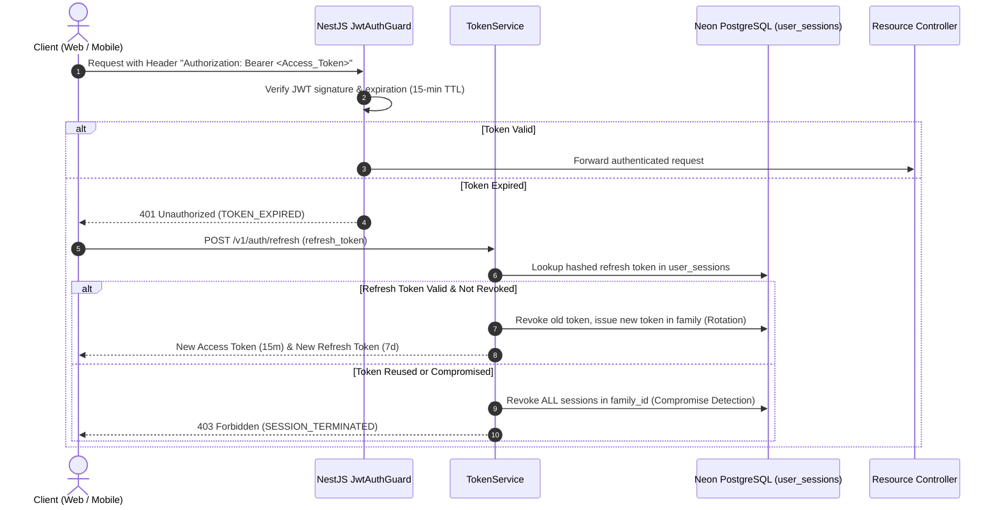
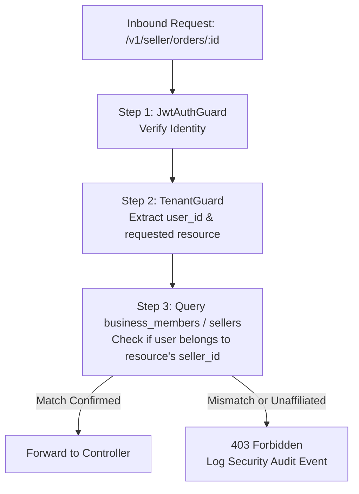
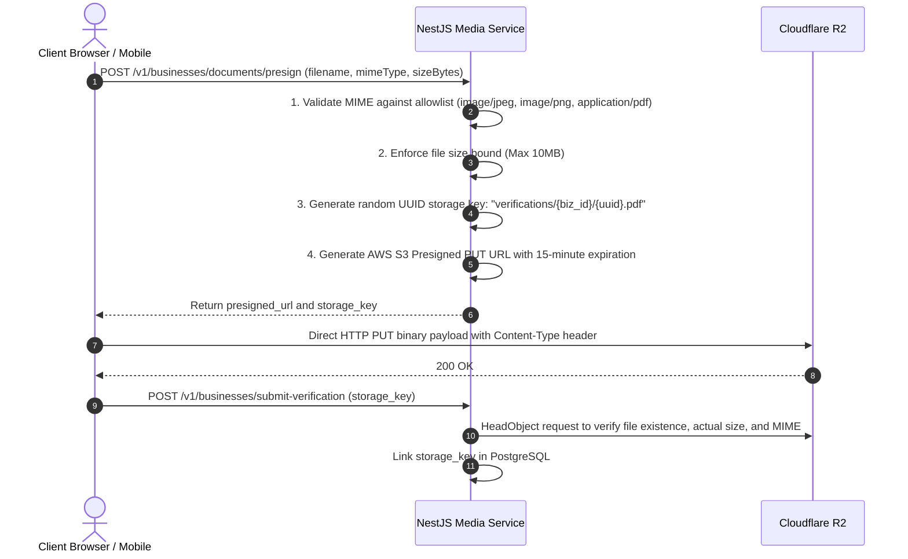

# Security Architecture & Data Protection Blueprint (v1.1 Corrected)

## 1. Threat Modeling (STRIDE Analysis)

As an enterprise commerce platform handling financial transactions, merchant trade licenses, and sensitive business procurement data, BDMart implements defenses across every threat category of the **STRIDE** model:

| Threat Category | Potential Attack Vector | Architectural Mitigation & Defense in Depth |
|---|---|---|
| **Spoofing Identity** | Attacker impersonates a merchant or business buyer via brute force or token theft. | Salted SHA-256 OTP hashing (`auth_otps`), Argon2id password hashing, SMS OTP rate-limiting, short-lived JWT access tokens (15 min), hardware-backed storage (`Expo SecureStore`), session revocation in DB with family rotation. |
| **Tampering with Data** | Attacker alters checkout prices in transit or tampers with payment webhook payloads. | Zero trust for client-side prices; totals recalculated on backend. Webhooks strictly verified via provider server-to-server validation APIs. |
| **Repudiation** | Seller denies receiving an order or admin denies approving a fraudulent refund. | Immutable, append-only `audit_logs` tracking actor ID, IP address, user agent, timestamp, before-state, and after-state. |
| **Information Disclosure** | Competitor intercepts wholesale quotes, seller settlement records, or private Trade Licenses. | Multi-tenant RBAC + `TenantGuard`. Private business documents stored in non-public Cloudflare R2 buckets accessed only via short-lived signed URLs. |
| **Denial of Service (DoS)** | Attacker floods OTP endpoints, catalog search, or checkout locks. | Sliding-window rate limiting (`@nestjs/throttler`), Cloudflare WAF and DDoS mitigation, connection pooling via Neon pgBouncer. |
| **Elevation of Privilege** | Normal consumer alters user role or modifies an administrative verification status. | Backend guards strictly enforce server-side role resolution from PostgreSQL; role claims inside JWTs are re-verified on critical mutations. |

---

## 2. Authentication & Session Security



### 2.1 Password Security
- **Algorithm:** **Argon2id** (OWASP recommended standard).
- **Parameters:** Memory: 64MB (`m=65536`), Iterations: 3 (`t=3`), Parallelism: 4 (`p=4`).
- **Policy:** Minimum 8 characters, requiring mixed-case alphanumeric and special characters.

### 2.2 Token Architecture
- **Access Tokens:** Signed with HMAC-SHA256 (`HS256`), containing `sub` (userId), `phone`, and `roles`. Expiration strictly set to **15 minutes**.
- **Refresh Tokens:** High-entropy random 256-bit strings, hashed with SHA-256 before storage in `user_sessions`. Expiration: **7 days**.
- **Token Rotation:** Every refresh request issues a new refresh token within the same `family_id` and invalidates the previous one. Replay of an invalidated token triggers **automatic revocation of all active sessions** for that user family.

---

## 3. Multi-Tenant Authorization & Seller Data Isolation

A fatal flaw in multi-vendor platforms is **Horizontal Privilege Escalation**, where Seller A accesses Seller B’s orders or financials by manipulating `seller_id` or `order_id` in API parameters.

### 3.1 Tenant Guard Architecture
In NestJS, all merchant and business routes are protected by a custom `TenantGuard`:



### 3.2 Database Query Scoping
Prisma queries within seller modules **always** enforce seller tenant boundaries at the database query level:
```typescript
async getSellerOrder(sellerId: string, orderId: string) {
  const order = await this.prisma.sellerOrder.findFirst({
    where: {
      id: orderId,
      sellerId: sellerId, // Enforces tenant isolation
      deletedAt: null,
    },
  });
  if (!order) throw new NotFoundException('Order not found or access denied');
  return order;
}
```

---

## 4. Secure File Upload Pipeline

To prevent arbitrary code execution, malicious shell scripts, or malware distribution through document uploads:



### Bucket Isolation Policy
- **Public Bucket (`bdmart-public-media`):** Contains approved canonical product images and seller store logos. Served globally via Cloudflare CDN caching with image transformation rules.
- **Private Bucket (`bdmart-private-documents`):** Contains trade licenses, e-TIN certificates, NID copies, and pro-forma invoices. **Zero public web access.** Accessible only by internal administrators via short-lived presigned GET URLs (5-minute expiration).

---

## 5. Payment Security & Webhook Tamper Resistance

### 5.1 Defense Against Payment Spoofing
- **No Client-Side Authority:** Browser or mobile app callbacks (e.g., return URLs) are treated as purely presentational redirects. An order is **never** marked `PAID` based on client redirects.
- **Server-to-Server IPN Re-Verification:** When SSLCOMMERZ or bKash fires a webhook, the backend extracts the transaction reference (`val_id` or `paymentID`) and calls the provider's server-side validation API using merchant credentials stored securely in Render environment variables.
- **Amount & Currency Assertion:** The backend verifies that `provider_amount == order_total` and `provider_currency == 'BDT'`. Any discrepancy triggers an immediate security alert and halts fulfillment.
- **Idempotency Guarantee:** Webhook events are logged in `payment_webhooks`. If an event with the same provider transaction ID has already been processed, the webhook returns `200 OK` immediately without repeating state mutations or balance credits.

---

## 6. Regulatory Compliance vs. Platform Business Risk Policies

To ensure complete legal audit readiness, BDMart explicitly distinguishes between **statutory legal mandates** and **internal business risk controls**:

### 6.1 Statutory Legal Mandates (Government of Bangladesh)
1. **Digital Commerce Operation Guidelines 2021 (Ministry of Commerce):**
   - *Merchant Identification:* Requires public disclosure of seller Trade License, registered address, and customer service contact info.
   - *Delivery Deadlines:* Deliveries must be completed within **5 days within the same district** and **10 days inter-district**, unless explicitly agreed otherwise.
   - *Prepaid Refunds:* If an advance-paid order cannot be delivered within the designated timeframe, the full prepaid amount must be refunded within **7 to 10 working days**.
2. **Bangladesh VAT Act 2012:**
   - Books of accounts, commercial tax invoices, and credit/debit notes must be retained for **6 years**.
3. **Payment and Settlement Systems Act 2014 (Bangladesh Bank):**
   - Unlicensed e-commerce platforms are **strictly prohibited** from issuing electronic money, holding consumer stored-value deposits, or operating independent escrow clearing without Payment Service Provider (PSP) or Payment System Operator (PSO) licenses.
   - BDMart operates solely as a merchant aggregator holding funds in designated merchant settlement bank accounts with approved partner gateways.

### 6.2 Platform Business Risk Policies (Internal & Configurable)
1. **Cash on Delivery (COD) ৳10,000 Ceiling:** This ceiling is an **internal marketplace risk mitigation policy** designed to limit courier Return-to-Origin (RTO) delivery fee losses, **NOT a statutory legal cap** set by Bangladesh Bank.
2. **15-Minute Inventory Reservation TTL:** Internal concurrency and liquidity rule.
3. **Category Commission Rates:** Commercial contractual agreements, fully configurable in database settings.

> [!IMPORTANT]
> **Legal Disclaimer:** While this security architecture reflects established e-commerce engineering standards, the operating company must obtain formal review from qualified Bangladesh legal counsel and chartered accountants before executing commercial merchant agreements or public launch.
