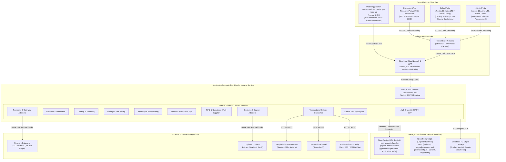
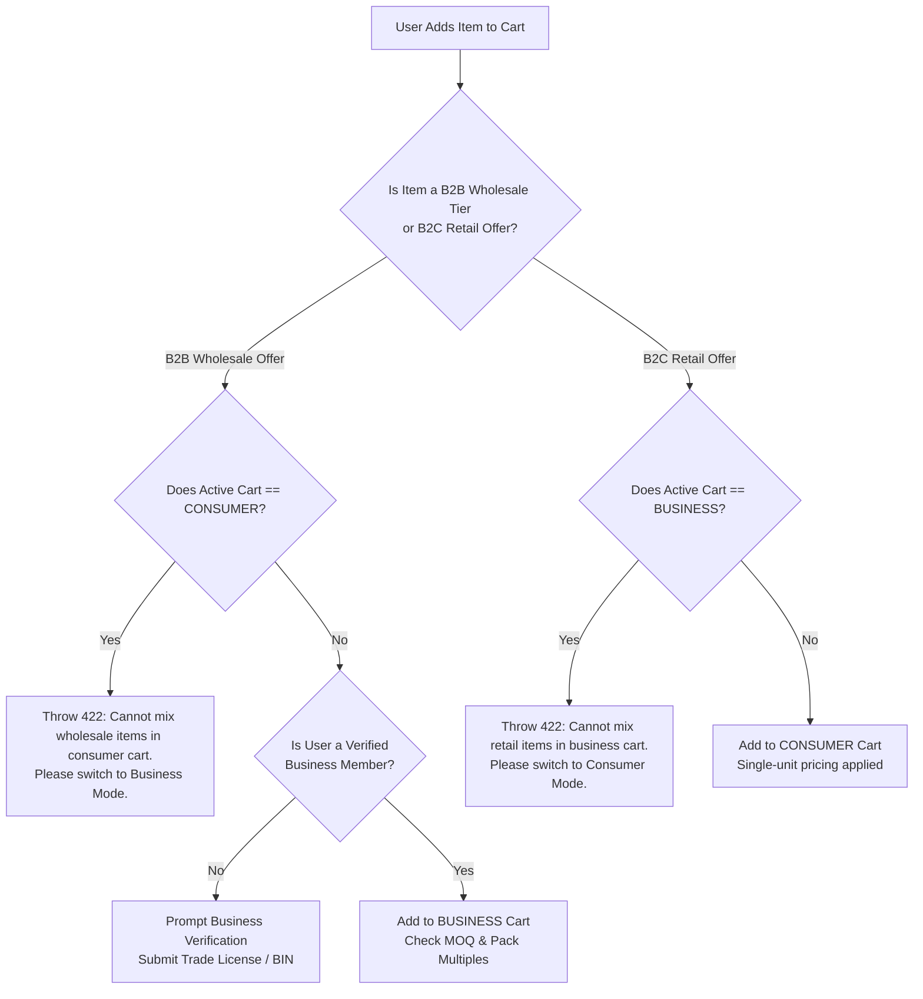
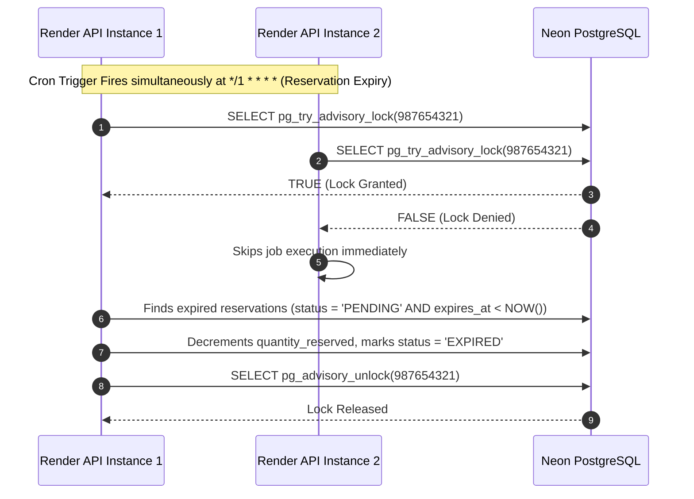

# System Architecture & Component Specification (v1.1 Corrected)

## 1. High-Level System Architecture

The BDMart platform is designed as a **Modular Monolith** backend supporting a unified multi-client frontend tier. All clients interact with a single, highly structured NestJS REST API. Cloud services are fully managed, eliminating local infrastructure dependencies on the development machine.



---

## 2. Multi-Supplier B2B Procurement Workflow (RFQ & Competitive Quotations)

In wholesale commerce, a business buyer frequently creates a single RFQ and solicits competitive bids from multiple authorized distributors or manufacturers.

```mermaid
sequenceDiagram
    autonumber
    actor Buyer as Business Buyer
    participant App as Buyer Portal / Mobile App
    participant API as NestJS RFQ Module
    participant DB as Neon PostgreSQL
    actor SupplierA as Supplier A (Wholesaler)
    actor SupplierB as Supplier B (Manufacturer)

    Buyer->>App: Creates RFQ (Title, Category, Items, Qty, Target Price, Delivery Date)
    App->>API: POST /v1/b2b/rfq-requests
    API->>DB: Insert rfq_requests & rfq_request_items (Status: OPEN)
    API->>DB: Link eligible category sellers in rfq_target_sellers
    API->>DB: Insert event in system_outbox (rfq.broadcasted)
    
    par Multi-Supplier Notification
        SupplierA->>API: GET /v1/seller/rfq-requests/:id (Views RFQ details)
        SupplierB->>API: GET /v1/seller/rfq-requests/:id (Views RFQ details)
    end
    
    SupplierA->>API: POST /v1/seller/rfq-requests/:id/quotations (Offers ৳520/unit, 3-day lead)
    API->>DB: Insert seller_quotations (QT-01, Status: SUBMITTED)
    
    SupplierB->>API: POST /v1/seller/rfq-requests/:id/quotations (Offers ৳505/unit, 7-day lead)
    API->>DB: Insert seller_quotations (QT-02, Status: SUBMITTED)
    
    Buyer->>API: GET /v1/b2b/rfq-requests/:id/quotations (Compares bids side-by-side)
    Buyer->>API: POST /v1/b2b/quotations/QT-02/accept (Selects Supplier B)
    
    rect rgb(240, 255, 240)
        Note over API,DB: ATOMIC QUOTATION ACCEPTANCE TRANSACTION
        API->>DB: Update QT-02 status to ACCEPTED
        API->>DB: Update competing quotations (QT-01) status to REJECTED
        API->>DB: Update parent rfq_requests status to AWARDED
        API->>DB: Generate Draft B2B Order with immutable price snapshot from QT-02
    end
    
    API-->>Buyer: Draft Order Created (ORD-B2B-XXXX); Supplier B Notified
```

---

## 3. Strict Cart & Order Segregation (B2B vs. B2C)

To guarantee compliance with statutory taxation (Bangladesh VAT Act 2012) and Ministry of Commerce commercial invoice guidelines, wholesale and retail purchases cannot be mixed in the same transaction:



---

## 4. Distributed Background Processing with Zero External Infrastructure

Render web services may scale horizontally to 2 or more Node.js instances. Without Redis, instances prevent duplicate scheduled tasks by leveraging **PostgreSQL Native Advisory Locks**:



### Transactional Outbox Pattern
1. State-changing transactions write an event row into `system_outbox` in the same database transaction.
2. A scheduled outbox worker, guarded by an advisory lock, polls `system_outbox` for `PENDING` records, dispatches SMS/Email/Push notifications, and updates the row to `COMPLETED` (or records failure retry counters).
3. If an external notification gateway fails or experiences latency, the user's primary transaction remains fast and unblocked.
