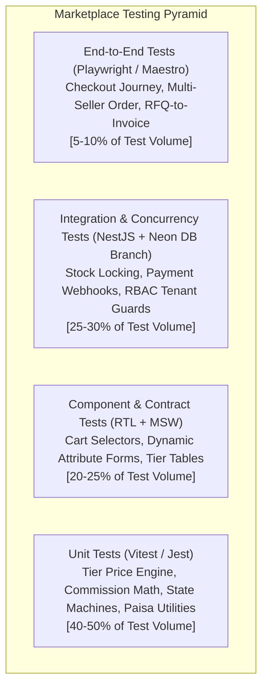
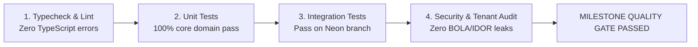

# Testing Strategy & Quality Assurance Architecture

## 1. Quality Philosophy & Testing Pyramid

In a commerce marketplace where software defects directly result in stock overselling, inaccurate payments, corrupted vendor settlements, or regulatory fines, quality assurance is an active architectural gate.



---

## 2. Test Suites by Layer

### 2.1 Unit Testing (Vitest / Jest)
- **Scope:** Pure TypeScript functions, mathematical calculations, and business rule engines.
- **Key Test Cases:**
  - *Wholesale Tier Calculation:* Verify correct unit price resolution for edge quantities (e.g., exactly at tier threshold `quantity = 100`, between tiers `quantity = 145`, above highest tier `quantity = 1200`).
  - *Monetary Precision:* Verify integer paisa arithmetic produces zero rounding drift across tax, coupon discount, delivery fee, and commission calculations.
  - *Order State Machine Transitions:* Validate legal state transitions (e.g., `PLACED -> PROCESSING` is valid; `PLACED -> DELIVERED` throws `IllegalStateTransitionException`).
  - *Bangladesh Phone & Address Sanitization:* Validate normalization of `017XXXXXXXX`, `+88017XXXXXXXX`, `88017XXXXXXXX`.

### 2.2 Backend Integration Testing (NestJS TestingModule + Neon Cloud Branch)
- **Scope:** Testing business services with real database queries and transaction boundaries.
- **Workflow on Windows without Docker:**
  - Tests connect directly to an isolated **Neon development branch** (`ep-test-branch-123.ap-southeast-1.aws.neon.tech`).
  - Neon branches are provisioned via the Neon API in seconds before the CI test suite runs, and destroyed immediately afterward.
- **Key Test Cases:**
  - *Transaction Rollback:* Ensure that if a payment record creation fails, the corresponding stock reservation is rolled back atomically.
  - *Database Constraints:* Verify that inserting duplicate SKUs, negative stock, or overlapping price tiers triggers PostgreSQL check constraint exceptions.

### 2.3 Concurrency & Stock Oversell Testing
- **Critical Risk:** Preventing race conditions when 100 buyers attempt to purchase the remaining 5 units of a high-demand wholesale batch simultaneously.
- **Test Methodology:**
  ```typescript
  it('should prevent overselling when 50 concurrent checkouts target 5 available units', async () => {
    const listingId = await createTestListingWithStock(5);
    const concurrentRequests = Array.from({ length: 50 }).map((_, i) =>
      checkoutService.placeOrder({
        userId: `user-${i}`,
        listingId,
        quantity: 1,
      })
    );
    
    const results = await Promise.allSettled(concurrentRequests);
    const successful = results.filter((r) => r.status === 'fulfilled');
    const failed = results.filter((r) => r.status === 'rejected');
    
    expect(successful.length).toBe(5);
    expect(failed.length).toBe(45);
    
    const finalStock = await inventoryService.getAvailableStock(listingId);
    expect(finalStock).toBe(0);
  });
  ```

### 2.4 Multi-Tenant Authorization & Security Testing
- **Objective:** Verify that `TenantGuard` and role policies prevent horizontal and vertical privilege escalation.
- **Automated Matrix Testing:**
  - Execute API requests against `/v1/seller/*` using tokens belonging to a different seller; assert `403 Forbidden`.
  - Execute administrative mutations (e.g., `/v1/admin/verifications/:id/decision`) using consumer or seller tokens; assert `403 Forbidden`.
  - Fuzz request parameters with SQL injection and path traversal payloads; assert `400 Bad Request` or sanitized handling.

### 2.5 Payment Gateway Sandbox Testing
- Automated test scripts simulating SSLCOMMERZ and bKash sandbox lifecycles:
  1. **Success Scenario:** Order placed -> Gateway initiated -> Mock IPN delivered -> Status transitions to `PAID`.
  2. **Duplicate Webhook Scenario:** Identical IPN delivered 5 times in 10 seconds -> Exactly one transition recorded, zero duplicate balance credits.
  3. **Failed / Cancelled Scenario:** User cancels at gateway -> Reservation released back to stock after 15 minutes.
  4. **Amount Tampering Scenario:** Malicious IPN alters `amount` from `৳15,000` to `৳150` -> Backend validation detects mismatch, flags order as `FRAUD_ALERT`, halts fulfillment.

### 2.6 Frontend & Mobile Testing
- **Web (Playwright):**
  - End-to-end checkout journey: Anonymous browse -> Phone OTP login -> Add B2C & B2B products from 2 different sellers -> Server-calculated checkout -> Mock payment -> Verify split sub-orders in seller portal.
- **Mobile (Maestro / Physical Device Testing):**
  - Physical testing on Android hardware via **Expo Go** and EAS preview builds.
  - Tests network disconnection resilience, retryable requests, and Bangla font rendering.

---

## 3. Milestone Quality Gates

No development milestone is marked complete unless it satisfies its predefined Quality Gate:



| Milestone | Mandatory Quality Criteria |
|---|---|
| **Milestone 1 (Foundation)** | Monorepo builds cleanly; Prisma schema generates types; CI pipeline passes lint & typechecks. |
| **Milestone 2 (Auth & Users)** | OTP rate-limiting verified; Argon2id hashing operational; JWT refresh rotation and revocation proven. |
| **Milestone 3 (Businesses & Sellers)** | Document upload presigned URLs functional; TenantGuard enforces complete seller data isolation. |
| **Milestone 4 (Catalog & Offers)** | Category attributes validated; duplicate detection flags matches; price tier lookups 100% tested. |
| **Milestone 5 (B2B Procurement)** | RFQ lifecycle tested; accepted quotation converts to draft order with immutable price snapshot. |
| **Milestone 6 (Inventory & Orders)** | Concurrency test proves zero oversell; parent order splits accurately into seller sub-orders. |
| **Milestone 7 (B2C Marketplace)** | B2C search filters operational; consumer cart recalculations verified; review gating enforced. |
| **Milestone 8 (Payments & Logistics)** | IPN validation immune to spoofing and replay; courier webhook updates parcel tracking milestones. |
| **Milestone 9 (Admin & Operations)** | Verification approval workflow audit-logged; finance reconciliation balances to the paisa. |
| **Milestone 10 (Security & Performance)** | Penetration testing checklist completed; database query latency under 50ms at 95th percentile. |
| **Milestone 11 (App Store Release)** | EAS cloud builds pass Google Play target API 36+ and Apple App Review guidelines. |

