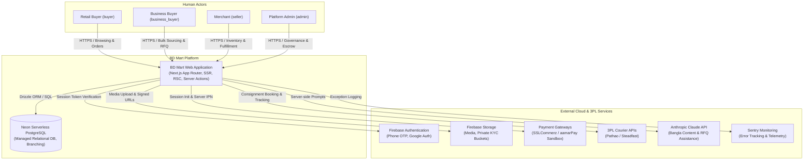
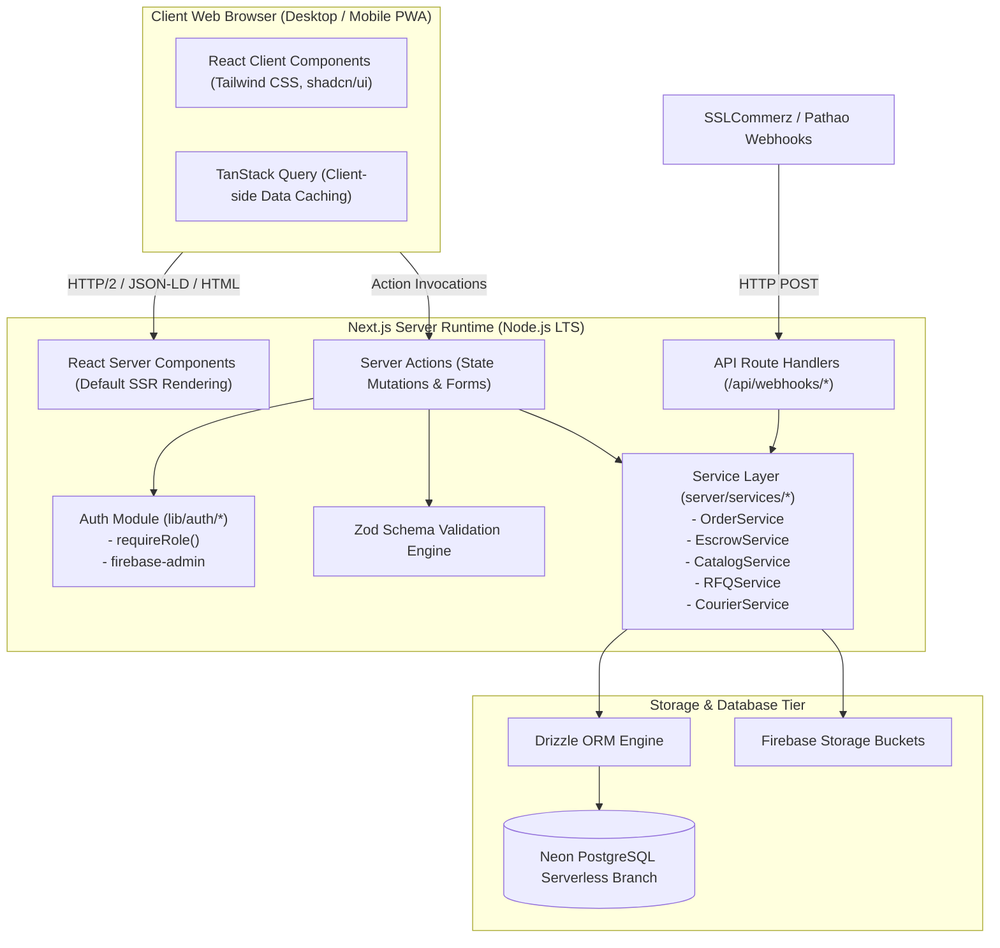

# System Context Specification

## 1. C4 System Context Diagram (Level 1)

The System Context diagram illustrates BD Mart's core boundaries and interactions with human actors and external systems:

---

## 2. C4 Container Diagram (Level 2)

---

## 3. External Integrations Matrix

| System | Role | Protocol | Security Mechanism |
|---|---|---|---|
| **Firebase Authentication** | User identity & phone OTP validation | REST / Admin SDK | Verification via `firebase-admin` server SDK; session stored in `HttpOnly` cookie. |
| **Firebase Storage** | Product imagery & KYC documents | REST / Admin SDK | Public read for product media; private ACL with admin-generated signed URLs for KYC documents. |
| **Neon PostgreSQL** | Primary relational database | PostgreSQL TCP (5432) | TLS/SSL encrypted connection pooling with role-based branching. |
| **SSLCommerz / aamarPay** | Payment processing gateway | REST / HTTPS Webhooks | Direct server-to-server transaction validation API; webhook signature verification; idempotency keys. |
| **Pathao / Steadfast** | 3PL courier logistics & tracking | REST / HTTPS Webhooks | Bearer API token; webhook secret hash validation. |
| **Anthropic Claude API** | Content generation & smart search | HTTPS (Server-Side) | Server-only `ANTHROPIC_API_KEY`; strict Zod schema validation on all returned AI responses. |
| **Sentry** | Production error monitoring | HTTPS | DSN endpoint; automated exception tracking with PII stripping. |
