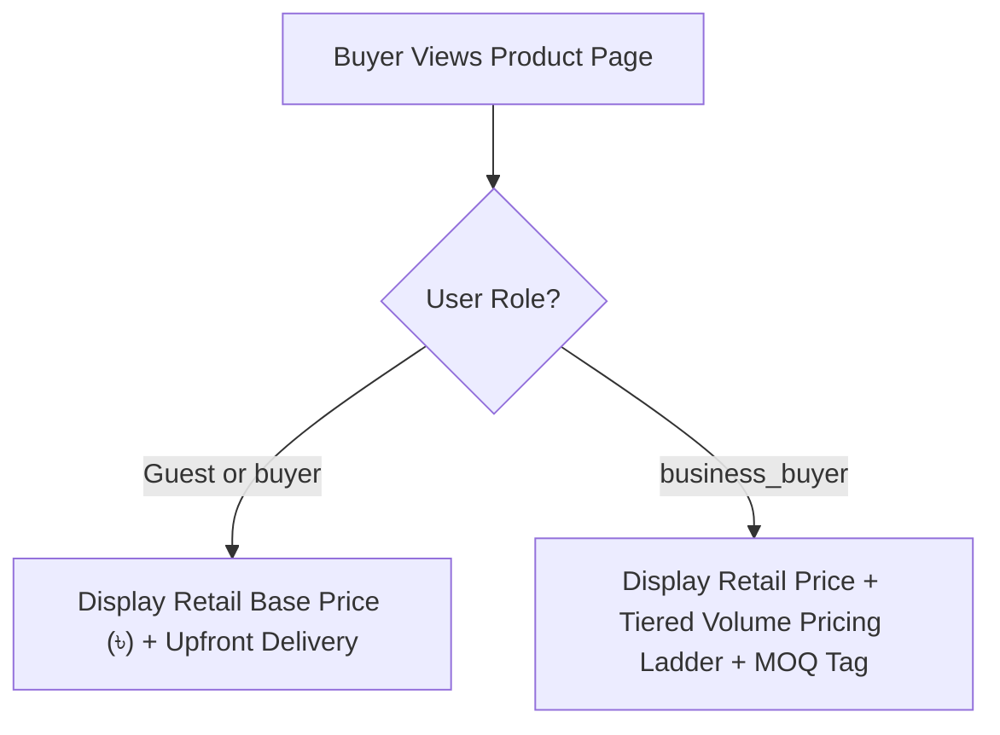

# Catalog and Pricing Specification

## 1. Catalog Architecture and SKU Structure

BD Mart uses a hierarchical catalog structure capable of accommodating consumer retail goods and bulk industrial products:
- **Category:** Hierarchical tree (`categories` table) with `parent_id`, URL slug, Bengali name (`name_bn`), and English name (`name_en`).
- **Product:** Master product entity (`products` table) containing seller ownership (`seller_id`), title, description, base retail price (`base_price`), MOQ (`moq`), and wholesale availability flag (`is_b2b_enabled`).
- **Product Variant:** Distinct physical sellable SKU (`product_variants` table) specifying specific attributes (e.g., Color, Size, Packaging specification stored in `jsonb`), SKU code, real-time stock balance, and variant price adjustment.

---

## 2. Dual-Engine Pricing Architecture

BD Mart serves two distinct buyer audiences with strict separation of pricing visibility and commercial rules:



### 2.1. Retail Pricing Rules (B2C)
- Displayed as a single unit price in Bangladeshi Taka (`base_price` in poisha).
- Single-item purchases are allowed (minimum purchase quantity = 1).
- Strike-through original price displayed when a promotional discount is active.
- Transparent upfront delivery fee added prior to checkout. No checkout surprise charges.

### 2.2. Wholesale Tiered Pricing Rules (B2B)
- Available **exclusively** on products where `is_b2b_enabled = true`.
- Visible **exclusively** to authenticated users with `role = 'business_buyer'` and verified status.
- Defined in the `price_tiers` table with `min_qty` and `unit_price`.
- Example Tier Structure for `SKU-JUTE-BAG-001`:
  - Retail Base Price (1–49 pcs): `৳350` (35,000 poisha)
  - Tier 1 (50–99 pcs): `৳280 / pc` (28,000 poisha)
  - Tier 2 (100–499 pcs): `৳220 / pc` (22,000 poisha)
  - Tier 3 (500+ pcs): `৳180 / pc` (18,000 poisha)
- **Minimum Order Quantity (MOQ) Constraint:** If `products.moq = 50`, a business buyer cannot add fewer than 50 units to a wholesale order. The server-side ordering action validates `qty >= product.moq`.

---

## 3. Financial Representation: Integer Poisha Standard

Floating-point data types (`float`, `real`, `numeric(x, y)`) are strictly prohibited for monetary storage and calculation.

- **Storage Unit:** All database monetary columns (`base_price`, `unit_price`, `subtotal`, `delivery_fee`, `vat`, `total`, `amount`) are stored as 64-bit integers (`bigint`) representing **poisha**.
- **Conversion Formula:**
  $$\text{Poisha} = \text{BDT} \times 100$$
  $$\text{BDT} = \frac{\text{Poisha}}{100}$$
- **UI Formatting Helper:** A centralized formatter `formatBDT(amountInPoisha: number, locale: 'bn' | 'en'): string` converts poisha to localized Taka:
  - English locale: `formatBDT(35000, 'en')` $\rightarrow$ `৳350`
  - Bengali locale: `formatBDT(35000, 'bn')` $\rightarrow$ `৳৩৫০`

---

## 4. Value Added Tax (VAT) Calculation Standard

Under Bangladesh NBR regulations, e-commerce transactions require transparent VAT accounting:
- **Standard Local VAT Rate:** 15% (or 5% for specified essential goods).
- **Tax Calculation Algorithm:**
  ```typescript
  // Server-side calculation in integer poisha
  const subtotalPoisha = calculateItemsSubtotal(items);
  const vatRateBps = 1500; // 15.00% expressed in basis points (1/100 of a percent)
  const vatAmountPoisha = Math.round((subtotalPoisha * vatRateBps) / 10000);
  const deliveryFeePoisha = getDeliveryFeeForLocation(destinationUpazila);
  const totalAmountPoisha = subtotalPoisha + vatAmountPoisha + deliveryFeePoisha;
  ```
- **Commercial Tax Invoicing:** Invoices issued to verified B2B buyers include the Seller BIN, Buyer BIN, tax breakdown per item, and subtotal.
