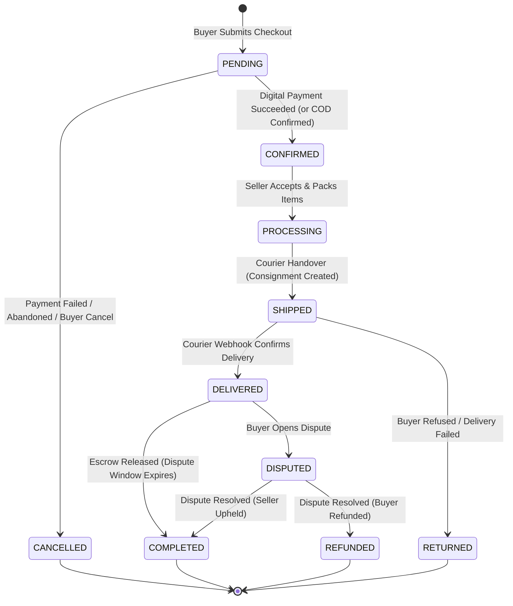

# Checkout and Orders Specification

## 1. Cart Architecture & Multi-Seller Splitting

The BD Mart shopping cart supports multi-vendor item selection while maintaining clear order separation:
- **Cart Storage:** Stored in client state / transient cookie for guests; synchronized to `carts` and `cart_items` tables upon login.
- **Multi-Vendor Order Partitioning:**
  When a buyer checks out with items from multiple sellers, the system generates **one master checkout transaction** for payment, but partitions the purchase into **distinct child orders** in the `orders` table, one per distinct `seller_id`:
  - Each seller receives their independent order with dedicated fulfillment lifecycle, consignment tracking number, and escrow ledger entry.
  - The buyer sees a consolidated payment screen and itemized order summary.

---

## 2. Upfront Delivery Fee Calculation Engine

BD Mart enforces a strict **Zero Hidden Fees** policy. The buyer must see the full delivered price upfront:
- **Geographic Hierarchy:** Bangladesh is divided into 8 Divisions, 64 Districts, and 495+ Upazilas.
- **Delivery Rate Card:**
  - Inside Dhaka Metro: `৳60` (6,000 poisha)
  - Dhaka Suburbs: `৳100` (10,000 poisha)
  - Outside Dhaka (Inter-district standard): `৳130` (13,000 poisha)
  - Express / Heavy Cargo (Wholesale bulk cargo > 5kg): Standard tier + `৳25` per additional kg.
- **Calculation Trigger:** As soon as the user selects or inputs their delivery address (or default address for logged-in buyers), the delivery fee is calculated immediately and factored into the cart summary.

---

## 3. Order Lifecycle State Machine

The order lifecycle is governed by a deterministic, server-enforced finite state machine:

### State Definitions & Permitted Transitions:
| State | Trigger | Actor | Side Effects |
|---|---|---|---|
| `PENDING` | Order created at checkout | Buyer | Inventory reserved; payment session initialized. |
| `CONFIRMED` | Successful payment callback or COD phone confirmation | Gateway / System | Inventory permanently committed; escrow record created in `held` state. |
| `PROCESSING` | Seller begins packing order | Seller | Packing slip generated; courier pickup requested. |
| `SHIPPED` | Courier scans package at pickup | Courier API | `shipments.tracking_no` populated; customer notified via SMS/email. |
| `DELIVERED` | Courier webhook reports successful physical delivery | Courier API | Buyer notified; dispute return countdown timer starts (7 days). |
| `COMPLETED` | Return window expires or buyer accepts delivery | System | Escrow funds transition from `held` to `released` for seller payout. |
| `CANCELLED` | Payment timeout or buyer cancels before packing | Buyer / System | Reserved inventory restored to variant stock. |
| `DISPUTED` | Buyer reports defective or missing items | Buyer | Escrow release frozen; dispute ticket opened in admin panel. |
| `REFUNDED` | Admin resolves dispute in buyer's favor or return completed | Admin / Gateway | Escrow refunded to buyer via original payment method. |
| `RETURNED` | Delivery rejected by recipient at doorstep | Courier API | Courier returns package to seller; stock restored; COD delivery charge recorded. |
