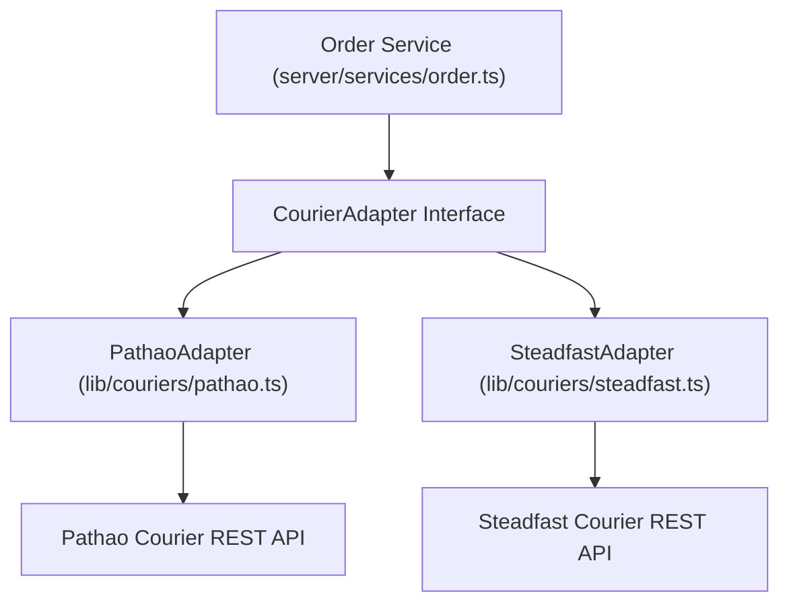

# Fulfillment and Returns Specification

## 1. Courier Partner Integration (3PL Adapter Pattern)

BD Mart integrates third-party logistics through an extensible `CourierAdapter` interface, insulating the core order service from carrier-specific API quirks.



### Courier Adapter Interface Contract:
```typescript
export interface CourierAdapter {
  createShipment(payload: {
    orderId: string;
    recipientName: string;
    recipientPhone: string;
    recipientAddress: string;
    recipientDivision: string;
    recipientDistrict: string;
    recipientUpazila: string;
    cashOnDeliveryAmountPoisha: number; // 0 for prepaid digital orders
    itemWeightKg: number;
  }): Promise<{
    courierName: 'pathao' | 'steadfast';
    trackingNumber: string;
    consignmentId: string;
    estimatedDeliveryDays: number;
  }>;

  trackShipment(trackingNumber: string): Promise<{
    currentStatus: 'PICKED_UP' | 'IN_TRANSIT' | 'DELIVERED' | 'RETURNED' | 'FAILED';
    latestEvent: string;
    timestamp: Date;
  }>;
}
```

---

## 2. Dispatch Workflow

1. **Order Acceptance:** The seller inspects pending orders in the Seller Portal.
2. **Packing Slip Generation:** The seller clicks "Pack Order", transitioning status to `PROCESSING`. The system generates a printable PDF packing slip featuring the order ID, recipient address, item SKU list, and barcode.
3. **Courier Pickup Request:** The seller clicks "Request Courier Pickup". The system calls the active `CourierAdapter.createShipment()`, which assigns a courier consignment ID and tracking number, updating `shipments` table.
4. **Courier Handover:** The courier pickup rider scans the package, triggering the first transit event. The order status updates to `SHIPPED`.

---

## 3. Real-Time Tracking & Webhook Lifecycle

The courier partner notifies BD Mart via incoming webhooks at `/api/webhooks/courier`:
- **Validation:** Webhook requests are verified using the courier's shared secret header (`X-Courier-Signature`).
- **Idempotency:** Webhook event IDs are checked against `audit_logs` to prevent processing repeated notifications.
- **Status Mapping:**
  - `courier:picked_up` $\rightarrow$ Order status `SHIPPED`.
  - `courier:out_for_delivery` $\rightarrow$ Buyer notified via SMS.
  - `courier:delivered` $\rightarrow$ Order status `DELIVERED`, physical delivery timestamp recorded, escrow timer begins.
  - `courier:returned` $\rightarrow$ Order status `RETURNED`.

---

## 4. Cancellations, Returns & Dispute Resolution

### 4.1. Order Cancellation Policy
- **By Buyer:** Permitted freely as long as order status is `PENDING` or `CONFIRMED`. Once status shifts to `PROCESSING` or `SHIPPED`, cancellations cannot be processed self-service.
- **By Seller:** If items are discovered out of stock, seller can initiate cancellation. If prepaid, buyer receives an immediate 100% refund from escrow. The seller's fulfillment reliability metric is penalized.

### 4.2. Return & Dispute Process
In accordance with Bangladesh Digital Commerce Operation Guidelines (2021):
1. **Dispute Window:** Buyers may raise a dispute within **7 calendar days** of physical delivery for:
   - Damaged or defective goods.
   - Products significantly different from catalog specifications or images.
   - Missing items or wrong quantities.
2. **Dispute Filing:** Buyer uploads photographic evidence and selects a reason in the Account portal (`disputes` table created).
3. **Escrow Freeze:** The associated escrow payout record in `escrow_ledger` is immediately shifted to `frozen`.
4. **Admin Arbitration:**
   - Platform Admin reviews evidence submitted by buyer and seller.
   - **Resolution A (Return & Refund):** Admin approves return. Buyer dispatches item back to seller. Upon receipt, escrow ledger updates to `refunded`, and digital payment gateway reverses funds to buyer.
   - **Resolution B (Claim Rejected):** Admin rejects buyer claim (e.g., buyer remorse or damaged after delivery). Escrow ledger updates to `released`, releasing payment to seller.
