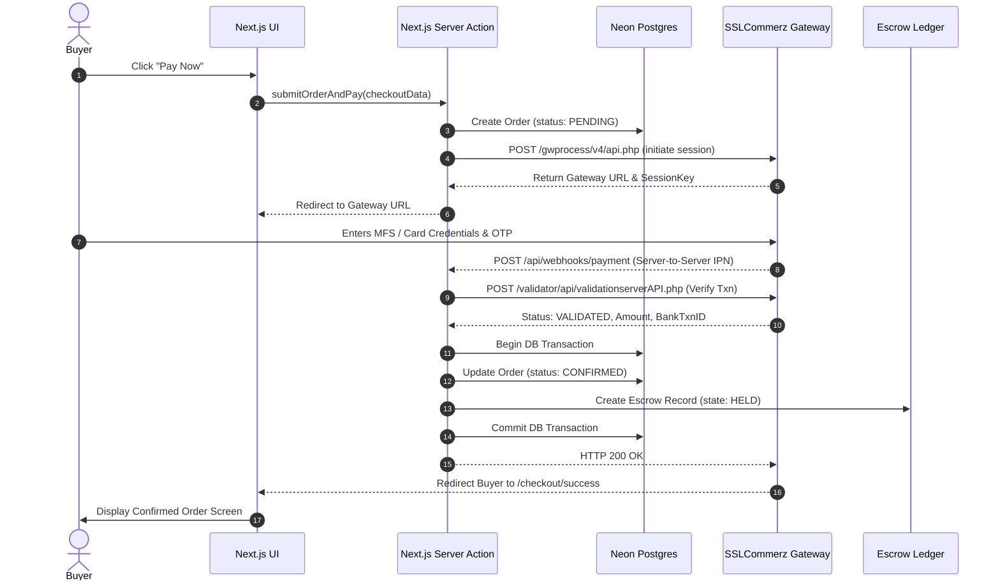

# Payments and Escrow Specification

## 1. Payment Infrastructure Architecture

BD Mart integrates a dual-provider payment gateway adapter architecture with SSLCommerz and aamarPay, operating in sandbox mode during development and testing.

---

## 2. Server-to-Server IPN & Webhook Security

The frontend browser redirect is treated strictly as an untrusted UX signal. **Under no circumstances is an order confirmed based solely on a client redirect.**

### IPN Verification Rules:
1. **Server Validation API:** When the gateway calls `/api/webhooks/payment`, the server extracts `val_id` and queries the gateway's server validation endpoint directly.
2. **Amount Reconciliation:** The server verifies that `gatewayResponse.currency_amount == order.total` down to the exact poisha. Any discrepancy triggers an immediate security alert and flags the order as `SUSPICIOUS_PAYMENT_FRAUD`.
3. **Idempotency Enforcement:**
   Every payment webhook is tracked using `idempotency_key` (derived from `gateway_name:txn_id`). If the gateway retransmits the same successful IPN multiple times:
   - The server queries `payments` by `txn_id`.
   - If already recorded as `VALIDATED`, the server returns `HTTP 200 OK` immediately without re-executing order confirmation or re-crediting the escrow ledger.

---

## 3. Escrow Ledger Mechanism

The escrow system protects buyer funds until delivery is verified and protects sellers by ensuring committed funds are guaranteed prior to dispatch.

### Escrow Ledger Schema (`escrow_ledger` table):
- `id`: UUID (Primary Key)
- `order_id`: UUID (Foreign Key $\rightarrow$ `orders.id`)
- `seller_id`: UUID (Foreign Key $\rightarrow$ `sellers.id`)
- `amount`: BigInt (poisha amount due to seller)
- `platform_fee`: BigInt (platform commission retained by BD Mart)
- `state`: Enum (`held`, `released`, `refunded`, `frozen`)
- `released_at`: Timestamp with timezone (nullable)
- `created_at`: Timestamp with timezone

### Escrow State Transitions:
1. **`held`:** Set immediately when the digital payment is confirmed.
2. **`frozen`:** Set if the buyer files a formal dispute within the 7-day post-delivery window.
3. **`released`:** Set when either:
   - Courier API fires `DELIVERED` webhook AND the 7-day dispute window expires without dispute.
   - Buyer manually clicks "Accept & Confirm Delivery" in the account portal.
   - Admin arbitrates a dispute in the seller's favor.
4. **`refunded`:** Set when an order is cancelled prior to shipment, or when an admin arbitrates a dispute in the buyer's favor. Funds are reversed via gateway refund API.

---

## 4. Cash on Delivery (COD) Accounting

For COD orders, the courier partner acts as the physical collection agent:
- The courier collects the full invoice amount (order total + delivery fee) at the doorstep.
- The courier reconciles and remits funds to BD Mart weekly, net of courier service fees.
- BD Mart credits the seller's account balance, deducting the platform commission.
- If the customer rejects the parcel at the door, the order transitions to `RETURNED`. The seller receives the returned merchandise, and courier return charges are applied per platform seller policy.
