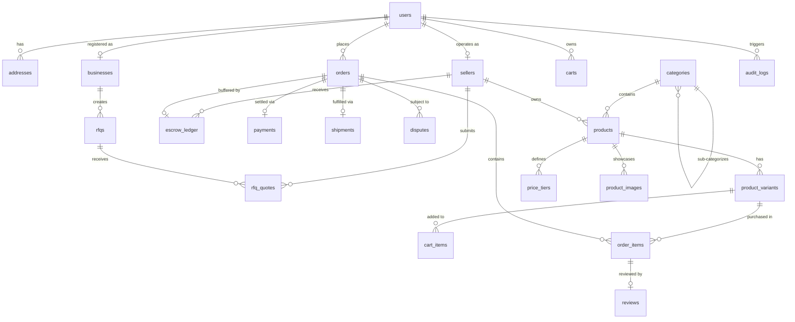

# Database Schema Specification

## 1. Entity Relationship (ER) Diagram



---

## 2. Definitive PostgreSQL Table Definitions

All tables include:
- `id`: `uuid DEFAULT gen_random_uuid() PRIMARY KEY`
- `created_at`: `timestamp with time zone DEFAULT now() NOT NULL`
- `updated_at`: `timestamp with time zone DEFAULT now() NOT NULL`

### 2.1. Identity & Organization Tables
```sql
CREATE TABLE users (
    id UUID PRIMARY KEY DEFAULT gen_random_uuid(),
    firebase_uid VARCHAR(128) NOT NULL UNIQUE,
    phone VARCHAR(20) NOT NULL UNIQUE,
    email VARCHAR(255),
    name VARCHAR(255) NOT NULL,
    role VARCHAR(32) NOT NULL DEFAULT 'buyer', -- buyer, business_buyer, seller, admin
    locale VARCHAR(10) NOT NULL DEFAULT 'bn',   -- bn, en
    created_at TIMESTAMPTZ NOT NULL DEFAULT now(),
    updated_at TIMESTAMPTZ NOT NULL DEFAULT now()
);

CREATE TABLE addresses (
    id UUID PRIMARY KEY DEFAULT gen_random_uuid(),
    user_id UUID NOT NULL REFERENCES users(id) ON DELETE CASCADE,
    division VARCHAR(64) NOT NULL,
    district VARCHAR(64) NOT NULL,
    upazila VARCHAR(64) NOT NULL,
    line TEXT NOT NULL,
    phone VARCHAR(20) NOT NULL,
    is_default BOOLEAN NOT NULL DEFAULT false,
    created_at TIMESTAMPTZ NOT NULL DEFAULT now(),
    updated_at TIMESTAMPTZ NOT NULL DEFAULT now()
);

CREATE TABLE sellers (
    id UUID PRIMARY KEY DEFAULT gen_random_uuid(),
    user_id UUID NOT NULL UNIQUE REFERENCES users(id) ON DELETE RESTRICT,
    shop_name VARCHAR(255) NOT NULL,
    trade_license_no VARCHAR(128) NOT NULL UNIQUE,
    trade_license_url TEXT NOT NULL,
    nid_ref VARCHAR(128) NOT NULL,
    kyc_status VARCHAR(32) NOT NULL DEFAULT 'pending', -- pending, approved, rejected
    commission_rate INTEGER NOT NULL DEFAULT 500,       -- basis points (500 bps = 5.00%)
    created_at TIMESTAMPTZ NOT NULL DEFAULT now(),
    updated_at TIMESTAMPTZ NOT NULL DEFAULT now()
);

CREATE TABLE businesses (
    id UUID PRIMARY KEY DEFAULT gen_random_uuid(),
    user_id UUID NOT NULL UNIQUE REFERENCES users(id) ON DELETE RESTRICT,
    company_name VARCHAR(255) NOT NULL,
    tin VARCHAR(64) NOT NULL UNIQUE,
    bin VARCHAR(64) NOT NULL UNIQUE,
    verified_at TIMESTAMPTZ,
    created_at TIMESTAMPTZ NOT NULL DEFAULT now(),
    updated_at TIMESTAMPTZ NOT NULL DEFAULT now()
);
```

### 2.2. Catalog & Pricing Tables
```sql
CREATE TABLE categories (
    id UUID PRIMARY KEY DEFAULT gen_random_uuid(),
    parent_id UUID REFERENCES categories(id) ON DELETE RESTRICT,
    slug VARCHAR(128) NOT NULL UNIQUE,
    name_bn VARCHAR(255) NOT NULL,
    name_en VARCHAR(255) NOT NULL,
    sort_order INTEGER NOT NULL DEFAULT 0,
    created_at TIMESTAMPTZ NOT NULL DEFAULT now(),
    updated_at TIMESTAMPTZ NOT NULL DEFAULT now()
);

CREATE TABLE products (
    id UUID PRIMARY KEY DEFAULT gen_random_uuid(),
    seller_id UUID NOT NULL REFERENCES sellers(id) ON DELETE RESTRICT,
    category_id UUID NOT NULL REFERENCES categories(id) ON DELETE RESTRICT,
    slug VARCHAR(255) NOT NULL UNIQUE,
    title_bn VARCHAR(255) NOT NULL,
    title_en VARCHAR(255) NOT NULL,
    description TEXT NOT NULL,
    status VARCHAR(32) NOT NULL DEFAULT 'draft', -- draft, active, inactive, archived
    base_price BIGINT NOT NULL,                  -- stored in integer poisha
    moq INTEGER NOT NULL DEFAULT 1,              -- Minimum Order Quantity
    is_b2b_enabled BOOLEAN NOT NULL DEFAULT false,
    created_at TIMESTAMPTZ NOT NULL DEFAULT now(),
    updated_at TIMESTAMPTZ NOT NULL DEFAULT now()
);

CREATE TABLE product_variants (
    id UUID PRIMARY KEY DEFAULT gen_random_uuid(),
    product_id UUID NOT NULL REFERENCES products(id) ON DELETE CASCADE,
    sku VARCHAR(128) NOT NULL UNIQUE,
    attributes JSONB NOT NULL DEFAULT '{}'::jsonb, -- e.g. {"color": "green", "size": "L"}
    stock INTEGER NOT NULL DEFAULT 0,
    price BIGINT NOT NULL,                         -- poisha
    created_at TIMESTAMPTZ NOT NULL DEFAULT now(),
    updated_at TIMESTAMPTZ NOT NULL DEFAULT now()
);

CREATE TABLE price_tiers (
    id UUID PRIMARY KEY DEFAULT gen_random_uuid(),
    product_id UUID NOT NULL REFERENCES products(id) ON DELETE CASCADE,
    min_qty INTEGER NOT NULL,
    unit_price BIGINT NOT NULL, -- poisha
    created_at TIMESTAMPTZ NOT NULL DEFAULT now(),
    updated_at TIMESTAMPTZ NOT NULL DEFAULT now(),
    CONSTRAINT uq_product_tier UNIQUE (product_id, min_qty)
);

CREATE TABLE product_images (
    id UUID PRIMARY KEY DEFAULT gen_random_uuid(),
    product_id UUID NOT NULL REFERENCES products(id) ON DELETE CASCADE,
    storage_path TEXT NOT NULL,
    sort INTEGER NOT NULL DEFAULT 0,
    created_at TIMESTAMPTZ NOT NULL DEFAULT now()
);
```

### 2.3. Cart, Orders & Financial Tables
```sql
CREATE TABLE carts (
    id UUID PRIMARY KEY DEFAULT gen_random_uuid(),
    user_id UUID NOT NULL UNIQUE REFERENCES users(id) ON DELETE CASCADE,
    created_at TIMESTAMPTZ NOT NULL DEFAULT now(),
    updated_at TIMESTAMPTZ NOT NULL DEFAULT now()
);

CREATE TABLE cart_items (
    id UUID PRIMARY KEY DEFAULT gen_random_uuid(),
    cart_id UUID NOT NULL REFERENCES carts(id) ON DELETE CASCADE,
    variant_id UUID NOT NULL REFERENCES product_variants(id) ON DELETE RESTRICT,
    qty INTEGER NOT NULL DEFAULT 1,
    created_at TIMESTAMPTZ NOT NULL DEFAULT now(),
    updated_at TIMESTAMPTZ NOT NULL DEFAULT now(),
    CONSTRAINT uq_cart_variant UNIQUE (cart_id, variant_id)
);

CREATE TABLE orders (
    id UUID PRIMARY KEY DEFAULT gen_random_uuid(),
    buyer_id UUID NOT NULL REFERENCES users(id) ON DELETE RESTRICT,
    type VARCHAR(16) NOT NULL DEFAULT 'b2c',        -- b2c, b2b
    status VARCHAR(32) NOT NULL DEFAULT 'PENDING',  -- PENDING, CONFIRMED, PROCESSING, SHIPPED, DELIVERED, COMPLETED, CANCELLED, DISPUTED, REFUNDED
    subtotal BIGINT NOT NULL,                       -- poisha
    delivery_fee BIGINT NOT NULL,                   -- poisha
    vat BIGINT NOT NULL,                            -- poisha
    total BIGINT NOT NULL,                          -- poisha
    address_snapshot JSONB NOT NULL,
    created_at TIMESTAMPTZ NOT NULL DEFAULT now(),
    updated_at TIMESTAMPTZ NOT NULL DEFAULT now()
);

CREATE TABLE order_items (
    id UUID PRIMARY KEY DEFAULT gen_random_uuid(),
    order_id UUID NOT NULL REFERENCES orders(id) ON DELETE CASCADE,
    variant_id UUID NOT NULL REFERENCES product_variants(id) ON DELETE RESTRICT,
    seller_id UUID NOT NULL REFERENCES sellers(id) ON DELETE RESTRICT,
    qty INTEGER NOT NULL,
    unit_price BIGINT NOT NULL,                     -- poisha
    title_snapshot VARCHAR(255) NOT NULL,
    created_at TIMESTAMPTZ NOT NULL DEFAULT now()
);

CREATE TABLE payments (
    id UUID PRIMARY KEY DEFAULT gen_random_uuid(),
    order_id UUID NOT NULL REFERENCES orders(id) ON DELETE RESTRICT,
    gateway VARCHAR(32) NOT NULL,                   -- sslcommerz, aamarpay, cod
    txn_id VARCHAR(128) NOT NULL UNIQUE,
    amount BIGINT NOT NULL,                         -- poisha
    status VARCHAR(32) NOT NULL,                    -- INITIATED, VALIDATED, FAILED, CANCELLED
    raw_payload JSONB NOT NULL DEFAULT '{}'::jsonb,
    created_at TIMESTAMPTZ NOT NULL DEFAULT now(),
    updated_at TIMESTAMPTZ NOT NULL DEFAULT now()
);

CREATE TABLE escrow_ledger (
    id UUID PRIMARY KEY DEFAULT gen_random_uuid(),
    order_id UUID NOT NULL UNIQUE REFERENCES orders(id) ON DELETE RESTRICT,
    seller_id UUID NOT NULL REFERENCES sellers(id) ON DELETE RESTRICT,
    amount BIGINT NOT NULL,                         -- poisha
    platform_fee BIGINT NOT NULL DEFAULT 0,         -- poisha
    state VARCHAR(32) NOT NULL DEFAULT 'held',      -- held, released, refunded, frozen
    released_at TIMESTAMPTZ,
    created_at TIMESTAMPTZ NOT NULL DEFAULT now(),
    updated_at TIMESTAMPTZ NOT NULL DEFAULT now()
);

CREATE TABLE shipments (
    id UUID PRIMARY KEY DEFAULT gen_random_uuid(),
    order_id UUID NOT NULL UNIQUE REFERENCES orders(id) ON DELETE RESTRICT,
    courier VARCHAR(32) NOT NULL,                   -- pathao, steadfast
    tracking_no VARCHAR(128) NOT NULL UNIQUE,
    consignment_id VARCHAR(128) NOT NULL,
    status VARCHAR(32) NOT NULL DEFAULT 'PENDING',  -- PENDING, PICKED_UP, IN_TRANSIT, DELIVERED, RETURNED, FAILED
    created_at TIMESTAMPTZ NOT NULL DEFAULT now(),
    updated_at TIMESTAMPTZ NOT NULL DEFAULT now()
);
```

### 2.4. B2B RFQ, Reviews, Disputes & Audit Logs
```sql
CREATE TABLE rfqs (
    id UUID PRIMARY KEY DEFAULT gen_random_uuid(),
    business_id UUID NOT NULL REFERENCES businesses(id) ON DELETE RESTRICT,
    title VARCHAR(255) NOT NULL,
    spec TEXT NOT NULL,
    qty INTEGER NOT NULL,
    target_price BIGINT,                            -- poisha
    status VARCHAR(32) NOT NULL DEFAULT 'OPEN',     -- OPEN, UNDER_EVALUATION, ACCEPTED, EXPIRED, CANCELLED
    expires_at TIMESTAMPTZ NOT NULL,
    created_at TIMESTAMPTZ NOT NULL DEFAULT now(),
    updated_at TIMESTAMPTZ NOT NULL DEFAULT now()
);

CREATE TABLE rfq_quotes (
    id UUID PRIMARY KEY DEFAULT gen_random_uuid(),
    rfq_id UUID NOT NULL REFERENCES rfqs(id) ON DELETE CASCADE,
    seller_id UUID NOT NULL REFERENCES sellers(id) ON DELETE RESTRICT,
    unit_price BIGINT NOT NULL,                     -- poisha
    lead_days INTEGER NOT NULL,
    status VARCHAR(32) NOT NULL DEFAULT 'SUBMITTED',-- SUBMITTED, ACCEPTED, REJECTED, WITHDRAWN
    created_at TIMESTAMPTZ NOT NULL DEFAULT now(),
    updated_at TIMESTAMPTZ NOT NULL DEFAULT now(),
    CONSTRAINT uq_rfq_seller UNIQUE (rfq_id, seller_id)
);

CREATE TABLE reviews (
    id UUID PRIMARY KEY DEFAULT gen_random_uuid(),
    order_item_id UUID NOT NULL UNIQUE REFERENCES order_items(id) ON DELETE RESTRICT,
    rating INTEGER NOT NULL CHECK (rating >= 1 AND rating <= 5),
    body TEXT NOT NULL,
    created_at TIMESTAMPTZ NOT NULL DEFAULT now(),
    updated_at TIMESTAMPTZ NOT NULL DEFAULT now()
);

CREATE TABLE disputes (
    id UUID PRIMARY KEY DEFAULT gen_random_uuid(),
    order_id UUID NOT NULL REFERENCES orders(id) ON DELETE RESTRICT,
    opened_by UUID NOT NULL REFERENCES users(id) ON DELETE RESTRICT,
    reason TEXT NOT NULL,
    status VARCHAR(32) NOT NULL DEFAULT 'OPEN',     -- OPEN, UNDER_REVIEW, RESOLVED_SELLER, RESOLVED_BUYER, DISMISSED
    resolution TEXT,
    created_at TIMESTAMPTZ NOT NULL DEFAULT now(),
    updated_at TIMESTAMPTZ NOT NULL DEFAULT now()
);

CREATE TABLE audit_logs (
    id UUID PRIMARY KEY DEFAULT gen_random_uuid(),
    actor_id UUID REFERENCES users(id) ON DELETE SET NULL,
    action VARCHAR(128) NOT NULL,
    entity VARCHAR(64) NOT NULL,
    entity_id UUID NOT NULL,
    meta JSONB NOT NULL DEFAULT '{}'::jsonb,
    ip VARCHAR(45),
    created_at TIMESTAMPTZ NOT NULL DEFAULT now()
);
```

---

## 3. Database Indexes
- `CREATE INDEX idx_products_slug ON products (slug);`
- `CREATE INDEX idx_products_cat_status ON products (category_id, status);`
- `CREATE INDEX idx_orders_buyer_created ON orders (buyer_id, created_at DESC);`
- `CREATE INDEX idx_price_tiers_product_min ON price_tiers (product_id, min_qty);`
- `CREATE INDEX idx_products_fts ON products USING gin(to_tsvector('simple', title_bn || ' ' || title_en || ' ' || description));`
