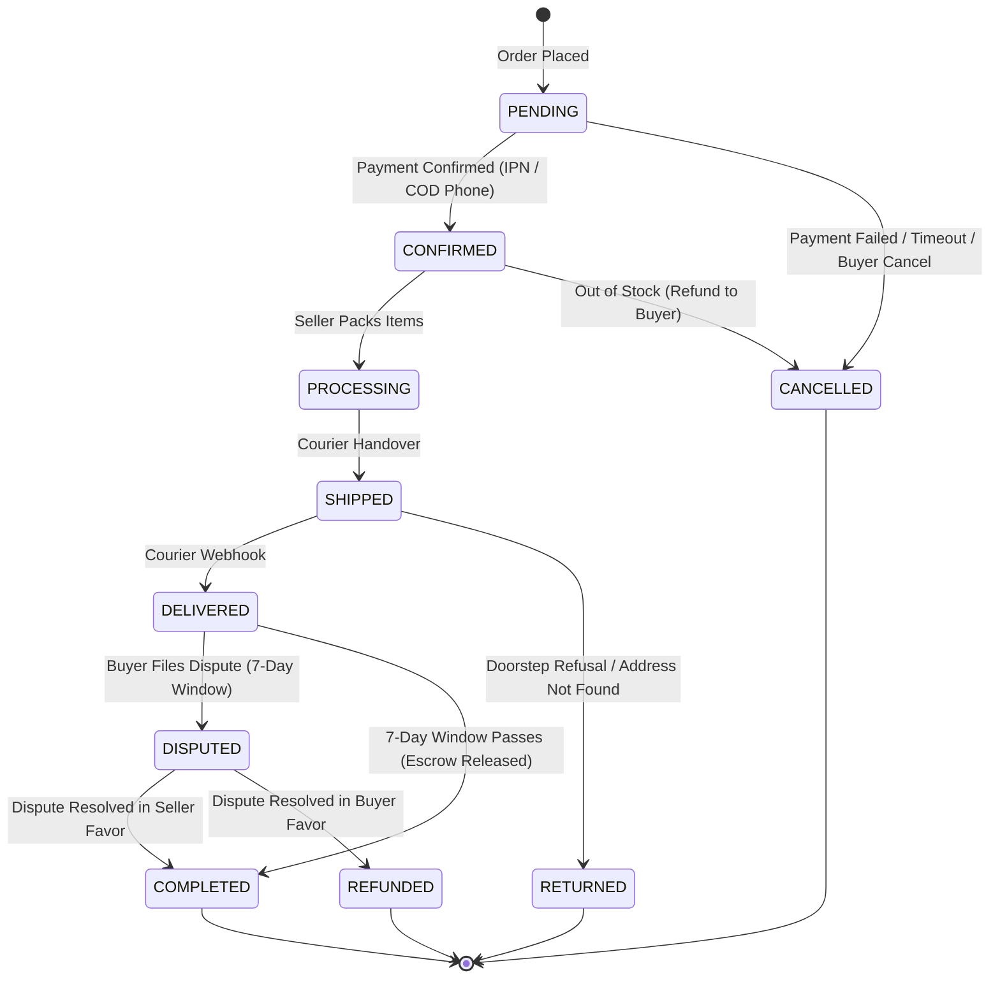
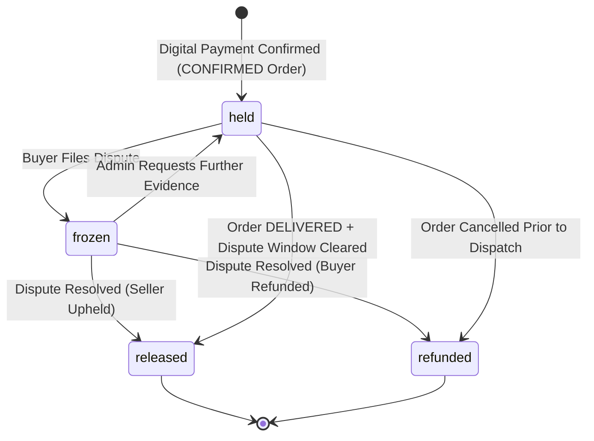
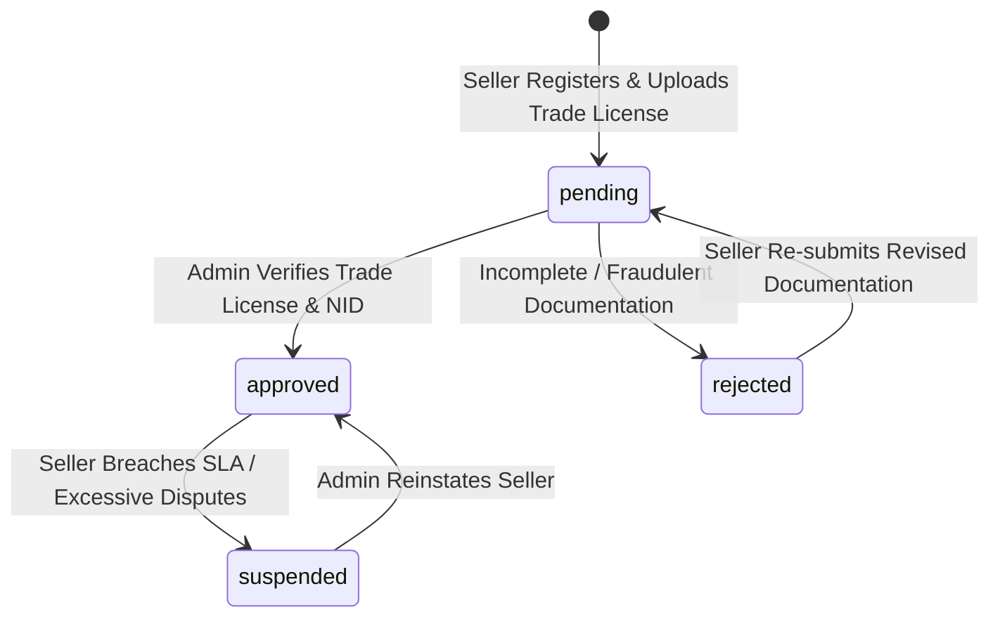
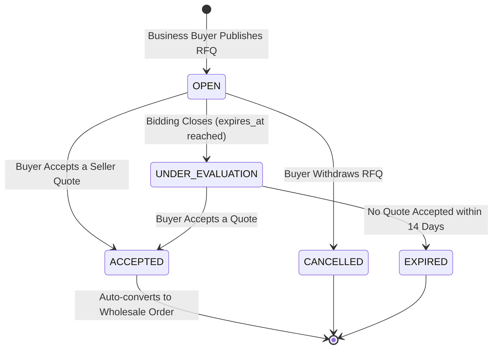

# State Machines Specification

## 1. Formal System State Machines

BD Mart models all multi-step lifecycles as deterministic finite state machines. Invalid or unauthorized transitions are rejected and recorded as security anomalies.

---

## 2. Order State Machine

---

## 3. Escrow Ledger State Machine

### Transition Invariants:
1. `held` $\rightarrow$ `released` requires either:
   - Courier shipment status `DELIVERED` AND `now() >= delivered_at + 7 days`.
   - Buyer explicit manual confirmation of satisfaction.
   - Admin dispute judgment (`DISPUTE_SELLER_WIN`).
2. Once an escrow record reaches `released` or `refunded`, it is in an immutable terminal state.

---

## 4. Seller KYC State Machine

---

## 5. RFQ Lifecycle State Machine

