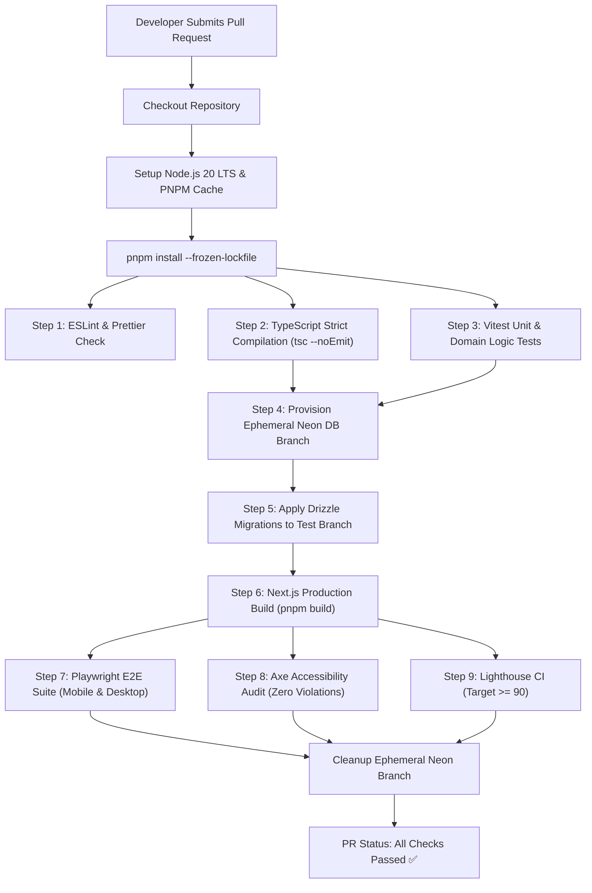

# CI/CD and Deployment Pipeline Specification

## 1. GitHub Actions CI Pipeline Architecture

Every Pull Request (PR) targeting `develop` or `main` must pass the automated GitHub Actions quality gate before merging. Direct pushes to `main` and `develop` are strictly prohibited via branch protection rules.



---

## 2. GitHub Actions Workflow Configuration (`.github/workflows/ci.yml`)

```yaml
name: BD Mart Continuous Integration & Quality Gate

on:
  pull_request:
    branches: [main, develop]
  push:
    branches: [develop]

concurrency:
  group: ${{ github.workflow }}-${{ github.ref }}
  cancel-in-progress: true

jobs:
  validate:
    name: Code Quality, Types & Unit Tests
    runs-on: ubuntu-latest
    steps:
      - uses: actions/checkout@v4

      - name: Install pnpm
        uses: pnpm/action-setup@v3
        with:
          version: 9

      - name: Setup Node.js 20 LTS
        uses: actions/setup-node@v4
        with:
          node-version: 20
          cache: 'pnpm'

      - name: Install Dependencies
        run: pnpm install --frozen-lockfile

      - name: Linting and Code Style
        run: pnpm lint && pnpm prettier --check .

      - name: Strict TypeScript Compilation
        run: pnpm tsc --noEmit

      - name: Vitest Unit & Domain Tests
        run: pnpm test:unit

  e2e-and-audit:
    name: Neon Branching, E2E & Performance Audits
    needs: validate
    runs-on: ubuntu-latest
    steps:
      - uses: actions/checkout@v4

      - name: Install pnpm
        uses: pnpm/action-setup@v3
        with:
          version: 9

      - name: Setup Node.js 20 LTS
        uses: actions/setup-node@v4
        with:
          node-version: 20
          cache: 'pnpm'

      - name: Install Dependencies
        run: pnpm install --frozen-lockfile

      - name: Install Playwright Browsers
        run: pnpm exec playwright install --with-deps

      - name: Create Ephemeral Neon Branch
        id: neon
        uses: neondatabase/create-branch-action@v5
        with:
          project_id: ${{ secrets.NEON_PROJECT_ID }}
          api_key: ${{ secrets.NEON_API_KEY }}
          branch_name: pr-${{ github.event.pull_request.number }}

      - name: Run Database Migrations
        env:
          DATABASE_URL: ${{ steps.neon.outputs.db_url_with_pooler }}
        run: pnpm drizzle-kit migrate

      - name: Build Next.js Application
        env:
          DATABASE_URL: ${{ steps.neon.outputs.db_url_with_pooler }}
        run: pnpm build

      - name: Execute Playwright E2E Tests
        env:
          DATABASE_URL: ${{ steps.neon.outputs.db_url_with_pooler }}
        run: pnpm test:e2e

      - name: Delete Ephemeral Neon Branch
        if: always()
        uses: neondatabase/delete-branch-action@v3
        with:
          project_id: ${{ secrets.NEON_PROJECT_ID }}
          api_key: ${{ secrets.NEON_API_KEY }}
          branch_id: ${{ steps.neon.outputs.branch_id }}
```

---

## 3. Production Deployment Protocol (Firebase App Hosting)

1. **Trigger:** PR merged into `main` branch.
2. **Automated Rollout:** Firebase App Hosting detects changes via GitHub Webhook, compiles the Next.js App Router standalone build, and rolls out a blue-green canary deployment.
3. **Database Migration Timing:**
   - Prior to merging into `main`, a backup snapshot is taken on the Neon production branch.
   - Migrations are applied forward-compatibly (additive column additions without breaking existing running queries).
4. **Post-Deployment Smoke Tests:**
   - Automated probe queries `/api/health`.
   - Synthetic ping verifies homepage, product detail pages, and checkout sandbox endpoints.
   - Sentry error rate monitored for 1 hour; any surge in 5xx errors automatically halts rollout.
