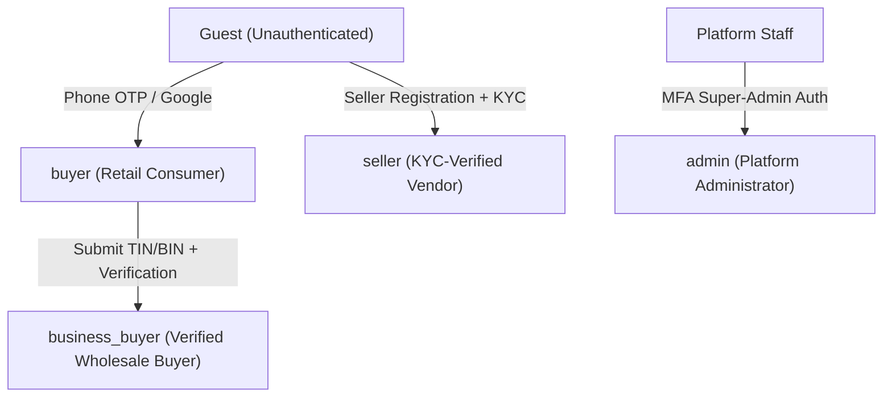

# Users and Roles Specification

## 1. Actor Hierarchy and Permission Domains

BD Mart defines four distinct platform roles, alongside unauthenticated guest visitors.

---

## 2. Detailed Actor Profiles

### 2.1. Guest (Unauthenticated Visitor)
- **Identity:** Anonymous session tracked via client local storage / transient cookie.
- **Permissions:**
  - View public storefront (Home, Categories, Product Detail Pages).
  - Search and filter products.
  - View retail pricing (`base_price`).
  - Add items to transient cart.
  - Calculate upfront delivery estimate by selecting destination Upazila.
- **Restrictions:**
  - Cannot view B2B tiered wholesale pricing or MOQ tiers.
  - Cannot create an RFQ.
  - Cannot complete checkout without authenticating (must authenticate via Phone OTP at checkout).

### 2.2. Retail Buyer (`buyer`)
- **Identity:** Authenticated via Firebase Authentication (Phone OTP primary, Google secondary). Profile record in `users` table with `role = 'buyer'`.
- **Permissions:**
  - All Guest capabilities.
  - Manage saved delivery addresses (`addresses` table with Division, District, Upazila).
  - Place B2C retail orders (single or multiple items from multiple sellers).
  - Select Cash on Delivery (COD) or Online Payment (SSLCommerz/aamarPay).
  - View order history and real-time courier tracking updates.
  - Submit product ratings and reviews *only* for items actually delivered to them.
  - Open a dispute on an order within the dispute window.
- **Restrictions:**
  - Cannot view B2B wholesale pricing tiers.
  - Cannot submit RFQs.

### 2.3. Verified Business Buyer (`business_buyer`)
- **Identity:** Authenticated user whose associated `businesses` record has `verified_at IS NOT NULL`.
- **Onboarding & Verification:**
  - Submits Company Name, Trade License Number, Tax Identification Number (TIN), and Business Identification Number (BIN / VAT Registration).
  - Admin verifies authenticity of documents against national registries.
- **Permissions:**
  - All Retail Buyer capabilities.
  - View wholesale tiered pricing (`price_tiers`) on B2B-enabled products.
  - Place bulk purchase orders meeting Minimum Order Quantities (MOQ).
  - Issue RFQs (Requests for Quotation) for custom volumes or product specifications.
  - Receive and evaluate seller price quotes.
  - Accept quotes and convert them into binding orders with escrow payment.
  - Download official VAT-compliant commercial tax invoices (PDF).

### 2.4. KYC-Verified Seller (`seller`)
- **Identity:** Authenticated user with a linked `sellers` table record (`kyc_status = 'approved'`).
- **Onboarding & KYC:**
  - Submits Shop Name, Trade License number and document upload, National ID (NID) reference number, and payout bank/MFS account.
  - KYC files stored securely in private Firebase Storage.
  - Approved manually by Platform Admin.
- **Permissions:**
  - Access Seller Portal (`/(seller)`).
  - Manage products: create, edit, deactivate products and variants.
  - Define B2C retail prices, B2B wholesale price tiers (`min_qty`, `unit_price`), and MOQ.
  - Track stock and receive low-inventory alerts.
  - View received orders; change status from `CONFIRMED` to `PROCESSING`.
  - Book courier shipments (generates Pathao/Steadfast tracking consignment).
  - View and respond to RFQs from business buyers with customized quotes.
  - View escrow ledger balances, pending releases, and historical payout disbursements.
- **Restrictions:**
  - Cannot publish products or receive orders until `kyc_status == 'approved'`.
  - Can strictly access and mutate only their own products, stock, and orders (`ownership check`).
  - Cannot release escrow funds unilaterally (escrow releases automatically on courier delivery confirmation).

### 2.5. Platform Administrator (`admin`)
- **Identity:** Platform staff account protected by multi-factor authentication (MFA) with `role = 'admin'`.
- **Permissions:**
  - Access Admin Panel (`/(admin)`).
  - Review and approve/reject Seller KYC submissions and Business Buyer verification requests.
  - Manage product taxonomy and categories (`categories` table).
  - Mediate and arbitrate customer disputes (`disputes` table), issuing escrow release to seller or refund to buyer.
  - View system-wide financial reporting, commission accruals, and escrow liability balances.
  - View tamper-evident audit logs (`audit_logs` table).
- **Restrictions:**
  - All administrative mutations are permanently logged with staff actor ID and IP address.
  - Admin cannot alter financial ledger balances without an associated order or dispute resolution event.
