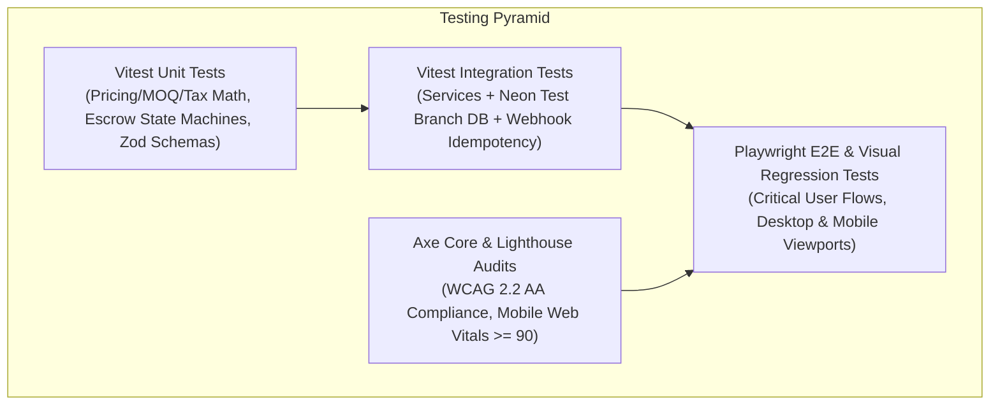

# Testing Strategy and Coverage Specification

## 1. Multi-Tier Testing Pyramid

BD Mart enforces a multi-tier automated testing strategy designed to verify functional correctness, data integrity, security authorization, and accessibility before any code enters production.

---

## 2. Test Suites & Tooling Architecture

| Tier | Tooling | Scope & Invariants | Execution Target |
|---|---|---|---|
| **Unit Tests** | Vitest | - Integer poisha math calculations - VAT (15%) and basis point conversions - Delivery fee calculation algorithms - Escrow state machine transitions - Zod schema validation & rejection | Run on every local edit & PR (`pnpm test:unit`). Fast (<5s). |
| **Integration Tests** | Vitest + Neon Ephemeral DB Branch | - Server Actions with active database transactions - Webhook signature verification and idempotency duplicate rejection - Row-level stock locking (`SELECT FOR UPDATE`) | Run on PR CI with ephemeral database branch (`pnpm test:integration`). |
| **End-to-End (E2E)** | Playwright | - Full browser journey: Guest $\rightarrow$ Phone OTP $\rightarrow$ Cart $\rightarrow$ Checkout $\rightarrow$ Sandbox Payment - B2B Wholesale MOQ rejection & wholesale purchase - RFQ creation and seller quote submission - Mobile viewport (375x667) and Desktop (1280x800) | Run on PR CI against local preview server (`pnpm test:e2e`). |
| **Accessibility** | `@axe-core/playwright` | - Automated WCAG 2.2 Level AA validation on all primary screen archetypes - Zero serious or critical accessibility violations allowed | Integrated into Playwright test runs. |
| **Performance** | Lighthouse CI (Mobile profile) | - Core Web Vitals audit: LCP < 2.5s, CLS < 0.1, INP < 200ms - Target score: >= 90 on Home, Category, and PDP | Run on PR build output via `@lhci/cli`. |

---

## 3. Mandatory Negative Testing Mandates

In financial, permission, and e-commerce systems, testing what users **cannot** do is just as critical as testing what they can do:

1. **Monetary Negative Tests:**
   - Attempt to checkout with client-modified unit prices or altered totals $\rightarrow$ Server recalculates and rejects tampering.
   - Attempt to submit negative quantities or non-integer amounts $\rightarrow$ Zod validation throws error.
2. **Authorization Negative Tests:**
   - Buyer attempts to access `/admin/sellers` or `/seller/dashboard` $\rightarrow$ Server Action returns HTTP 403 Forbidden.
   - Seller A attempts to update or delete Seller B's product $\rightarrow$ Service throws `ForbiddenError` (ownership check).
   - Regular `buyer` attempts to fetch wholesale `price_tiers` or call B2B order action $\rightarrow$ Throws `AuthorizationError`.
3. **Commerce Negative Tests:**
   - Attempt to place a wholesale order with `quantity < product.moq` $\rightarrow$ Server rejects with `MOQ_NOT_MET`.
   - Attempt to order more units than available stock in concurrent checkouts $\rightarrow$ Second transaction cleanly throws `InsufficientStockError`.
   - Payment gateway callback arrives with amount 1 poisha less than order total $\rightarrow$ Order flagged as `SUSPICIOUS_PAYMENT_FRAUD`.
