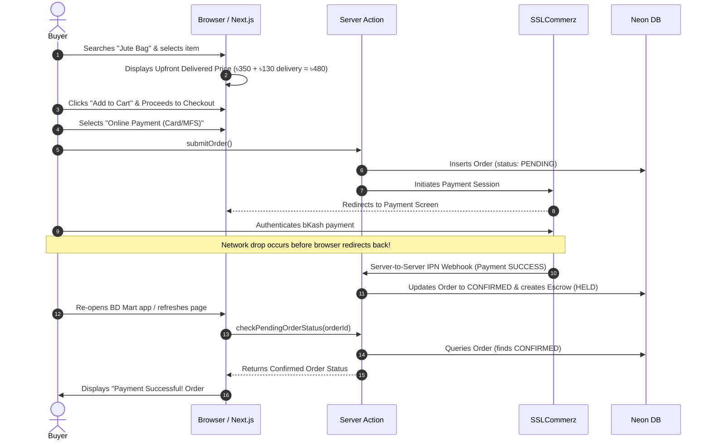

# Critical User Journeys Specification

## 1. Journey 1: Retail Purchase & Network Interruption Recovery (B2C)

### Scenario:
A consumer in Sylhet purchases a handcrafted jute bag (`SKU-JUTE-BAG-001`) via mobile web on a 3G mobile data connection.



### Edge-Case Recovery Logic:
- **Client Redirect Failure:** Even if the buyer's browser crashes, drops signal, or closes before the return URL loads, the server-to-server IPN guarantees order confirmation.
- **Interrupted Payment Check:** On loading the account orders page, any recent `PENDING` order performs a server-side reconciliation check against the payment gateway to resolve the final state cleanly.

---

## 2. Journey 2: Verified B2B Wholesale Order with MOQ Enforcement

### Scenario:
A verified retail boutique owner from Chittagong places a bulk order for 100 units of `SKU-JUTE-BAG-001`.

1. **Authentication & Authorization:**
   - User logs in; session verification confirms `role == 'business_buyer'` and `businesses.verified_at != null`.
2. **Wholesale PDP Discovery:**
   - Navigates to `/bn/wholesale/p/eco-jute-tote-bag`.
   - The UI displays the Tiered Pricing Ladder:
     - 1–49 pcs: Retail only (`৳350`)
     - 50–99 pcs: `৳280 / pc`
     - 100–499 pcs: `৳220 / pc`
     - 500+ pcs: `৳180 / pc`
     - Prominent Badge: **"নূন্যতম অর্ডার (MOQ): ৫০ পিস"**.
3. **Quantity Selection & Real-Time Calculation:**
   - Buyer enters quantity `100`.
   - System recalculates unit price dynamically to Tier 2 (`৳220 / pc`).
   - Subtotal updates to `৳22,000` (2,200,000 poisha).
   - 15% VAT is calculated: `৳3,300` (330,000 poisha).
   - Upfront Bulk Freight is calculated based on weight (100 bags $\approx$ 25kg): `৳650` (65,000 poisha).
   - Upfront Total Displayed: `৳25,950` (2,595,000 poisha).
4. **Order Commitment & Proforma Generation:**
   - Buyer clicks "Place Wholesale Order".
   - Server Action verifies:
     - `quantity (100) >= product.moq (50)` $\checkmark$
     - Stock balance $\ge 100$ $\checkmark$
   - Proforma Commercial Invoice PDF is generated automatically.
   - Escrow payment holds `৳25,950` securely upon payment completion.

---

## 3. Journey 3: Seller KYC Onboarding & Administrative Approval

```mermaid
sequenceDiagram
    autonumber
    actor Seller
    participant SellerPortal as Seller Portal
    participant Storage as Firebase Storage (Private)
    participant DB as Neon DB
    actor Admin

    Seller->>SellerPortal: Submits Shop Name, Trade License #, NID Ref
    Seller->>Storage: Uploads Trade License PDF (Private Bucket)
    Seller->>DB: Creates Seller Record (kyc_status: PENDING)
    Note over Seller: Cannot publish products yet (Catalog locked)
    Admin->>DB: Reviews pending KYC queue in /admin/sellers
    Admin->>Storage: Inspects Trade License PDF via signed URL
    Admin->>DB: Approves Seller (kyc_status: APPROVED)
    DB->>DB: Writes Audit Log (action: SELLER_KYC_APPROVED)
    DB-->>Seller: Sends Approval Notification SMS/Email
    Note over Seller: Seller Portal fully unlocked; products visible in store
```
