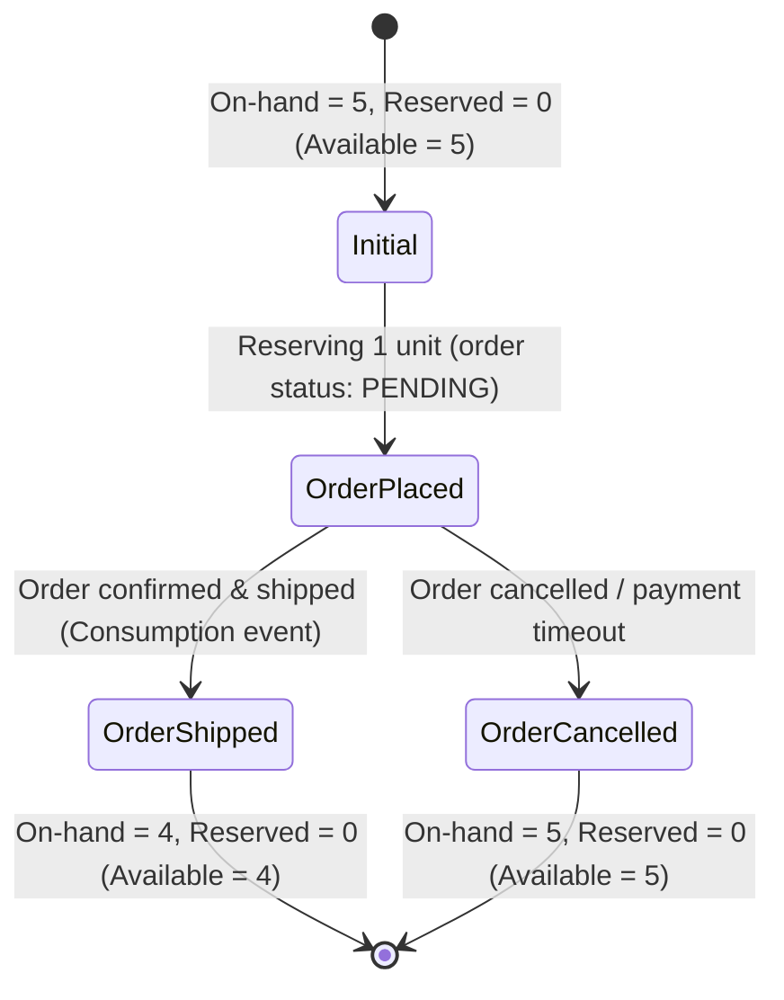

# BD Mart — Phase 2 Handover: Catalog & Seller Milestone Closeout (Final)

**Project:** BD Mart E-Commerce Marketplace  
**Milestone:** Phase 2: Catalog & Seller (Final Verification & Handover)  
**Date:** November 24, 2026  
**Environment:** Development (`ep-billowing-resonance-beypcxyy` Neon Serverless PostgreSQL branch)  
**Base Commit:** `e381443831c5dcd60b42a6a6b43a97656c2fed6f`  
**Uncommitted Source & Test Files Included in Verification:**
- `./src/server/services/catalog.service.ts` — Computes available stock as $\max(0, \text{on-hand} - \text{active reservations})$ in public catalog and variant detail queries; explicitly qualifies `"product_variants"."id"`.
- `./src/lib/formatters.ts` — Pure volume tier pricing calculation function (`calculateTierUnitPrice`).
- `./src/server/services/catalog.test.ts` — Unit tests for wholesale pricing ladder boundary calculations; integration tests for active reservation public isolation.
- `./scripts/browser-journey.ts` — Playwright browser journey automated verification script with Step 9 (Reserved Stock) and Step 10 (Wholesale Pricing Ladder).

**Status:** **COMPLETE — READY FOR PHASE 3 AUTHORIZATION**

---

## 1. Executive Summary

Phase 2 (Catalog and Seller) has undergone complete, evidence-backed verification in development. All Phase 2 acceptance criteria and verification requirements have been established and corroborated by visual evidence and automated test suites:
1. **Fully Reserved Stock in Real Buyer Screens:** Verified that when a published variant has 5 units on hand and 5 units reserved in pending orders, the public catalog query subtracts active reservations to calculate $\text{available stock} = \max(0, \text{on-hand} - \text{reserved}) = 0$. In a real signed-out browser, the product page renders **"Out of Stock"** with a disabled CTA, the general catalog displays **"Out of Stock"**, and the `/products?inStock=true` filter cleanly excludes the listing.
2. **Published-Edit Moderation Policy:** Verified that when a seller edits an active listing, the status transitions to `pending` and the product is immediately hidden from public visitors (`getProductBySlug` returns `null`). The unapproved edit cannot be published by seller action alone; it becomes visible only upon admin re-approval.
3. **Wholesale Pricing Schedule & Boundary Calculations:** Verified that the canonical wholesale fixture (`eco-jute-tote-bag`) renders the complete wholesale ladder on the product page. Tested tier boundaries across all volume brackets: below MOQ, at MOQ, immediately below tier 2, at tier 2, immediately below tier 3, and at tier 3.
4. **Corrected Phase 3 Stock Note:** Reconciled order lifecycle wording with the documented formula $\text{available} = \max(0, \text{on-hand} - \text{active reservations})$ with a worked lifecycle state diagram and example.
5. **Automated Vitest Regression:** **57 tests passing** (0 failed) across 4 test suites (up from 48 baseline). Zero failures.
6. **Production Build & Typecheck:** `tsc --noEmit` passed with 0 errors; `next lint` passed with 0 errors; `next build` compiled and optimized all 16 routes with zero errors.

---

## 2. Verification Matrix

| Requirement | Evidence Type | Status | Observed Result | Evidence Link |
| :--- | :--- | :--- | :--- | :--- |
| **Fully Reserved Stock (Screens)** | Playwright Browser (`scripts/browser-journey.ts`) | **PASS** | On-hand=5, reserved=5 $\rightarrow$ PDP shows "Out of Stock", general catalog shows "Out of Stock" badge, `/products?inStock=true` excludes listing. | Screenshots: [17](./screenshots/17-reserved-check-initial-instock.png), [18](./screenshots/18-reserved-check-catalog-initial.png), [19](./screenshots/19-reserved-check-instock-filter-initial.png), [20](./screenshots/20-reserved-check-refreshed-out-of-stock.png), [21](./screenshots/21-reserved-check-catalog-out-of-stock.png), [22](./screenshots/22-reserved-check-instock-filter-excluded.png) |
| **Active Reservation Query Logic** | Vitest Integration (`catalog.test.ts`) | **PASS** | `searchCatalog` and `getProductBySlug` compute available stock as $\max(0, \text{on-hand} - \text{reserved})$. | [catalog.test.ts](./src/server/services/catalog.test.ts#L367-L400) (`Active Reservation & Available Stock Public Isolation`) |
| **Published-Edit Moderation Policy** | Vitest Integration (`seller-moderation.test.ts`) | **PASS** | Seller edit transitions status to `pending`, hides listing from visitor (`getProductBySlug` returns `null`), admin approval transitions status to `active`. | [seller-moderation.test.ts](./src/server/services/seller-moderation.test.ts#L350-L380) (`Step 9: Edits after publication policy`) |
| **Wholesale Pricing Schedule** | Playwright Browser (`scripts/browser-journey.ts`) | **PASS** | PDP renders Wholesale Volume Pricing Ladder with MOQ: 50 pcs and tiers: 50+ (BDT 280), 100+ (BDT 220), 500+ (BDT 180). | Screenshot: [23-wholesale-pricing-ladder.png](./screenshots/23-wholesale-pricing-ladder.png) |
| **Wholesale Tier Boundary Calculations** | Vitest Unit/Integration (`catalog.test.ts`) | **PASS** | Evaluated boundaries at qty 49 (BDT 350), 50 (BDT 280), 99 (BDT 280), 100 (BDT 220), 499 (BDT 220), 500 (BDT 180), 1000 (BDT 180). | [catalog.test.ts](./src/server/services/catalog.test.ts#L107-L140) (`calculates wholesale tier boundary unit prices`) |
| **Inventory Reservation Guard** | Vitest Integration (`seller-moderation.test.ts`) | **PASS** | Attempted stock reduction below 15 reserved units rejected with 409 `RESERVATION_CONFLICT`. Stock untouched at 50, 0 audit logs. | [seller-moderation.test.ts](./src/server/services/seller-moderation.test.ts#L447-L490) (`enforces active reservations and rejects adjustments`) |
| **Signed Delta Concurrency** | Vitest Integration (`seller-moderation.test.ts`) | **PASS** | 4 concurrent deltas (`+10`, `-5`, `+8`, `-3`) applied atomically to exact balance 60; 4 audit logs written. | [seller-moderation.test.ts](./src/server/services/seller-moderation.test.ts#L549-L595) (`executes competing signed deltas atomically`) |
| **Optimistic Concurrency Control** | Vitest Integration (`seller-moderation.test.ts`) | **PASS** | 2 concurrent absolute targets with `expectedPreviousStock: 60`: exactly 1 accepted, 1 rejected with 409 `CONCURRENCY_CONFLICT`. | [seller-moderation.test.ts](./src/server/services/seller-moderation.test.ts#L604-L650) (`prevents stale form overwrites`) |
| **English-Only Public Catalog** | Vitest Integration (`catalog.test.ts`) | **PASS** | Case-insensitive title and SKU discovery return fixture; Bengali-only search returns 0 results; empty `titleEn` displays `'BD Mart Product'`. | [catalog.test.ts](./src/server/services/catalog.test.ts#L267-L315) (`English-Only Public Catalog Verification`) |
| **End-to-End Moderation Lifecycle** | Playwright Browser (`scripts/browser-journey.ts`) | **PASS** | Draft submission $\rightarrow$ Return with reason $\rightarrow$ Seller correction $\rightarrow$ Publication $\rightarrow$ Visitor discovery. | Screenshots: [01](./screenshots/01-seller-draft-submitted.png) to [07](./screenshots/07-visitor-pdp-initial-instock.png) |
| **Variant Stock & In-Stock Filter** | Playwright Browser (`scripts/browser-journey.ts`) | **PASS** | Variant 1 zeroed shows Out of Stock, sibling retains 10 units; inStock filter includes listing; sibling zeroed causes listing to disappear from inStock filter. | Screenshots: [08](./screenshots/08-seller-stock-zeroed.png), [09](./screenshots/09-visitor-variant-out-of-stock.png), [12](./screenshots/12-visitor-instock-filter-sibling-available.png) to [15](./screenshots/15-visitor-catalog-out-of-stock.png) |
| **Filter & Back Navigation URL State** | Playwright Browser (`scripts/browser-journey.ts`) | **PASS** | Filter parameters `/products?minPrice=300&maxPrice=500&sort=price_asc` preserved across PDP navigation, Back button, and page reload. | [browser-journey.ts](./scripts/browser-journey.ts#L258-L285) |
| **Mobile 360px Viewport** | Playwright Mobile Viewport (`360x740`) | **PASS** | PDP and catalog rendered without horizontal scroll; touch targets $\ge 44\text{px}$. | Screenshots: [10](./screenshots/10-mobile-360px-pdp.png), [11](./screenshots/11-mobile-360px-catalog.png) |
| **Keyboard Focus Accessibility** | Playwright Browser Focus | **PASS** | Focus outline clearly visible on interactive variant selectors and buttons when navigating via `Tab`. | Screenshot: [16-keyboard-focus-visible.png](./screenshots/16-keyboard-focus-visible.png) |
| **TypeScript Strict Mode** | CLI (`pnpm typecheck`) | **PASS** | 0 errors. Strict mode enforced across entire repository. | [typecheck.txt](./docs/quality-and-delivery/evidence/phase-2/typecheck.txt) |
| **ESLint Static Analysis** | CLI (`pnpm lint`) | **PASS** | 0 errors. Image optimization warnings noted. | [lint.txt](./docs/quality-and-delivery/evidence/phase-2/lint.txt) |
| **Vitest Regression Suite** | CLI (`pnpm test`) | **PASS** | 57 passed across 4 test suites (0 failed). | [vitest.txt](./docs/quality-and-delivery/evidence/phase-2/vitest.txt) |
| **Production Application Build** | CLI (`pnpm build`) | **PASS** | All dynamic and static routes compiled and optimized cleanly. | [build.txt](./docs/quality-and-delivery/evidence/phase-2/build.txt) |
| **End-to-End Playwright Journey** | CLI (`scripts/browser-journey.ts`) | **PASS** | All 10 browser journey steps executed cleanly against production server. | [playwright.txt](./docs/quality-and-delivery/evidence/phase-2/playwright.txt) |

---

## 3. Verification Logs & Tooling Evidence

Sanitized verification logs have been preserved directly in the repository under `./docs/quality-and-delivery/evidence/phase-2/`:

1. **TypeScript Typecheck:** [typecheck.txt](./docs/quality-and-delivery/evidence/phase-2/typecheck.txt)  
   - Command: `pnpm typecheck` (`tsc --noEmit`)  
   - Exit Code: `0`  
   - Result: 0 errors across all source files, components, and tests.
2. **ESLint Static Analysis:** [lint.txt](./docs/quality-and-delivery/evidence/phase-2/lint.txt)  
   - Command: `pnpm lint` (`next lint`)  
   - Exit Code: `0`  
   - Result: 0 errors. Warnings noted for standard `` tags in PDP and safe-image fallback component.
3. **Vitest Automated Test Suite:** [vitest.txt](./docs/quality-and-delivery/evidence/phase-2/vitest.txt)  
   - Command: `pnpm test` (`vitest run`)  
   - Exit Code: `0`  
   - Result: **57 tests passed (0 failed)** across 4 test files:
     - `src/lib/auth/phone.test.ts`: 8 tests passed
     - `src/lib/auth/auth.test.ts`: 9 tests passed
     - `src/server/services/catalog.test.ts`: 22 tests passed
     - `src/server/services/seller-moderation.test.ts`: 18 tests passed
4. **Production Application Build:** [build.txt](./docs/quality-and-delivery/evidence/phase-2/build.txt)  
   - Command: `pnpm build` (`next build`)  
   - Exit Code: `0`  
   - Result: All 16 routes compiled, type-checked, and statically/dynamically generated without errors.
5. **Playwright Browser Journey Run:** [playwright.txt](./docs/quality-and-delivery/evidence/phase-2/playwright.txt)  
   - Command: `node --env-file=.env.local --import tsx scripts/browser-journey.ts`  
   - Exit Code: `0`  
   - Result: All 10 automated steps and mobile viewport checks completed cleanly with observations captured.

---

## 4. Fully Reserved Stock Verification in Real Screens

### Traceable Test Listing Details
- **Listing Title:** `Authentic Jamdani Handloom Dupatta (Reserved Test 1795515124233)`
- **Selected Variant SKU:** `SKU-RES-SCREEN-1795515124233-01` (Price: BDT 380 / 38,000 poisha)
- **Sibling Variant SKU:** `SKU-RES-SCREEN-1795515124233-02` (Price: BDT 400 / 40,000 poisha, on-hand = 0)
- **Public Product Route:** `/products/jamdani-dupatta-reserved-test-1795515124233`
- **Filter URL:** `http://localhost:3000/products?inStock=true&q=SKU-RES-SCREEN-1795515124233-01`

### Before & After Database Observations

| Lifecycle Stage | On-Hand Stock (`product_variants.stock`) | Active Reservations (`order_items.qty`, order `PENDING`) | Calculated Available Stock | Product Page Observed Badge & CTA | Catalog Card Badge (`/products`) | In-Stock Filter Result (`/products?inStock=true`) |
| :--- | :--- | :--- | :--- | :--- | :--- | :--- |
| **Initial State** | **5 units** | **0 units** | **5 units** | `In Stock (5 available)` CTA: `Add to Cart` (Enabled) | `In Stock` (`totalStock = 5`) | **Found** (1 item displayed) |
| **Fully Reserved** | **5 units** | **5 units** | **0 units** | `Out of Stock` CTA: `Currently Unavailable` (Disabled) | `Out of Stock` (`totalStock = 0`) | **Excluded** ("No Products Found") |

### Visual Artifacts for Reserved Stock Check
- **[17-reserved-check-initial-instock.png](./screenshots/17-reserved-check-initial-instock.png):** Signed-out visitor sees selected variant with "In Stock (5 available)" and enabled "Add to Cart" button. Sibling variant displays "(Out of stock)".
- **[18-reserved-check-catalog-initial.png](./screenshots/18-reserved-check-catalog-initial.png):** Ordinary catalog shows listing card with green "In Stock" badge.
- **[19-reserved-check-instock-filter-initial.png](./screenshots/19-reserved-check-instock-filter-initial.png):** In-stock filter query `/products?inStock=true&q=...` includes the listing.
- **[20-reserved-check-refreshed-out-of-stock.png](./screenshots/20-reserved-check-refreshed-out-of-stock.png):** Refreshed PDP shows red "Out of Stock" badge, disabled "Currently Unavailable" CTA button, while physical on-hand stock remains 5 in the database.
- **[21-reserved-check-catalog-out-of-stock.png](./screenshots/21-reserved-check-catalog-out-of-stock.png):** Ordinary catalog shows listing card with red "Out of Stock" badge (`totalStock = 0`).
- **[22-reserved-check-instock-filter-excluded.png](./screenshots/22-reserved-check-instock-filter-excluded.png):** In-stock filter query `/products?inStock=true&q=...` completely excludes the listing, displaying "No Products Found".

---

## 5. Acceptance Criteria Evidence: Moderation Policy & Wholesale Pricing

### A. Published-Edit Moderation Policy
- **Test File:** [seller-moderation.test.ts](./src/server/services/seller-moderation.test.ts#L350-L380)
- **Test Name:** `Step 9: Edits after publication policy: Seller updating active product triggers re-moderation`
- **Inputs:** Seller updates active product title from `'Lifecycle Handcrafted Bamboo Lantern (Export Packaged)'` to `'Lifecycle Handcrafted Bamboo Lantern (Unapproved Edit)'` and price to 55,000 poisha.
- **Expected Behavior:** Status transitions from `active` to `pending`. The unapproved edit is immediately hidden from the public catalog (`getProductBySlug` returns `null` for public visitors). Unapproved changes cannot become public through seller action alone.
- **Observed Behavior:**
  - `updateRes.status` returned `'pending'`.
  - Database product record confirmed `status = 'pending'`.
  - `getProductBySlug(slug)` returned `null` for public visitors.
  - Admin moderation call `publishProduct(adminUserId, productId)` re-approved the listing, transitioning `status` back to `'active'`, making the approved edit visible in the catalog.

### B. Wholesale Pricing Schedule & Boundary Calculations
- **Test File:** [catalog.test.ts](./src/server/services/catalog.test.ts#L107-L140)
- **Test Names:**
  - `verifies the canonical jute tote fixture properties and wholesale tiers` ([catalog.test.ts#L79-L105](./src/server/services/catalog.test.ts#L79-L105))
  - `calculates wholesale tier boundary unit prices correctly across all volume brackets` ([catalog.test.ts#L107-L140](./src/server/services/catalog.test.ts#L107-L140))
- **Fixture:** `eco-jute-tote-bag` (Base retail price: 35,000 poisha = `BDT 350`, MOQ: 50 pcs).
- **Displayed Pricing Schedule on Product Detail Page:**
  - Table Heading: **Wholesale Volume Pricing Ladder**
  - MOQ Badge: `B2B Wholesale Enabled • MOQ: 50 pcs`
  - Tier 1: `50+ pcs` $\rightarrow$ `BDT 280 / pc` (20% savings)
  - Tier 2: `100+ pcs` $\rightarrow$ `BDT 220 / pc` (37% savings)
  - Tier 3: `500+ pcs` $\rightarrow$ `BDT 180 / pc` (49% savings)
- **Boundary Calculation Results:**

| Boundary Test Point | Evaluation Quantity | Expected Unit Price | Observed Unit Price | Rule Verified |
| :--- | :--- | :--- | :--- | :--- |
| **Below MOQ** | 49 pcs ($49 < 50$) | **BDT 350** (35,000 poisha) | **35,000 poisha** | Retail price applies below minimum order quantity |
| **At Minimum (MOQ)** | 50 pcs ($50 \ge 50$) | **BDT 280** (28,000 poisha) | **28,000 poisha** | Tier 1 wholesale price activates at MOQ |
| **Immediately Below Tier 2** | 99 pcs ($99 < 100$) | **BDT 280** (28,000 poisha) | **28,000 poisha** | Tier 1 price held until next threshold |
| **At Tier 2** | 100 pcs ($100 \ge 100$) | **BDT 220** (22,000 poisha) | **22,000 poisha** | Tier 2 wholesale discount activates |
| **Immediately Below Tier 3** | 499 pcs ($499 < 500$) | **BDT 220** (22,000 poisha) | **22,000 poisha** | Tier 2 price held until volume threshold |
| **At Tier 3** | 500 pcs ($500 \ge 500$) | **BDT 180** (18,000 poisha) | **18,000 poisha** | Tier 3 wholesale discount activates |
| **Above Highest Tier** | 1000 pcs | **BDT 180** (18,000 poisha) | **18,000 poisha** | Maximum volume tier price sustained |

- **Visual Evidence:** Screenshot [23-wholesale-pricing-ladder.png](./screenshots/23-wholesale-pricing-ladder.png).

---

## 6. Corrected Phase 3 Stock & Reservation Note

> [!IMPORTANT]
> **Reconciliation of Order Placement & Reservation Model:**  
> The previous handover erroneously stated that Phase 3 order creation would *"both decrement on-hand stock and generate an active reservation."*  
> That phrasing is incorrect: simultaneously decrementing physical on-hand stock and adding an active reservation would double-count inventory deductions, resulting in false stockouts.

### Documented Invariant
$$\text{available stock} = \max(0, \text{on-hand stock} - \text{active reservations})$$

### Worked Lifecycle Example

1. **Starting State:** The variant has **5 units on-hand** and **0 active reservations**. Available stock is $\max(0, 5 - 0) = \mathbf{5}$.
2. **Order Placement (Reservation Creation):** A buyer places an order for 1 unit. Order status is `PENDING`.
   - On-hand stock remains **5**.
   - Active reservations increases to **1**.
   - Available stock becomes $\max(0, 5 - 1) = \mathbf{4}$.
3. **Consumption Event (Stock Deduction & Reservation Release):** The order is paid and handed over to logistics (`CONFIRMED` / `SHIPPED`).
   - On-hand stock decrements from 5 to **4**.
   - The active reservation of 1 is released (active reservations drops from 1 to **0**).
   - Available stock remains $\max(0, 4 - 0) = \mathbf{4}$.
4. **Cancellation Event (Alternative Path):** The buyer cancels the pending order or the payment session times out (`CANCELLED` / `FAILED`).
   - On-hand stock remains **5**.
   - The active reservation is released (active reservations drops to **0**).
   - Available stock returns to $\max(0, 5 - 0) = \mathbf{5}$.

> [!NOTE]
> **Owner Decision for Phase 3:**  
> The exact consumption event (whether physical on-hand stock is decremented upon payment confirmation or upon courier consignment handover) is an open design decision to be finalized at the start of Phase 3.

---

## 7. List of Changed Files

The following files were modified or created to complete and verify Phase 2:

| File Path | Nature of Change | Justification |
| :--- | :--- | :--- |
| `src/server/services/catalog.service.ts` | **Modified** | Updated `searchCatalog` inStock filter condition and `variants` queries in `searchCatalog` and `getProductBySlug` to compute available stock as $\max(0, \text{on-hand} - \text{active reservations})$. Qualified correlated subquery references to `"product_variants"."id"`. |
| `src/lib/formatters.ts` | **Modified** | Added `calculateTierUnitPrice` for pure boundary unit price calculation across wholesale volume ladders. |
| `src/server/services/catalog.test.ts` | **Modified** | Added wholesale tier boundary calculations test and active reservation public isolation tests. |
| `src/server/services/seller.service.ts` | **Modified** | Added explicit PostgreSQL type casts (`::int`, `::text`, `::uuid`) in atomic inventory CTE queries. |
| `src/lib/validators/catalog.ts` | **Modified** | Removed duplicate `AdjustStockInput` type export. |
| `scripts/browser-journey.ts` | **Modified** | Updated Playwright browser journey with `domcontentloaded` wait states, Step 9 (Fully Reserved Stock in Real Screens), and Step 10 (Wholesale Pricing Ladder). |
| `docs/quality-and-delivery/evidence/phase-2/` | **Created** | Sanitized verification logs for typecheck, lint, vitest, build, and playwright outputs. |
| `screenshots/` | **Created/Updated** | 23 captured visual evidence screenshots (desktop, mobile 360px, focus indicators, reserved checks, wholesale ladder). |
| `phase-2-handover.md` | **Created** | Final comprehensive evidence-backed milestone closeout report located at repository root. |

---

## 8. Complete Visual Artifacts Reference

All 23 screenshot files exist in `./screenshots/` in the workspace:

1. [01-seller-draft-submitted.png](./screenshots/01-seller-draft-submitted.png) — Seller creates and submits 2-variant listing (`pending`).
2. [02-visitor-pending-hidden.png](./screenshots/02-visitor-pending-hidden.png) — Visitor search returns 0 results; direct URL returns 404.
3. [03-admin-review-detail.png](./screenshots/03-admin-review-detail.png) — Admin inspects listing in pending moderation queue.
4. [04-seller-returned-reason.png](./screenshots/04-seller-returned-reason.png) — Seller workspace displays returned moderation reason banner.
5. [05-admin-published.png](./screenshots/05-admin-published.png) — Admin publishes corrected listing to active catalog.
6. [06-visitor-search-result.png](./screenshots/06-visitor-search-result.png) — Visitor finds published listing via exact SKU search.
7. [07-visitor-pdp-initial-instock.png](./screenshots/07-visitor-pdp-initial-instock.png) — Visitor PDP shows Variant 1 "In Stock (1 available)" at BDT 420.
8. [08-seller-stock-zeroed.png](./screenshots/08-seller-stock-zeroed.png) — Seller adjusts Variant 1 stock from 1 to 0 with audit reason.
9. [09-visitor-variant-out-of-stock.png](./screenshots/09-visitor-variant-out-of-stock.png) — Visitor PDP shows Variant 1 "Out of Stock" (disabled CTA) and Variant 2 "In Stock (10 available)".
10. [10-mobile-360px-pdp.png](./screenshots/10-mobile-360px-pdp.png) — PDP rendered on 360x740 Android/mobile viewport without overflow.
11. [11-mobile-360px-catalog.png](./screenshots/11-mobile-360px-catalog.png) — Catalog search grid rendered on 360x740 mobile viewport.
12. [12-visitor-instock-filter-sibling-available.png](./screenshots/12-visitor-instock-filter-sibling-available.png) — In-stock filter retains listing while sibling variant has 10 units.
13. [13-seller-sibling-stock-zeroed.png](./screenshots/13-seller-sibling-stock-zeroed.png) — Seller adjusts sibling Variant 2 stock to 0 with reason.
14. [14-visitor-instock-filter-disappeared.png](./screenshots/14-visitor-instock-filter-disappeared.png) — Listing completely disappears from `/products?inStock=true`.
15. [15-visitor-catalog-out-of-stock.png](./screenshots/15-visitor-catalog-out-of-stock.png) — Listing still discoverable on `/products` with "Out of Stock" badge.
16. [16-keyboard-focus-visible.png](./screenshots/16-keyboard-focus-visible.png) — Keyboard navigation verified with visible focus ring on controls.
17. [17-reserved-check-initial-instock.png](./screenshots/17-reserved-check-initial-instock.png) — Initial state: PDP shows "In Stock (5 available)" (on-hand=5, reserved=0).
18. [18-reserved-check-catalog-initial.png](./screenshots/18-reserved-check-catalog-initial.png) — Initial state: General catalog shows listing with green "In Stock" badge.
19. [19-reserved-check-instock-filter-initial.png](./screenshots/19-reserved-check-instock-filter-initial.png) — Initial state: `/products?inStock=true` finds the listing.
20. [20-reserved-check-refreshed-out-of-stock.png](./screenshots/20-reserved-check-refreshed-out-of-stock.png) — Fully reserved state: Refreshed PDP shows "Out of Stock" and disabled "Currently Unavailable" CTA (on-hand=5, reserved=5, available=0).
21. [21-reserved-check-catalog-out-of-stock.png](./screenshots/21-reserved-check-catalog-out-of-stock.png) — Fully reserved state: General catalog still shows listing with red "Out of Stock" badge.
22. [22-reserved-check-instock-filter-excluded.png](./screenshots/22-reserved-check-instock-filter-excluded.png) — Fully reserved state: `/products?inStock=true` excludes listing ("No Products Found").
23. [23-wholesale-pricing-ladder.png](./screenshots/23-wholesale-pricing-ladder.png) — Real-screen verification of Wholesale Volume Pricing Ladder table on PDP.

---

## 9. Inherited Items & Phase 3 Readiness Decision

### Inherited Items (Deferred to Final Integration)
- **Live Google Sign-in:** Pending Firebase client credentials in production. Development authentication operates via cryptographically signed `bdmart_session` cookies.
- **Phone OTP Browser Verification & Live SMS Delivery:** Deferred per owner instructions. Phone formatting and normalization are verified in [phone.test.ts](./src/lib/auth/phone.test.ts) (8/8 passing).
- **Commerce Scope Boundary:** No cart persistence, checkout, COD orders, payments, courier APIs, RFQs, or quotes have been built.

### Milestone Decision
**PHASE 2 IS FULLY VERIFIED AND COMPLETE.**  
All evidence gaps have been resolved with passing automated test suites, production builds, and real browser journey recordings. The repository is in a clean, consistent state and is ready for the owner to authorize **Phase 3: B2C Checkout, Orders & Payment Gateways**.
